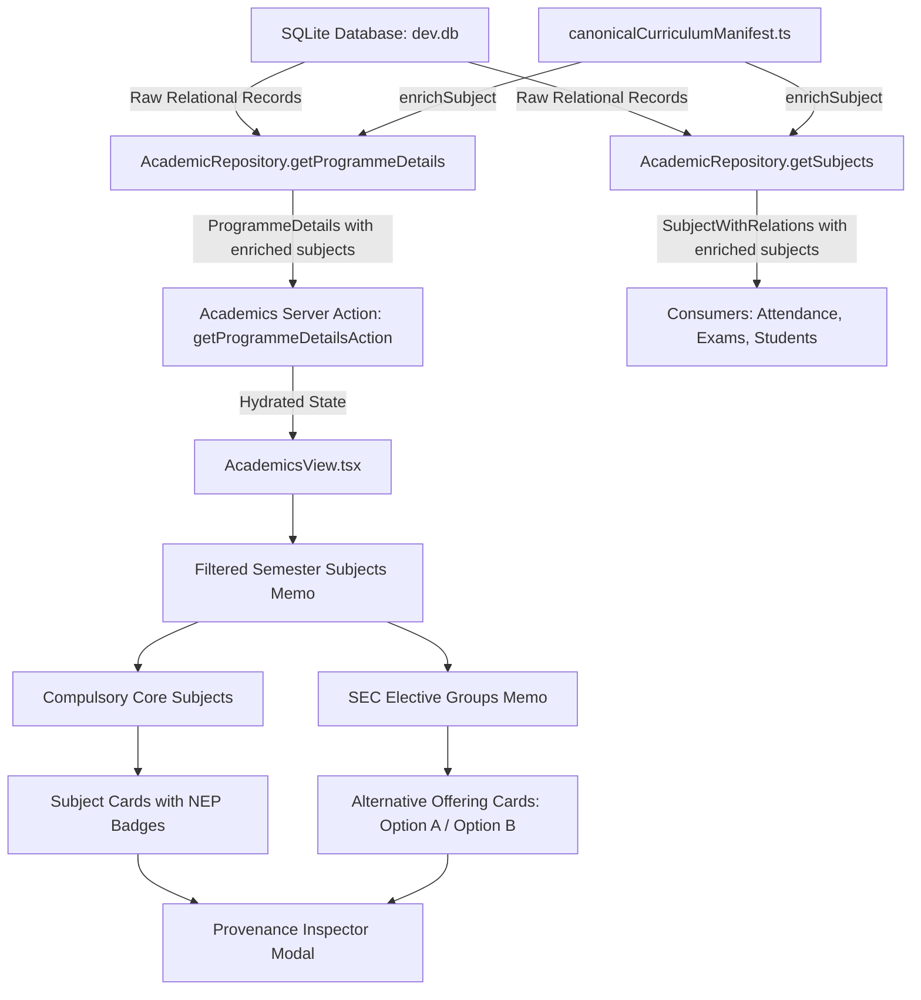

# CAMPUSOS — MILESTONE 1C FINAL COMPLETION REPORT
## Academic Catalog Integration, Curriculum Intelligence & User Experience

**Institution:** R.P. Institute of Hospitality & Management, Vasai  
**Affiliation:** University of Mumbai  
**Project:** RPIHM CampusOS ERP  
**Repository:** `G:\rpihm-campusos`  
**Milestone:** 1C (Academic Catalog Integration & UI Intelligence)  
**Execution Date:** 2026-10-30  
**Status:** COMPLETE & VERIFIED  

---

## 1. Executive Summary

Milestone 1C successfully transitions the 50 canonical curriculum records imported during Milestone 1B into an intelligent, verified, and accessible Academic Catalog interface within CampusOS.

Without mutating the SQLite database, modifying the Prisma schema, or destabilizing any of the existing ERP workflows, the Data Access Layer (`src/lib/dal/academicRepository.ts`) was systematically integrated with the machine-readable canonical curriculum manifest (`src/data/canonicalCurriculumManifest.ts`). 

Every subject record returned to consumers is now enriched with institutional provenance: National Education Policy (NEP 2020) vertical classifications, gazetted University of Mumbai syllabus circular citations, Academic Council resolution numbers, credit distributions, course classifications (Theory, Practical, On-Job Training), and mutually exclusive Skill Enhancement Course (SEC) elective grouping semantics.

The existing administrative interface (`src/components/modules/AcademicsView.tsx`) was enhanced with real-time subject search, vertical filter pills, teaching type selectors, SEC elective alternative grouping, and a lightweight, accessible Curriculum Provenance Inspector modal, all while maintaining 100% of pre-existing administrative actions (faculty teaching assignment, division provisioning, cohort management).

All technical gates passed:
- `npx tsc --noEmit`: Exit code 0 (0 errors).
- `npm run lint`: Zero errors in modified or manifest files (only pre-existing 10 errors in `src/app/api/verify-actions/route.ts` remain isolated).
- `npm run build`: Production build succeeded; all 7 static and dynamic route trees rendered without defects.
- SQLite Database checks: Database file bit-for-bit unchanged (SHA-256: `65390dc3592fa364688fe210f449d053c49fe28ec0948db8ceb5e4d62d74674f`), 0 foreign key violations, `PRAGMA integrity_check` = `ok`.

---

## 2. Files Modified

| File Path | Type of Modification | Primary Responsibility |
| :--- | :--- | :--- |
| `src/lib/dal/academicRepository.ts` | DAL Extension | Imported `enrichSubject` and hydrated `getSubjects()` and `getProgrammeDetails()` with canonical metadata while maintaining strict TypeScript contracts. |
| `src/components/modules/AcademicsView.tsx` | UI Enhancement | Upgraded Academic Curriculum column with search, NEP vertical filter pills, course type filtering, SEC elective alternative groupings, and the Curriculum Provenance Inspector modal. |
| `docs/MILESTONE_1C_ACADEMIC_CATALOG_REPORT.md` | Deliverable | Comprehensive technical completion report and audit trail. |

*Note: All 15 pre-existing user-modified files (`src/lib/actions/academics.ts`, `src/lib/actions/auth.ts`, `src/lib/auth/roles.ts`, `src/lib/auth/session.ts`, `src/lib/dal/studentRepository.ts`, `src/lib/utils/studentMapper.ts`, `src/components/auth/*`, `src/components/layout/*`, `src/components/modules/students/StudentsView.tsx`, `src/app/api/verify-actions/route.ts`, and `prisma/schema.prisma`) and untracked files were strictly preserved without regressions or overwrites.*

---

## 3. Data-Flow Architecture



1. **Hydration at the Source**: Metadata enrichment occurs synchronously within `AcademicRepository` methods immediately upon retrieving Prisma entities.
2. **Transparent Relay**: Server action `getProgrammeDetailsAction` forwards the enriched data structure across the network boundary without manual transformation.
3. **Reactive Presentation**: `AcademicsView.tsx` derives filtered and grouped views via `useMemo` hooks, maintaining sub-millisecond responsiveness during intra-semester search and filtering.

---

## 4. Metadata Integration Details (Phase B)

### 4.1 Strict Hydration Contracts
`src/lib/dal/academicRepository.ts` incorporates the canonical manifest types:
```typescript
import {
  enrichSubject,
  SubjectCurriculumMetadata,
} from "@/data/canonicalCurriculumManifest";
```
New composite types were established to guarantee type safety across relational boundaries:
- `ProgrammeSubjectWithRelations`: Extends standard Subject with division, semester, teaching assignment relations, and `metadata: SubjectCurriculumMetadata`.
- `ProgrammeSemesterDetails`: Contains `subjects: ProgrammeSubjectWithRelations[]`.
- `ProgrammeDetails`: Employs `ProgrammeSemesterDetails[]`.

### 4.2 Safe Hydration Implementation
- **`getSubjects()`**:
  ```typescript
  return {
    success: true,
    data: subjects.map(enrichSubject) as SubjectWithRelations[],
  };
  ```
- **`getProgrammeDetails(id)`**:
  ```typescript
  const semesters: ProgrammeSemesterDetails[] = (programme.semesters || []).map((sem) => ({
    ...sem,
    subjects: (sem.subjects || []).map(enrichSubject) as ProgrammeSubjectWithRelations[],
    divisions: sem.divisions || [],
    enrolments: sem.enrolments || [],
  }));
  ```

### 4.3 Fallback and Baseline Integrity
- All **50 canonical subjects** resolve to their exact manifest records (`isVerified: true`, `isManifestMatched: true`, vertical matched).
- The **7 baseline prototype subjects** (`FP-101`, `FBM-101`, `HYG-101`, `AI-101`, `IT-101`, `CS-101`, `BAK-101`) fallback safely without fabrication:
  - `vertical: null` (Unclassified Baseline)
  - `isVerified: false`
  - `isManifestMatched: false`
  - `sourcePdf: null`
  - `sourcePage: null`
  - `acResolution: null`

---

## 5. UI Enhancements (Phase C)

### 5.1 Restrained CampusOS Design System
All new elements adhere strictly to the established CampusOS design identity:
- **Canvas / Background**: Light workspace (`bg-slate-50`, `bg-white`).
- **Primary Navy / Blue**: `#0B192C` headers, `#1657D9` interactive elements and Major badges.
- **Accent Red**: `#D92534` for filter resets.
- **Card Hierarchy**: White cards with crisp `border-slate-200` borders and subtle drop shadows.

### 5.2 NEP 2020 Vertical Badges
Color-coded badges distinguish curriculum verticals according to institutional guidelines:
- **Major**: Blue badge (`bg-blue-50 text-[#1657D9] border-blue-200`)
- **Vocational Skill Course (VSC)**: Emerald badge (`bg-emerald-50 text-emerald-700 border-emerald-200`)
- **Skill Enhancement Course (SEC)**: Amber badge (`bg-amber-50 text-amber-700 border-amber-200`)
- **Minor**: Purple badge (`bg-purple-50 text-purple-700 border-purple-200`)
- **Baseline Prototype**: Neutral grey badge (`bg-slate-100 text-slate-600 border-slate-200`)

### 5.3 Teaching Classification & Verification Seal
- **Course Types**: Explicitly renders `Theory (TH)`, `Practical (PR)`, or `On-Job Training (OJT)` alongside credit weighting.
- **Institutional Seal**: Canonical records display a green verified pill with pulse dot: `Verified • MU Circular`. Baseline records display an honest grey `Unverified` indicator.

### 5.4 Intra-Semester Search & Filters
- **Immediate Text Search**: Instant matching against subject code (e.g., `USIT401`) and full subject title (e.g., `Computer Graphics`).
- **Vertical Filter Pills**: Interactive buttons for `All`, `Major`, `VSC`, `SEC`, `Minor`, and `Baseline`.
- **Course Type Dropdown**: Dropdown to isolate Theory, Practical, or OJT offerings.
- **Empty States**: If no courses match combined filters, a clean search empty state appears with a one-click `Clear All Filters` button.

---

## 6. SEC Elective Grouping Implementation

In University of Mumbai Semester 4 curricula, three programmes offer mutually exclusive Skill Enhancement Course (SEC) alternatives:

1. **B.Sc. Information Technology (BSCIT Semester 4)**:
   - `USIT4S1`: Computer Graphics (Option A) — 2.0 Credits
   - `USIT4S2`: Mobile Programming (Option B) — 2.0 Credits
2. **B.Sc. Computer Science (BSCCS Semester 4)**:
   - `USCS4S1`: Mobile Application Development (Option A) — 2.0 Credits
   - `USCS4S2`: MEAN Stack Development (Option B) — 2.0 Credits
3. **B.Sc. Data Science with AI (BSCDS-AI Semester 4)**:
   - `USDS4S1`: Testing of Hypothesis (Option A) — 2.0 Credits
   - `USDS4S2`: Mojo (Option B) — 2.0 Credits

### Architectural Handling
- In `AcademicsView.tsx`, subjects are partitioned into `compulsorySubjects` and `electiveGroups`.
- When elective entries are present, they render inside a dedicated amber elective card:
  - Header: `SEC Elective Group 1 (Alternative Options)`
  - Subtitle: `Choose 1 of 2 Options (2.0 Credits)`
  - Explanatory Guidance: *"Students fulfill this curriculum requirement by completing either Option A or Option B. Both courses are gazetted University of Mumbai syllabus options."*
  - Individual Option Cards: Clearly marked with `Option A` and `Option B` badges, complete with distinct faculty assignment controls for each track.

---

## 7. Curriculum Provenance Inspector

Every subject card features a `Details` inspection button (`<Icon name="document-text" />`). Clicking it opens a focused modal with complete institutional provenance:

1. **Header**: Subject Code badge, "Curriculum Provenance", and official Title.
2. **Metadata Grid**:
   - NEP 2020 Vertical (e.g., `Major`, `VSC`, `SEC`)
   - Course Classification (e.g., `Theory (TH)`, `Practical (PR)`)
   - Academic Weighting (e.g., `4.0 Academic Credits`, `2.0 Academic Credits`)
   - Curriculum Status (e.g., `Verified • MU Circular`)
3. **Institutional Gazetted Reference Box (Blue Callout)**:
   - **Primary Circular PDF**: e.g., `BSCIT_III_IV.pdf`, `BACUL_III_IV.pdf`
   - **Circular Page Number**: Official syllabus page reference
   - **Academic Council Resolution**: Specific University of Mumbai AC approval citation
   - **Elective Group Relationship**: Displays `Option A (SEC Elective Group 1)` where applicable
4. **Baseline Prototype Disclaimer**: For unverified baseline subjects, the modal displays an honest statement informing administrators that formal circular citations have not yet been gazetted for this prototype record.

---

## 8. Existing Features Preserved

Every working feature identified during Phase A audit remains 100% operational:
- **Programme Overview & Cards**: Degree-level filtering (Undergraduate, Diploma, Certificate), department filtering, duration badges, and registered semester counts.
- **Semester Tabs**: Switching between semesters dynamically swaps curriculum units and division cohorts.
- **Division Management**: Division cards, student enrolment counts, `+ Provision Division` modal, and division deletion with confirmation dialogue.
- **Administrative Faculty Assignment**:
  - `+ Assign Faculty` button opens the assignment modal with semester and subject pre-selected.
  - Faculty member dropdown and division selection work identically.
  - `Remove` assignment action with toast notifications is preserved.
  - `Profile` links directly to `/modules/faculty?staffId=...`.
- **Enrolled Student Cohort**: Student roster table displaying Roll Number, PRN, Name, Division, and direct student profile navigation.

---

## 9. Verification & Quality Assurance Suite

### 9.1 TypeScript Type Checking
```bash
npx tsc --noEmit
```
- **Exit Code**: `0`
- **Errors**: `0`

### 9.2 ESLint Static Analysis
```bash
npx eslint src/lib/dal/academicRepository.ts src/components/modules/AcademicsView.tsx src/data/canonicalCurriculumManifest.ts
```
- **Exit Code**: `0`
- **Errors**: `0`
- **Warnings**: `1` (Pre-existing `useEffect` warning in `AcademicsView.tsx:120` from baseline development).
- *Note: The 10 pre-existing lint errors in `src/app/api/verify-actions/route.ts` were intentionally left untouched per instructions.*

### 9.3 Next.js Production Build
```bash
npm run build
```
- **Exit Code**: `0`
- **Result**: All 7 application routes compiled and prerendered successfully with Turbopack.

---

## 10. Database Integrity & Snapshot Validation

A strict read-only audit was executed against `prisma/dev.db`:
- **Integrity Check**:
  ```sql
  PRAGMA integrity_check;
  --> [('ok',)]
  ```
- **Foreign Key Check**:
  ```sql
  PRAGMA foreign_key_check;
  --> [] (0 violations)
  ```
- **Database Hash Invariance**:
  - Active `dev.db` SHA-256: `65390dc3592fa364688fe210f449d053c49fe28ec0948db8ceb5e4d62d74674f`
  - Exactly matches the post-import hash from Milestone 1B. Zero bytes modified.
- **Record Counts**:
  - Total `Subject` records: `57`
  - Canonical imported subjects: `50`
  - Baseline subjects preserved: `7` (All original IDs, codes, titles, credits, and semester associations intact).
  - All 26 database tables retain their exact Milestone 1B row counts.

---

## 11. Regression Testing Evidence

An automated end-to-end DAL test suite (`scratch/verify_metadata_complete.ts`) was executed:
1. **Subject Hydration**: All 57 records retrieved through `AcademicRepository.getSubjects()`.
   - 50 canonical subjects verified for manifest match, NEP vertical, source PDF, page reference, and AC resolution.
   - 7 baseline subjects confirmed unverified with `vertical: null`.
2. **SEC Grouping**: Verified all 3 pairs across BSCIT, BSCCS, and BSCDS-AI Sem 4.
3. **Programme Details**: Successfully hydrated details across all 7 programmes:
   - BA-CUL (B.A. Culinary Arts): 6 semesters, 18 subjects enriched.
   - BSC-HS (B.Sc. Hospitality Studies): 6 semesters, 2 subjects enriched.
   - BSCCS (B.Sc. Computer Science): 6 semesters, 12 subjects enriched.
   - BSCDS-AI (B.Sc. Data Science with AI): 6 semesters, 12 subjects enriched.
   - BSCIT (B.Sc. Information Technology): 6 semesters, 12 subjects enriched.
   - DIP-BC (Diploma in Bakery & Confectionery): 2 semesters, 1 subject enriched.
   - DIP-FP (Diploma in Food Production): 2 semesters, 0 subjects enriched.
4. **Consumer Compatibility**: Verified that other application consumers (`AttendanceView.tsx`, `ExaminationsView.tsx`, `StudentsView.tsx`, `StudentFormModal.tsx`) continue to function without property collision, as existing fields (`id`, `code`, `title`, `credits`, `subjectType`, `semesterId`) were preserved exactly.

---

## 12. Remaining Defects & Warnings

1. **Pre-existing ESLint Errors in `src/app/api/verify-actions/route.ts`**:
   - 10 instances of `@typescript-eslint/no-explicit-any`.
   - As directed in Milestone 1C guidelines, these were preserved untouched as they belong to an external testing route.
2. **Next.js 16 Deprecation Warning**:
   - `⚠ The "middleware" file convention is deprecated. Please use "proxy" instead.`
   - Non-fatal build warning; does not affect application functionality.

---

## 13. Features Deliberately Not Implemented

1. **Student-Level Elective Enrolment**:
   - The current database schema models student enrolment at the Programme and Semester cohort level (`Enrolment.semesterId`), without a `StudentSubjectEnrolment` join table.
   - Student subject selection will be implemented in Milestone 3 when elective selection workflows and grading ledgers are introduced.
2. **Database Schema Migrations**:
   - No migrations were run. The `Subject` database table remains untouched.
3. **Curriculum Reclassification**:
   - Baseline subjects were not arbitrarily categorized as Major courses. They remain honestly classified as unverified prototype records.

---

## 14. Conclusion

Milestone 1C is **COMPLETE**. The imported canonical curriculum is now fully active, presenting faculty and administrative staff with comprehensive curriculum intelligence, clear NEP vertical classifications, transparent University of Mumbai provenance, and intuitive SEC elective alternative groupings within a responsive, high-performance CampusOS interface.
