# RPIHM CampusOS — Milestone 2A.2 Implementation & Verification Report
## Student Admission, Enrolment Lifecycle & Cohort Progression

**Programme:** R.P. Institute of Hospitality & Management (RPIHM) Institutional ERP  
**Subsystem:** Student Information System (SIS Core)  
**Milestone:** 2A.2  
**Date:** 2026-11-01  
**Lead Implementation Engineer:** Antigravity AI  
**Operational Database Baseline SHA-256:** `86ff618cc96c421591237b0f589945644540868e6d151c2db789d3a4d7399e41`  
**Operational Database Final SHA-256:** `86ff618cc96c421591237b0f589945644540868e6d151c2db789d3a4d7399e41` (100% Invariant)

---

## 1. Executive Summary

Milestone 2A.2 advances CampusOS from the static 360° Student Dossier baseline delivered in Milestone 2A.1 to a dynamic, transactional, and relational academic lifecycle engine. This milestone delivers:
1. **Mandatory Preflight Hardening:**
   - Strict production lockdown of the development authentication helper (`src/app/api/dev-login/route.ts`), enforcing unconditional HTTP 404 responses for all HTTP verbs in production environments.
   - Attendance formula reconciliation in both documentation and DAL code, clarifying that the 75% attendance threshold is an institutional advisory guideline rather than a statutory mandate.
2. **Atomic Student Admission & Registration:**
   - Institutional and personal intake workflow validating academic placement hierarchy (`validateEnrolmentPlacement`), supporting `ACTIVE` and `PROVISIONAL` admission statuses, preventing duplicate PRNs and roll numbers, and executing immediate client-side redirection to the newly admitted student's 360° dossier.
3. **Relational Enrolment Lifecycle:**
   - Preservation of historical enrolment records when students advance semesters (archiving prior active placements as `COMPLETED` and provisioning new terms as `ENROLLED`).
   - In-place division corrections that update active placements without creating redundant duplicate enrolments or overwriting academic history.
4. **Controlled Cohort Progression Workflow:**
   - A multi-step administrative console (`CohortProgressionModal.tsx`) enabling academic administrators to filter source cohorts, inspect progression candidates, review eligibility status, configure target terms and divisions, and execute batch promotions within an ACID transaction (`prisma.$transaction`) featuring automatic rollback upon failure.
5. **Permanent CampusOS Identity & Access Management (IAM) Roadmap:**
   - Architectural framework mapping 1:1 `UserAccount` relations to `Student` and `Staff` records across 6 institutional personas, formalizing an enterprise IAM roadmap scheduled for Milestone 2B.

All deliverables were verified against an isolated SQLite test database with **49/49 automated assertions passed**, **11 full-fidelity browser verification screenshots captured via headless Edge CDP**, **0 TypeScript errors**, **0 ESLint errors**, and a **successful Next.js Turbopack production build**. The operational database `prisma/dev.db` remained strictly untouched throughout all operations.

---

## 2. Mandatory Preflight Verification Outcomes

### A. Development Authentication Helper Lockdown (`src/app/api/dev-login/route.ts`)
- **Inspection:** The route handler previously allowed query parameter token logins without asserting `NODE_ENV`.
- **Hardening Action:** Implemented an unconditional production check:
  ```typescript
  if (process.env.NODE_ENV === "production") {
    return NextResponse.json({ error: "Not Found" }, { status: 404 });
  }
  ```
  Both `GET` and `POST` handlers immediately return HTTP 404 whenever `process.env.NODE_ENV === "production"`.
- **Verification Evidence:** Automated assertions `T2.1` and `T2.2` simulated production requests against the route handler, confirming HTTP 404 rejection across both methods.

### B. Attendance Formula Consistency & Status Clarification
- **Formula Reconciliation:** The attendance calculation in `studentRepository.ts` and the dossier UI computes:
  $$\text{Attendance Rate} = \frac{\text{Present} + \text{Late}}{\text{Total Sessions Held}} \times 100$$
  $$\text{Total Sessions Held} = \text{Present} + \text{Late} + \text{Absent} + \text{Excused}$$
- **Policy Classification:** The 75% attendance threshold has been formally documented as an **institutional advisory benchmark**, not a statutory or university-mandated rule. No silent modifications were made to attendance calculation mechanics during this milestone.

---

## 3. Architecture & Delivered Workflows

```mermaid
flowchart TD
    subgraph Admission [Student Admission Workflow]
        A1[Admin Enters Student Info] --> A2[Select Programme, AY, Sem, Div]
        A2 --> A3{validateEnrolmentPlacement}
        A3 -- Valid --> A4[createStudentWithEnrolment Tx]
        A3 -- Invalid --> A5[Reject with Hierarchy Error]
        A4 --> A6[Create Student Record]
        A4 --> A7[Create Initial Enrolment 'ENROLLED']
        A6 & A7 --> A8[Client Navigates to /modules/students/id]
    end

    subgraph Enrolment [Enrolment Lifecycle Management]
        E1[Active Student in Sem N] --> E2{Operation Type}
        E2 -- In-Place Division Update --> E3[Update Division ID on Current Enrolment]
        E3 --> E4[Preserve Enrolment Count & History]
        E2 -- Semester Progression --> E5[progressSingleStudent Tx]
        E5 --> E6[Archive Current Enrolment as 'COMPLETED']
        E5 --> E7[Insert New Enrolment as 'ENROLLED']
        E5 --> E8[Update Student currentSemester = N+1]
    end

    subgraph CohortProgression [Cohort Progression Console]
        C1[Admin Selects Source Cohort] --> C2[previewCohortProgression]
        C2 --> C3[Enumerate Candidates & Eligibility]
        C3 --> C4[Admin Selects Eligible Students]
        C4 --> C5[Preview Destination Term & Division]
        C5 --> C6[Admin Confirms Progression]
        C6 --> C7[executeCohortProgression Tx]
        C7 --> C8{Transaction Success?}
        C8 -- Yes --> C9[Display Post-Progression Summary]
        C8 -- Failure --> C10[Rollback All Enrolments Automatically]
    end
```



### 3.1 Student Admission & Registration Workflow
- **Service Layer:** `StudentRepository.createStudentWithEnrolment` in `src/lib/dal/studentRepository.ts`.
- **Validation:** Enforces `validateEnrolmentPlacement` to verify that the selected division belongs to the selected semester, and the semester belongs to the selected programme.
- **Unique Constraint Guards:** Checks for existing PRN (`DUPLICATE_PRN`) and Roll Number (`DUPLICATE_ROLL`) before writing to the database.
- **Admission Status:** Supports `ACTIVE` and `PROVISIONAL` statuses on `Student.status`.
- **Immediate Navigation:** `StudentsView.tsx` executes `router.push(/modules/students/${createdStudentId})` immediately after receiving the response from `createStudentAction`.

### 3.2 Enrolment Lifecycle & History Preservation
- **Single Student Progression:** `StudentRepository.progressSingleStudent`:
  - Locates the student's current active enrolment.
  - Updates prior enrolment status to `COMPLETED`.
  - Inserts new enrolment record with status `ENROLLED`, destination academic year, semester, and division.
  - Updates `Student.currentSemester` on the student master record.
- **Division Updates:** Detects when a placement change occurs within the same semester and executes an in-place update on the active enrolment, preventing duplicate rows or artificial term fragmentation.

### 3.3 Cohort Progression Engine
- **Component:** `src/components/modules/students/CohortProgressionModal.tsx`.
- **Step 1 (Source Cohort):** Dynamic selectors for Programme, Academic Year, Semester, and Division. Fetches semesters and divisions via `getProgrammeDetailsAction`.
- **Step 2 (Candidate Inspection):** Displays candidate table with PRN, Full Name, Current Status, Eligibility badge, and checkboxes. Identifies students with blocks (e.g. inactive status, graduation alerts).
- **Step 3 (Destination Setup & Confirmation):** Auto-calculates next semester ($N+1$), presents destination division options, and displays a summary table before committing.
- **Step 4 (Transactional Execution):** Executes `executeCohortProgressionAction` within `prisma.$transaction`. Upon any failure, rolls back all updates and returns clean error diagnostics.
- **Step 5 (Execution Summary):** Displays total candidates, succeeded count, failed count, and provides a direct button to refresh student records.

---

## 4. Permanent Identity & Access Management (IAM) Roadmap

In accordance with Section 4 of the milestone specification, the CampusOS product roadmap and identity architecture have been formalized:

### 4.1 Architectural Foundations
1. **Single Institutional Identity:** Every individual at RPIHM has exactly one `UserAccount` linked via 1:1 relation to either `Student` (`UserAccount.studentId`) or `Staff` (`UserAccount.staffId`).
2. **Persistent Accounts:** Changing a student's semester, division, or status, or changing a staff member's designation or department, never creates a new user account.
3. **Role Segregation:** 6 institutional personas (`STUDENT_VIEWER`, `FACULTY_MEMBER`, `HOD`, `ACADEMIC_ADMIN`, `FINANCE_OFFICER`, `SYSTEM_ADMIN`) with explicit permissions.
4. **Credential Privacy:** Passwords and tokens are strictly segregated from SIS profile records and are never exposed in profile views or reports.

### 4.2 Milestone Phasing
* **Milestone 2A.2 (Current):** Preserved existing operational user baseline (2 accounts). Formalized IAM architecture and server-side RBAC guards.
* **Milestone 2B (Dedicated IAM & Bulk Provisioning):** Scheduled after foundational operational workflows are complete:
  - Bulk account provisioning engine for students and faculty.
  - Department-scoped permissions for Heads of Department (HODs).
  - Self-service password reset and session auditing.
  - Dedicated Student and Faculty Self-Service Portals.

---

## 5. Source Code Changes

### Files Modified & Created

| File Path | Nature | Purpose |
|---|---|---|
| `src/app/api/dev-login/route.ts` | **Hardened** | Enforced strict production 404 rejection across GET and POST. |
| `src/lib/dal/studentRepository.ts` | **Extended** | Reconciled attendance policy notes; added `createStudentWithEnrolment` admission status support; implemented `previewCohortProgression`, `executeCohortProgression`, and `progressSingleStudent`. |
| `src/lib/actions/students.ts` | **Extended** | Added `previewCohortProgressionAction`, `executeCohortProgressionAction`, and `progressSingleStudentAction` with server-side RBAC guards (`WRITE_STUDENTS`). |
| `src/components/modules/students/CohortProgressionModal.tsx` | **Created** | Multi-step interactive cohort progression console with candidate inspection, confirmation dialog, and execution summary. |
| `src/components/modules/students/StudentsView.tsx` | **Extended** | Integrated "Cohort Progression" action button, modal state, and immediate navigation to newly admitted student dossier. |
| `src/components/modules/students/StudentDossierView.tsx` | **Extended** | Added "Progress Placement" action in header and Academic History tab; connected placement edit workflows. |
| `scripts/test_milestone2a2_suite.ts` | **Created** | Comprehensive 49-assertion automated verification suite testing admission, duplicates, history preservation, batch transactions, rollback, and RBAC. |
| `scripts/run_browser_verification_m2a2.ts` | **Created** | Real Edge CDP browser verification script capturing 11 workflow screenshots. |
| `docs/PHASE_2A_SIS_DISCOVERY_AND_BLUEPRINT.md` | **Updated** | Updated SIS roadmap and authored Section 8 (Permanent CampusOS IAM Architecture). |

---

## 6. Verification Evidence & Quality Assurance

### 6.1 Static Analysis & Build Integrity
- **TypeScript:** `npx tsc --noEmit` $\to$ **0 errors**.
- **ESLint:** `npm run lint` $\to$ **0 errors** (46 pre-existing non-blocking warnings).
- **Production Build:** `npm run build` $\to$ **Successfully compiled in Turbopack** with all static and dynamic App Router routes generated.

### 6.2 Automated Test Suite Results (`scripts/test_milestone2a2_suite.ts`)
Executed against `isolated_test.db`:

```
========================================================
   CAMPUSOS — MILESTONE 2A.2 AUTOMATED VERIFICATION
========================================================

--- SUITE 1: Database Isolation & Pre-Flight ---
  [PASS] T1.1: Active database connection is strictly bound to isolated_test.db
  [PASS] T1.2: Operational database dev.db is protected from test mutations

--- SUITE 2: Preflight Corrections Verification ---
  [PASS] T2.1: Dev-login GET route returns 404 in production environment
  [PASS] T2.2: Dev-login POST route returns 404 in production environment
  [PASS] T2.3: Aarav Sharma dossier loaded successfully
  [PASS] T2.4: Attendance formula explicitly documents (Present + Late) / Total Opportunities
  [PASS] T2.5: 75% attendance threshold correctly documented as institutional advisory guideline (not statutory)

--- SUITE 3: Student Admission & Registration Workflow ---
  [PASS] T3.1: Active academic year located in isolated database
  [PASS] T3.2: B.Sc. DS Semester 1 located in database
  [PASS] T3.3: Division located for Semester 1
  [PASS] T3.4: Student registered successfully with atomic enrolment
  [PASS] T3.5: Registered student assigned UUID primary key
  [PASS] T3.6: Provisional admission status correctly persisted on student record
  [PASS] T3.7: Initial enrolment record created with status ENROLLED
  [PASS] T3.8: Registration prevents duplicate PRN with DUPLICATE_PRN error code
  [PASS] T3.9: Registration prevents duplicate Roll Number with DUPLICATE_ROLL error code
  [PASS] T3.10: Registration rejects invalid division-semester placement hierarchy

--- SUITE 4: Enrolment Lifecycle & History Preservation ---
  [PASS] T4.1: Destination Semester 2 and division located
  [PASS] T4.2: Single student progressed to Semester 2 successfully
  [PASS] T4.3: Dossier retrieved post-progression
  [PASS] T4.4: Student master currentSemester updated to 2
  [PASS] T4.5: Active placement reflects Semester 2
  [PASS] T4.6: Historical enrolments count preserved (exactly 2 enrolments: Sem 1 and Sem 2)
  [PASS] T4.7: Historical Semester 1 enrolment archived as COMPLETED
  [PASS] T4.8: New Semester 2 enrolment active with status ENROLLED
  [PASS] T4.9: In-place division update within same semester succeeded
  [PASS] T4.10: In-place division update does NOT generate duplicate enrolment (remains 2)
  [PASS] T4.11: Active placement updated to new division

--- SUITE 5: Cohort Progression Transactional Workflow ---
  [PASS] T5.1: Cohort progression preview generated successfully
  [PASS] T5.2: Destination semester auto-calculated as Semester 3
  [PASS] T5.3: Available divisions for destination semester enumerated
  [PASS] T5.4: Test student present in cohort candidates list
  [PASS] T5.5: Test student evaluated as eligible for progression
  [PASS] T5.6: Second candidate student registered in Sem 2
  [PASS] T5.7: Semester 3 located for cohort batch destination
  [PASS] T5.8: Transactional batch cohort progression succeeded
  [PASS] T5.9: Both students progressed to Semester 3
  [PASS] T5.10: Zero batch failures recorded
  [PASS] T5.11: Repeat progression cleanly rejects duplicate active enrolment in destination
  [PASS] T5.12: Invalid destination placement rejects batch progression
  [PASS] T5.13: Transactional rollback verified (enrolment count completely unchanged after failed batch)

--- SUITE 6: Server-Side RBAC Authorization ---
  [PASS] T6.1: SYSTEM_ADMIN holds WRITE_STUDENTS authorization
  [PASS] T6.2: ACADEMIC_ADMIN holds WRITE_STUDENTS authorization
  [PASS] T6.3: FACULTY_MEMBER denied WRITE_STUDENTS authorization
  [PASS] T6.4: STUDENT_VIEWER denied WRITE_STUDENTS authorization
  [PASS] T6.5: Unauthenticated previewCohortProgressionAction fails closed with UNAUTHORIZED
  [PASS] T6.6: Unauthenticated executeCohortProgressionAction fails closed with UNAUTHORIZED
  [PASS] T6.7: Unauthenticated progressSingleStudentAction fails closed with UNAUTHORIZED

--- SUITE 7: Operational Database Baseline Integrity ---
  [PASS] T7.1: Operational database dev.db SHA-256 hash is 100% invariant throughout test execution

--- Clean up isolated test records ---
  [INFO] Isolated test records cleaned up.

========================================================
TOTAL ASSERTIONS: 49
PASSED:           49
FAILED:           0
========================================================
```

### 6.3 Browser Verification Evidence (11 Captures)
Captured using real headless Microsoft Edge via Chrome DevTools Protocol (CDP) on port 3005:

| # | Artifact Filename | Description | Accessible File URI |
|---|---|---|---|
| 1 | `m2a2_01_student_directory_actions.png` | Student Directory with "Cohort Progression" and "Enroll New Student" action buttons | [m2a2_01_student_directory_actions.png](file:///C:/Users/ADMIN/.gemini/antigravity-ide/brain/92156811-1189-49ac-9a04-c65d40f8cb9c/m2a2_01_student_directory_actions.png) |
| 2 | `m2a2_02_student_admission_modal.png` | Admission & Registration Modal with placement selectors and status fields | [m2a2_02_student_admission_modal.png](file:///C:/Users/ADMIN/.gemini/antigravity-ide/brain/92156811-1189-49ac-9a04-c65d40f8cb9c/m2a2_02_student_admission_modal.png) |
| 3 | `m2a2_03_post_admission_dossier.png` | Immediate post-admission landing on 360° Student Dossier | [m2a2_03_post_admission_dossier.png](file:///C:/Users/ADMIN/.gemini/antigravity-ide/brain/92156811-1189-49ac-9a04-c65d40f8cb9c/m2a2_03_post_admission_dossier.png) |
| 4 | `m2a2_04_dossier_academic_history_initial.png` | Academic History Tab displaying active placement and "Progress Placement" action | [m2a2_04_dossier_academic_history_initial.png](file:///C:/Users/ADMIN/.gemini/antigravity-ide/brain/92156811-1189-49ac-9a04-c65d40f8cb9c/m2a2_04_dossier_academic_history_initial.png) |
| 5 | `m2a2_05_cohort_progression_source_modal.png` | Cohort Progression Modal: Source cohort selection step | [m2a2_05_cohort_progression_source_modal.png](file:///C:/Users/ADMIN/.gemini/antigravity-ide/brain/92156811-1189-49ac-9a04-c65d40f8cb9c/m2a2_05_cohort_progression_source_modal.png) |
| 6 | `m2a2_06_cohort_progression_candidate_table.png` | Cohort Progression Modal: Candidate inspection table with eligibility badges | [m2a2_06_cohort_progression_candidate_table.png](file:///C:/Users/ADMIN/.gemini/antigravity-ide/brain/92156811-1189-49ac-9a04-c65d40f8cb9c/m2a2_06_cohort_progression_candidate_table.png) |
| 7 | `m2a2_07_cohort_progression_confirmation.png` | Cohort Progression Modal: Confirmation dialog with destination term preview | [m2a2_07_cohort_progression_confirmation.png](file:///C:/Users/ADMIN/.gemini/antigravity-ide/brain/92156811-1189-49ac-9a04-c65d40f8cb9c/m2a2_07_cohort_progression_confirmation.png) |
| 8 | `m2a2_08_cohort_progression_summary.png` | Cohort Progression Modal: Post-execution summary card with success counts | [m2a2_08_cohort_progression_summary.png](file:///C:/Users/ADMIN/.gemini/antigravity-ide/brain/92156811-1189-49ac-9a04-c65d40f8cb9c/m2a2_08_cohort_progression_summary.png) |
| 9 | `m2a2_09_progressed_student_dossier_updated.png` | Progressed student dossier reflecting updated current semester & archived enrolment | [m2a2_09_progressed_student_dossier_updated.png](file:///C:/Users/ADMIN/.gemini/antigravity-ide/brain/92156811-1189-49ac-9a04-c65d40f8cb9c/m2a2_09_progressed_student_dossier_updated.png) |
| 10 | `m2a2_10_unauthorized_rbac_rejection.png` | Student Viewer perspective verifying absence of administrative progression controls | [m2a2_10_unauthorized_rbac_rejection.png](file:///C:/Users/ADMIN/.gemini/antigravity-ide/brain/92156811-1189-49ac-9a04-c65d40f8cb9c/m2a2_10_unauthorized_rbac_rejection.png) |
| 11 | `m2a2_11_mobile_responsive_progression.png` | Mobile responsive viewport (390x844) showing clean modal usability | [m2a2_11_mobile_responsive_progression.png](file:///C:/Users/ADMIN/.gemini/antigravity-ide/brain/92156811-1189-49ac-9a04-c65d40f8cb9c/m2a2_11_mobile_responsive_progression.png) |

### 6.4 Database Invariance Check
- **Baseline SHA-256:** `86ff618cc96c421591237b0f589945644540868e6d151c2db789d3a4d7399e41`
- **Post-Verification SHA-256:** `86ff618cc96c421591237b0f589945644540868e6d151c2db789d3a4d7399e41`
- **Integrity Status:** 100% Invariant. Zero writes or mutations touched the operational database.

---

## 7. Known Limitations & Outstanding Institutional Decisions

1. **Academic Progression Criteria:**
   - Formal ATKT (Allowed To Keep Terms) rules (e.g. maximum permissible failing subjects or credits) require official University of Mumbai or RPIHM academic council guidelines before automated disqualification can be hardcoded.
   - For Milestone 2A.2, all enrolled students in the cohort are evaluated as eligible unless their status is inactive or an active enrolment already exists in the destination semester, leaving promotion decisions to authorized academic administrators.
2. **Student Document Management:**
   - Document upload, storage, verification, and mandatory checklist validation remain deferred to Milestone 2A.3.
3. **Bulk Account Provisioning:**
   - Full student and staff account creation remains deferred to Milestone 2B (Identity & Access Management).

---

## 8. Conclusion

Milestone 2A.2 has successfully delivered an enterprise student admission, relational enrolment lifecycle, and transactional cohort progression workflow. All engineering, verification, and architectural goals have been completed and verified with zero regressions.
