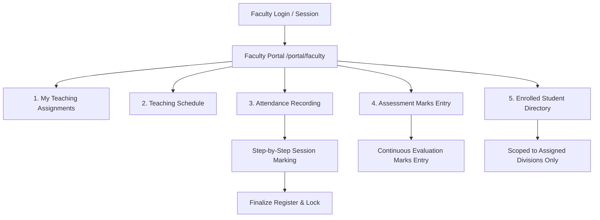

# CAMPUSOS — MILESTONE 2A.4 ARCHITECTURE BLUEPRINT
## Student & Faculty Self-Service Portals
### Stage 0: Discovery | Stage 1: Student Portal Delivered

**Subsystem:** Student Information System (SIS) & Role-Based Workspaces  
**Milestone:** 2A.4 (Stage 1: Student Self-Service Portal)  
**Status:** **Stage 1 Delivered & Verified | Stage 2 Assessment Complete — Pending Explicit Authorization | Stage 3 Pending**  
**Date:** November 1, 2026  
**Lead Product Engineer:** Antigravity  
**Product Direction:** ChatGPT (Product Architect & Creative Director)  
**Operational Database:** `prisma/dev.db` (Documented Baseline Post-Stage 1: `2F092C9633F565F416051E4551A6D0751DAB601163271D10F3AC49AA0BD0B162`; Current Audited State: `DF7B49BD5E1FBF5B90A36A0658D7DC83D6B21C8948EA1805934BF03608B670ED`, 684,032 bytes; Historical Pre-Rotation Baseline: `86FF618CC96C421591237B0F589945644540868E6D151C2DB789D3A4D7399E41`)

---

## 1. Executive Summary

Milestone 2A.4 designs the self-service user experiences for **Students** (`STUDENT_VIEWER`) and **Faculty Members** (`FACULTY_MEMBER`) within the existing RPIHM CampusOS ERP platform. 

### Core Product Directives
1. **Unified Identity, Distinct Workspaces:** Student and faculty experiences are **not** independent applications, separate repositories, or isolated micro-frontends. They are role-tailored workspaces rendered from the single central identity, authentication, authorization, and data foundation of CampusOS.
2. **Powerful Functionality Underneath, Simple on the Surface:** The interface must be clean, uncluttered, fast, accessible, and mobile-first, presenting students and teachers with exactly the tools and records they need while hiding administrative overhead.
3. **No Greenfield Rebuilding:** Milestone 2A.1 (360° Dossier), Milestone 2A.2 (Enrolment Lifecycle & Progression), and Milestone 2A.3 (Document Management) already constructed robust repositories, server actions, and domain models. Milestone 2A.4 leverages and connects these existing capabilities.
4. **Honest Data & Policy Integrity:** Never fabricate operational records. Never display simulated attendance percentages, draft exam results as published scores, or fake announcements. Honest, clear empty states are mandatory when institutional data has not been recorded or published.
5. **Zero Premature Account Provisioning & Controlled Credential Maintenance:** The operational database contains 13 student profiles and 2 existing administrator accounts. No student or faculty accounts were provisioned. The two existing administrator accounts (`admin.local@sample.rpihm.ac.in` and `k.sharma@sample.rpihm.ac.in`) underwent explicitly authorized credential rotation during Stage 1 security closure, updating their password hashes and salts via standard `scrypt` and revoking active sessions. Student and faculty mass onboarding remains strictly deferred to **Milestone 2B (Institutional IAM & Bulk Onboarding)**. Automated testing continues to use isolated test database fixtures (`prisma/isolated_test.db`).

---

## 2. Existing Architecture & Reusable Assets

A comprehensive code discovery across `G:\rpihm-campusos` reveals an exceptionally rich set of existing models, repositories, and server actions ready for direct reuse:

### 2.1 Route & View Architecture

| Route Pattern | Target Component | Current Behavioral State & Reusability |
| :--- | :--- | :--- |
| `/` | `src/app/page.tsx` (`AuthenticatedDashboard`) | Renders `ExecutiveOverview` (campus-wide statistics) and `ModuleSwitchboard`. Currently accessed by all roles; must be adapted to route students and faculty to their respective portals. |
| `/login` | `src/app/login/page.tsx` | Highly polished `AnimatedLampLogin` with `CinematicWelcomeTransition`. Fully reusable across all institutional roles. |
| `/modules/[slug]` | `src/app/modules/[slug]/page.tsx` | Generic module console with `hasModuleAccess` guard. Renders `StudentsView`, `FacultyView`, `AttendanceView`, `ExaminationsView`, `FinanceView`, `ReportsView`, `SettingsView`. |
| `/modules/students/[id]` | `src/app/modules/students/[id]/page.tsx` | Full-page 360° Student Dossier (`StudentDossierView`) with 6 deep-linkable tabs: Overview, Academics, Attendance, Fees, Examinations, Documents. Reusable data structures. |
| `/api/students/[id]/documents/[docId]/download` | Route Handler | Private streaming binary handler with strict IDOR prevention, cache control, and staff/self authorization. |

### 2.2 Data Access Layer (DAL) & Repositories

| Repository | Source File | Existing Capabilities Reusable for Portals |
| :--- | :--- | :--- |
| **`StudentRepository`** | [`src/lib/dal/studentRepository.ts`](file:///g:/rpihm-campusos/src/lib/dal/studentRepository.ts) | - `getStudentById`: Fetch student profile metadata.<br>- `getStudentDossier360`: Complete 360° data aggregation (attendance summary, fee ledger, exam results, enrolment history).<br>- `getStudentDocuments`: Category breakdown, version chains, audit trail.<br>- `uploadStudentDocument`: Multi-phase compensating file upload.<br>- `replaceStudentDocument`: Revision superseding with version preservation. |
| **`AttendanceRepository`** | [`src/lib/dal/attendanceRepository.ts`](file:///g:/rpihm-campusos/src/lib/dal/attendanceRepository.ts) | - `getAttendanceSummary`: Student session counts, internal rate calculation, and shortage helper (retained for institutional reporting; student portal displays raw counts only with neutral advisory notice).<br>- `getAttendanceSessions`: Filtered session listings.<br>- `recordAttendanceSession`: Batch attendance marking by faculty.<br>- `finalizeSession`: Finalize draft attendance registers.<br>- `amendAttendanceRecord`: Justified status corrections. |
| **`ExamRepository`** | [`src/lib/dal/examRepository.ts`](file:///g:/rpihm-campusos/src/lib/dal/examRepository.ts) | - `getStudentResultSummaries`: Retrieves grade cards; strictly filters `approvalStatus = 'PUBLISHED'` when `isStudentViewer: true`.<br>- `getComponentsForSession`: Subject assessment components.<br>- `getExamRosterForComponent`: Enrolled candidate rosters.<br>- `recordStudentMarks`: Faculty mark entry with `isFacultyScoped: true`. |
| **`FeeRepository`** | [`src/lib/dal/feeRepository.ts`](file:///g:/rpihm-campusos/src/lib/dal/feeRepository.ts) | - `getStudentFeeLedger`: Complete ledger summary (invoices, payments, receipts, fee heads, balance). Strictly denies faculty and scopes students to `studentId === user.studentId`. |
| **`AcademicRepository`** | [`src/lib/dal/academicRepository.ts`](file:///g:/rpihm-campusos/src/lib/dal/academicRepository.ts) | - `getProgrammes`, `getProgrammeDetails`, `getSemesters`, `getSubjects`, `getCurrentAcademicYear`: Academic structure and curriculum queries (accessible to all authenticated users). |
| **`TimetableRepository`** | [`src/lib/dal/timetableRepository.ts`](file:///g:/rpihm-campusos/src/lib/dal/timetableRepository.ts) | - `getTimetable`: Filter timetable entries by division, subject, semester, or teaching assignment. |
| **`FacultyRepository`** | [`src/lib/dal/facultyRepository.ts`](file:///g:/rpihm-campusos/src/lib/dal/facultyRepository.ts) | - `getStaffById`: Faculty profile, department, and active `TeachingAssignment` relations with divisions and subjects. |

### 2.3 Server Actions & Security Enforcements

Existing server actions already implement strict record-level authorization:
- `getStudentsAction` & `getStudentDossierAction`: Scopes `STUDENT_VIEWER` strictly to `user.studentId`; scopes `FACULTY_MEMBER` strictly to `allowedDivisionIds` derived from active teaching assignments.
- `getAttendanceSummaryAction`: Auto-injects `filter.studentId = user.studentId` for students.
- `recordAttendanceSessionAction`: Rejects faculty attempting to record attendance for unassigned divisions with `UNASSIGNED_CLASS_ACCESS_DENIED`.
- `getStudentFeeLedgerAction`: Excludes `FACULTY_MEMBER` completely; validates student ownership.
- `uploadStudentDocumentAction`: Blocks student uploading for another student record (`FORBIDDEN`).

---

## 3. Identity & Data Availability Audit

A read-only audit of the operational database (`prisma/dev.db`) was conducted to establish current operational baseline counts:

### 3.1 Identity & Account Registry

```
=== OPERATIONAL DATABASE (prisma/dev.db) IDENTITY AUDIT ===
Total Student Profiles:             13
Total Staff Profiles:               13
Total UserAccounts:                 2
Accounts Linked to Students:        0 / 13 (0%)
Accounts Linked to Staff:           1 / 13 (7.7% - Khushali Sharma)
Unlinked Student Profiles:          13
Unlinked Staff Profiles:            12
Operational STUDENT_VIEWER Accounts: 0
Operational FACULTY_MEMBER Accounts: 0 (Khushali Sharma holds ACADEMIC_ADMIN)
Operational SYSTEM_ADMIN Accounts:  1 (admin.local@sample.rpihm.ac.in)
Operational ACADEMIC_ADMIN Accounts: 1 (k.sharma@sample.rpihm.ac.in)
```

### 3.2 Operational Records by Domain

| Domain | Database Table | Operational Count (`dev.db`) | Data Assessment for Portals |
| :--- | :--- | :---: | :--- |
| **Students** | `Student` | **13** | 13 genuine student records across 7 programmes. |
| **Enrolments** | `Enrolment` | **14** | 14 active and historical semester placements across divisions. |
| **Programmes & Subjects** | `Programme`, `Subject` | **7 / 57** | Complete curriculum catalog across culinary arts and hospitality. |
| **Divisions** | `Division` | **20** | Active class divisions across programmes and semesters. |
| **Teaching Assignments** | `TeachingAssignment` | **5** | 5 active instructional mappings across 4 faculty members. |
| **Timetable** | `TimetableEntry` | **0** | **Empty.** Must render honest empty state: *"Timetable schedule has not been published yet."* |
| **Attendance Sessions** | `AttendanceSession` | **1** | 1 recorded session (Wed Oct 7, 2026, AI-101 Div A, 2 attendance records). |
| **Attendance Records** | `AttendanceRecord` | **2** | Individual student attendance markers. |
| **Examinations** | `ExamSession` | **1** | 1 regular exam session with 2 assessment components. |
| **Exam Results** | `ExamResultSummary` | **2** | **Both results are in `approvalStatus: DRAFT`**. Zero published results. Under Rule 4, draft results must be hidden from students; student portal must display honest empty state: *"No examination results published yet."* |
| **Fee Structures** | `FeeStructure` | **2** | Fee structures defined for culinary and hospitality terms. |
| **Student Fee Invoices** | `StudentFeeInvoice` | **1** | 1 invoice (`INV-2026-7759`, Khan Umar, Rs. 50,000, Paid). |
| **Fee Receipts** | `FeeReceipt` | **1** | 1 payment receipt linked to the invoice. |
| **Student Documents** | `StudentDocument` | **0 in dev.db** | Models defined in `schema.prisma` and verified in `isolated_test.db` (93 tests). Zero operational documents in `dev.db`. |
| **Notices / Announcements** | *None* | **0** | **No database model exists.** Must NOT invent simulated notices. |

---

## 4. Student Portal Workflow Map

The Student Portal (`/portal/student`) is structured around 6 simple, high-visibility workspace sections:

```mermaid
graph TD
    StudentLogin[Student Login / Session] --> PortalHome[Student Self-Service Portal /portal/student]
    PortalHome --> TabProfile[1. Identity & Academic Profile]
    PortalHome --> TabTimetable[2. Class Schedule & Timetable]
    PortalHome --> TabAttendance[3. Attendance Ledger]
    PortalHome --> TabExams[4. Grade Cards & Results]
    PortalHome --> TabFees[5. Fee Invoices & Receipts]
    PortalHome --> TabDocs[6. Document Submissions]

    TabProfile --> SubEnrolment[Enrolment History & Placement]
    TabAttendance --> SubAdvisory[Advisory 75% Reference Notice (Raw Counts Only)]
    TabExams --> SubPublishedOnly[Published Results Only / DRAFT Hidden]
    TabFees --> SubReceiptDownload[Printable Fee Receipt Voucher]
    TabDocs --> SubUpload[Upload / Supersede Credentials]
```

### Screen 4.1: Student Workspace Home & Identity Header
- **UI Elements:**
  - Institutional student card:
    - **Initials Avatar:** Rendered from `Student.fullName` with institutional typography and colors (profile photos are not stored in the database model).
    - **Student Identifiers:** Full Name, PRN (`Student.prn`), Roll Number (`Student.rollNumber`).
    - **Academic Placement:** Programme Name (`Programme.name`), Current Semester (`Student.currentSemester`), Division (`Enrolment.division.name` from active placement).
    - **Status Badge:** Derived directly from `Student.status` enum (`ACTIVE`, `INACTIVE`, `SUSPENDED`, `ALUMNI`).
    - **Mentor Faculty:** Derived from `Student.mentorFaculty` (displays mentor name if assigned, or displays honest *"Unassigned"* status if unrecorded).
  - Quick KPI Strip:
    - **Current Enrolment:** Programme Code, Semester Number, Division.
    - **Documents Submitted:** Count of submitted documents and breakdown by verification status (e.g. *"1 Verified, 1 Pending Review"*). Note: No required total or completion percentage is calculated pending formal institutional policy.
    - *(Stage 2 Preview Metrics: Attendance raw session counts & Fee Ledger balance).*
- **Data Source:** `StudentRepository.getStudentDossier360(session.user.studentId)`.
- **Authorization:** `requirePermission("READ_STUDENTS")` + `session.user.studentId === targetId`.
- **Empty State:** If student profile is unlinked: friendly warning to contact the Registrar Office.

### Screen 4.2: Enrolment History & Curriculum
- **UI Elements:**
  - Active semester curriculum list: Subject Code (`Subject.code`), Subject Title (`Subject.title`), Credits (`Subject.credits`), Subject Type (`Subject.subjectType`: Theory vs Practical Kitchen). *(Note: Syllabus breakdown/topics are not stored in the database model and are omitted).*
  - Enrolment history card: Chronological timeline of past semesters, academic years, divisions, and progression status (`PROMOTED`, `ENROLLED`).
- **Data Source:** `dossier.enrolments`, `AcademicRepository.getSubjects(currentSemesterId)`.
- **Empty State:** Honest message if elective subjects or curriculum have not yet been assigned.

### Screen 4.3: Class Timetable
- **UI Elements:**
  - Clean day-by-day weekly grid (Monday to Saturday) showing time slots, subjects, rooms, and faculty names.
- **Data Source:** `getStudentSelfTimetable()`: Scoped strictly to active enrolment (`status === "ENROLLED"`), semester, and division; honest `NO_ACTIVE_ENROLMENT` empty state if un-enrolled; zero client-supplied division or semester IDs accepted.
- **Operational Reality:** `TimetableEntry` table currently contains 0 records in `dev.db`.
- **Honest Empty State:**
  ```
  [Calendar Icon]
  No Class Schedule Published
  No timetable has been published for your current semester and division yet. Please check back prior to session commencement.
  ```
  *(Note: If placement details are displayed in UI empty states, they must be dynamically derived from the authenticated student's active enrolment. Never hardcode a division or semester).*

### Screen 4.4: Attendance Ledger & Session Breakdown
- **UI Elements:**
  - Summary cards: Total Sessions Held, Present, Late, Absent, Excused. (Raw counts only; zero calculated percentages, percentage progress bars, or radial gauges rendered).
  - Subject-wise session counts table: Subject Code, Subject Name, Sessions Held, Present, Late, Absent, Excused.
  - Advisory Notice Banner: *"The 75% figure is shown solely as an unverified advisory reference. It is not an approved institutional policy or an examination eligibility determination."*
  - Session-by-session chronological history table: Date, Time Slot, Subject, Session Type, Topic Covered, Faculty Member, Attendance Status badge (Present/Late/Absent/Excused), and Remarks.
  - *(Display Policy: The student portal will NOT calculate or display overall or subject-wise percentages, percentage progress bars, shortage warnings, attendance eligibility badges, or disciplinary/compliance verdicts. Existing repository calculations remain intact for institutional reporting).*
- **Data Source:** `AttendanceRepository.getAttendanceSummary({ studentId: session.user.studentId })`, `AttendanceRepository.getAttendanceSessions({ studentId: session.user.studentId })` (scoped strictly to session student).
- **Empty State:** *"No attendance records logged for your classes yet."*

### Screen 4.5: Examination Results & Grade Cards
- **UI Elements:**
  - Examination Session selector (e.g. "Winter 2026 Regular SEE").
  - Published Grade Card: SGPA, Letter Grade, Overall Result Status (`PASSED`, `ATKT`).
  - Subject-wise marks breakdown: Subject Code, Title, Credits, Total Marks, Marks Obtained, Grade Point.
- **Data Source:** `ExamRepository.getStudentResultSummaries({ studentId, isStudentViewer: true })`.
- **Security & Integrity Rule:** Strictly filters `approvalStatus === 'PUBLISHED'`. Draft results are withheld.
- **Honest Empty State (dev.db baseline):**
  ```
  [Academic Cap Icon]
  Examination Results Not Published
  No examination results have been published for your account yet. Published results will appear here when they become available.
  ```

### Screen 4.6: Fee Invoices, Payments & Receipts
- **UI Elements:**
  - Student Fee Ledger Overview: Total Demand (₹), Total Payments Recorded in CampusOS (₹), Net Balance (₹), Clearance Status badge (derived presentation states: `NOT_INVOICED`, `CLEARED`, `PARTIALLY_CLEARED`, `PENDING_DUES`). Payment efficiency percentages are strictly omitted.
  - Invoices Table: Invoice #, Date Generated, Due Date, Total Demand, Status (`PAID`, `PARTIALLY_PAID`, `PENDING`).
  - Component Fee Heads: Itemized breakdown (Tuition, Kitchen Lab, Knife-Kit, Library).
  - Receipts Archive: Receipt #, Payment Date, Amount, Payment Mode (UPI, NEFT, Cheque), Recorded Transaction Reference, and "Print / View Receipt" action. All receipt data represents payments recorded in CampusOS; no independent external bank settlement or payment verification is claimed.
- **Data Source:** `FeeRepository.getStudentFeeLedger(session.user.studentId)` (Strictly session-derived; client cannot supply student ID). CampusOS currently supports single-direction student invoice and recorded-payment tracking. It is not a full accounting or reconciliation system.
- **Operational Reality & Display Policy:**
  - The operational database (`dev.db`) contains 1 genuine paid invoice (`INV-2026-7759`, Khan Umar, ₹50,000, `PAID`) and 1 linked receipt (`REC-2026-121403`).
  - For students with existing fee records: Display their actual invoice, itemized fee heads, payment history, and receipt vouchers (Status: `CLEARED`).
  - For students without existing fee records: Display an honest, respectful empty state: *"No fee invoices have been generated for your student account yet."* (Status: `NOT_INVOICED`). Explicitly distinguish a student with no invoice records from a student whose invoices have been fully paid. Absence of invoices is NEVER treated as fee clearance or absence of financial obligations.
  - **Audited Financial Aggregation Rules:**
    - Invoice demand is the billed amount (`totalDemand = sum(inv.totalDemand)`).
    - `FeeReceipt` records are the single source of truth for payments (`totalPaid = sum(inv.receipts)`).
    - Do not double-count receipts; each receipt links strictly to one invoice.
    - Do not add a nonexistent `paidAmount` field to `StudentFeeInvoice`.
    - Preserve existing overpayment safeguards (rejected at mutation time). If a surplus credit balance exists (`totalPaid > totalDemand`), explicitly disclose the credit balance in UI rather than silently concealing it with `Math.max(0, ...)`.
  - **Financial Safety Rules:** Never prescribe a universal empty state. Never fabricate or duplicate payments. Never expose another student's financial records. Faculty access is strictly denied (`403 FORBIDDEN`). Student access is strictly read-only.

### Screen 4.7: Student Document Management & Verification Self-Service
- **UI Elements:**
  - Supported institutional document categories: Identity Proof, HSC Marksheet, SSC Marksheet, Transfer Certificate, Migration Certificate, etc. (Technical catalog; no mandatory submission requirements are enforced pending formal institutional policy).
  - Active document list: Filename, category label, upload date, file size, version badge (`v1`, `v2`), status (`VERIFIED`, `PENDING_VERIFICATION`, `REJECTED`).
  - Document replacement button with version notice: *"Replacing this document preserves Version 1 and retains its verification audit trail."*
  - Rejection details drawer: Displays official reviewer remarks and institutional justification if status is `REJECTED`.
  - Verification Timeline drawer: Read-only chronological audit trail of all verification events.
- **Data Source:** `StudentRepository.getStudentDocuments(session.user.studentId)` (Strictly session-derived).
- **Comprehensive Document Security & Operation Coverage:**
  - Prior to reusing `StudentDocumentsTab.tsx`, all underlying action and download dependencies must enforce student ownership server-side:
    1. **Listing Documents:** Uses `getStudentSelfDocumentsAction()`; resolves `studentId` exclusively from server session.
    2. **Uploading Documents:** Uses `uploadStudentSelfDocumentAction()`; binds uploaded file to session `studentId`, enforces file validation, magic bytes (`%PDF-`, `PNG`, `JPEG`), and 10MB bounds.
    3. **Replacing Documents:** Uses `replaceStudentSelfDocumentAction()`; verifies existing document belongs to session `studentId`, archives predecessor, creates `v2` in `PENDING_VERIFICATION`, and retains full verification history.
    4. **Downloading Documents:** Binary streaming route handler (`/api/students/[id]/documents/[docId]/download`) verifies `params.id === session.user.studentId` and `doc.studentId === session.user.studentId`.
    5. **Viewing Verification History:** Student can inspect verification decisions and reviewer notes on their own documents.
    6. **Verification Protection:** Students CANNOT approve, reject, or verify documents. Any invocation of staff verification actions (`verifyStudentDocumentAction`) by `STUDENT_VIEWER` is strictly rejected with `403 FORBIDDEN`.
    7. **Lifecycle Preservation:** Restrictive foreign key policies (`onDelete: Restrict`) prevent destruction of historical verification records.
- **Empty State:** *"No compliance documents have been submitted to date. Supported categories can be submitted below."*

### Screen 4.8: Profile Settings & Account Security
- **UI Elements:**
  - Read-only institutional profile info (Date of Birth, Blood Group, Guardian Name & Contact).
  - Notice: *"To update legal name, PRN, or contact details, please file a request with the Registrar Office."*
  - Password change form (Current password, New password, Confirm password).

---

## 5. Faculty Portal Workflow Map

The Faculty Portal (`/portal/faculty`) is focused strictly on instructional duties and assigned cohorts:



### Screen 5.1: Faculty Workspace Home & Overview
- **UI Elements:**
  - Faculty Profile Header: Full Name, Employee Code (`RPIHM-FAC-xxx`), Designation, Department, Date of Joining, Workload Hours, Office Location.
  - Quick Instructional KPIs:
    - **Active Teaching Assignments:** Count of mapped subject-division pairs.
    - **Today's Classes:** Timetable slots for the current calendar day.
    - **Attendance Drafts:** Sessions awaiting finalization.
    - **Pending Mark Entries:** Open assessment components.
- **Data Source:** `FacultyRepository.getStaffById(user.staffId)`.
- **Authorization:** `requirePermission("READ_FACULTY")`.

### Screen 5.2: My Teaching Assignments
- **UI Elements:**
  - Structured card grid of assigned subjects:
    - Subject Code & Name (e.g. `FP-101 - Classical Culinary Foundation`).
    - Degree Programme & Semester (e.g. `BA-CUL`, Semester 1).
    - Assigned Division (e.g. `Div A`).
    - Weekly Instructional Hours (e.g. `4 Hours/Week`).
- **Data Source:** `prisma.teachingAssignment.findMany({ where: { staffId: user.staffId } })`.
- **Empty State (for staff without assignments):**
  ```
  [Book Open Icon]
  No Instructional Assignments
  No teaching assignments have been configured for your staff profile for the 2026–27 academic term. Please contact the Academic Dean or HOD.
  ```

### Screen 5.3: Faculty Teaching Timetable
- **UI Elements:**
  - Weekly instructional schedule displaying only the faculty member's assigned lecture and practical laboratory slots.
- **Data Source:** `TimetableRepository.getTimetable({ staffId: user.staffId })`.
- **Empty State:** *"No instructional timetable entries have been scheduled for your profile."*

### Screen 5.4: Attendance Session Recording & Management
- **Workflow:**
  1. **Select Assignment:** Dropdown filtered strictly to faculty's `teachingAssignments` (Subject + Division).
  2. **Session Details:** Date (defaults to today), Start Time, End Time, Session Type (Theory / Practical Kitchen), Topic Covered.
  3. **Roster Marking:** Loads students enrolled in the selected division. Fast actions: "Mark All Present", individual toggles (`PRESENT`, `ABSENT`, `LATE`, `EXCUSED`).
  4. **Submission:** "Save as Draft" or "Submit & Finalize Attendance".
  5. **Session Log:** List of previously recorded sessions with status (`DRAFT`, `FINALIZED`). Allows amending draft sessions with mandatory remark.
- **Data Source:** `AttendanceRepository.getCohortForSession`, `recordAttendanceSessionAction`, `finalizeAttendanceSessionAction`.
- **Authorization:** `requirePermission("RECORD_ATTENDANCE")` + row-level check `assignment.staffId === user.staffId`.

### Screen 5.5: Student Assessment Marks Entry
- **Workflow:**
  1. **Select Component:** Faculty selects an open assessment component belonging to their assigned subject (e.g. `AI-101 - Internal Assessment IA`, Max Marks: 25).
  2. **Roster Grid:** Enrolled candidates displayed with PRN, Roll Number, Full Name, and numeric score input (bounded 0 to `maxMarks`).
  3. **Special Status Toggles:** `ABSENT`, `EXEMPT`, `MEDICAL_LEAVE`.
  4. **Save & Submit:** Saves batch marks via `recordStudentMarksAction`.
- **Data Source:** `ExamRepository.getComponentsForSession`, `ExamRepository.getExamRosterForComponent`, `recordStudentMarksAction`.
- **Security Check:** `isFacultyScoped = true`; faculty cannot moderate or publish results.

### Screen 5.6: Cohort Student Directory (Assigned Divisions Only)
- **UI Elements:**
  - List of students enrolled in the divisions assigned to this faculty member.
  - Search by student name or roll number.
  - Read-only summary card: Student Name, PRN, Roll Number, Division, and recorded attendance session counts (Held / Attended).
- **Security Boundaries:**
  - **Forbidden:** No access to student fee ledgers.
  - **Forbidden:** No access to student document verification or private uploads.
  - **Forbidden:** No student record editing, progression, or deletion.
  - **Forbidden:** No visibility into students outside assigned divisions.
- **Data Source:** `StudentRepository.getStudents({ allowedDivisionIds: assignedDivisionIds })`.

---

## 6. Feature Readiness Matrix

| Feature / Workspace Area | User Role | Status Classification | Existing Files & Functions | Data Availability (`dev.db`) | Dependencies & Missing Work |
| :--- | :---: | :--- | :--- | :--- | :--- |
| **Personal Identity Profile** | Student | **Existing & Reusable** | `StudentRepository.getStudentById` | 13 student profiles exist | Wire into dedicated student layout. |
| **Enrolment & Progression History** | Student | **Existing & Reusable** | `StudentRepository.getStudentDossier360` | 14 enrolments exist | Fully functional in DAL; needs portal card. |
| **Current Curriculum & Subjects** | Student | **Existing & Reusable** | `AcademicRepository.getSubjects` | 57 subjects exist | Display active semester subjects. |
| **Student Timetable** | Student | **Existing but Incomplete** | `TimetableRepository.getTimetable` | **0 records in dev.db** | DAL complete; needs honest empty state. |
| **Student Attendance Ledger** | Student | **Existing & Reusable** | `AttendanceRepository.getAttendanceSummary` | 1 session, 2 records | Fully supported in DAL and server actions. |
| **Examination Results** | Student | **Existing & Reusable** | `ExamRepository.getStudentResultSummaries` | 2 results (both `DRAFT`) | DAL hides draft results; honest empty state. |
| **Fee Invoices & Receipts** | Student | **Existing & Reusable** | `FeeRepository.getStudentFeeLedger` | 1 invoice, 1 receipt | Fully functional; displays itemized ledger. |
| **Document Submissions** | Student | **Existing & Reusable** | `StudentRepository.getStudentDocuments` | Verified in test db | Reusable `StudentDocumentsTab` UI. |
| **Announcements & Notices** | Student | **Not Currently Supported** | None (only mock in `mockData.ts`) | **No DB model** | Omit from initial portal to avoid fake data. |
| **Profile Settings** | Student | **Requires Policy/Approval** | `UserAccount` password reset | 2 accounts in dev.db | Self-service password change permitted; profile edits require registrar. |
| **Faculty Profile & Dept** | Faculty | **Existing & Reusable** | `FacultyRepository.getStaffById` | 13 staff profiles | Mapped to `Staff` table. |
| **Teaching Assignments** | Faculty | **Existing & Reusable** | `prisma.teachingAssignment` | 5 assignments exist | Mapped across 4 faculty members. |
| **Faculty Timetable** | Faculty | **Existing but Incomplete** | `TimetableRepository.getTimetable` | **0 records in dev.db** | Needs honest empty state. |
| **Attendance Session Recorder** | Faculty | **Existing & Reusable** | `AttendanceRepository.recordAttendanceSession` | Model & DAL complete | Reuse session marking modal/view. |
| **Student Roster in Assigned Cohort**| Faculty | **Existing & Reusable** | `StudentRepository.getStudents(allowedDivisions)` | 13 students exist | Fully enforced row-level boundary. |
| **Continuous Assessment Marks** | Faculty | **Existing & Reusable** | `ExamRepository.recordStudentMarks` | 2 assessment components | Scoped to assigned subjects. |
| **Document Verification** | Faculty | **Not Authorized (By Design)** | `StudentDocumentVerification` | Staff-only | Faculty explicitly prohibited. |
| **Finance & Fee Ledger** | Faculty | **Not Authorized (By Design)** | `FeeRepository` | Admin-only | Faculty explicitly prohibited. |

---

## 7. Role-Based Authorization & Permission Matrix

The architecture strictly respects the institutional permissions defined in [`src/lib/auth/roles.ts`](file:///g:/rpihm-campusos/src/lib/auth/roles.ts). No permissions are fabricated or expanded:

| Capability / Resource Action | Required Permission | `SYSTEM_ADMIN` | `ACADEMIC_ADMIN` | `FACULTY_MEMBER` | `STUDENT_VIEWER` |
| :--- | :--- | :---: | :---: | :---: | :---: |
| **View Own Student Dossier / Profile** | `READ_STUDENTS` | Full | Full | Assigned Only | **Own Profile Only** |
| **View Student Directory** | `READ_STUDENTS` | Full | Full | **Assigned Cohorts Only** | **Denied** (Own Only) |
| **Edit Student Profile / Progression** | `WRITE_STUDENTS` | Full | Full | **Denied** | **Denied** |
| **View Attendance Records** | `VIEW_ATTENDANCE` | Full | Full | **Assigned Cohorts** | **Own Records Only** |
| **Record Daily Attendance** | `RECORD_ATTENDANCE` | Full | Full | **Assigned Classes Only** | **Denied** |
| **Edit Finalized Attendance** | `EDIT_FINALIZED_ATTENDANCE` | Full | Full | **Denied** | **Denied** |
| **View Class Timetable** | `VIEW_ATTENDANCE` | Full | Full | **Assigned Timetable** | **Division Timetable** |
| **Manage Timetable Entries** | `MANAGE_ACADEMICS` | Full | Full | **Denied** | **Denied** |
| **View Examination Results** | `VIEW_RESULTS` | Full | Full | **Assigned Subjects** | **Published Only** |
| **Enter Assessment Marks** | `ENTER_MARKS` | Full | Full | **Assigned Subjects Only**| **Denied** |
| **Moderate Marks / Publish Results**| `PUBLISH_RESULTS` | Full | Full | **Denied** | **Denied** |
| **View Fee Invoices & Receipts** | `VIEW_FEES` | Full | Full | **Denied** | **Own Ledger Only** |
| **Manage / Collect Student Fees** | `COLLECT_FEES` | Full | Full | **Denied** | **Denied** |
| **Upload Compliance Documents** | `UPLOAD_STUDENT_DOCUMENTS` | Full | Full | **Denied** | **Own Profile Only** |
| **Verify / Reject Documents** | `VERIFY_STUDENT_DOCUMENTS` | Full | Full | **Denied** | **Denied** |

*Note: Future IAM roadmap roles (`HOD`, `FINANCE_OFFICER`) are intentionally omitted from this active matrix.*

---

## 8. UX, Layout & Navigation Architecture

### 8.1 Visual Identity Alignment
Both portals adhere strictly to the proven RPIHM design tokens:
- **Navigation Backdrop:** Deep Navy `#071322` and `#0B1528`.
- **Workspace Background:** Neutral Canvas `#F8FAFC`.
- **Card Surfaces:** Pure White `#FFFFFF` with `#E2E8F0` micro-borders and soft shadows.
- **Brand Primary Accent:** Institutional Royal Blue `#1657D9`.
- **Status Indicators:**
  - Verified / Present / Paid: Emerald `#10B981` / `#ECFDF5`.
  - Pending / Draft / Partial: Amber `#F59E0B` / `#FFFBEB`.
  - Rejected / Absent / Overdue: Crimson `#D92534` / `#FEF2F2`.
  - Superseded / Archived: Slate `#64748B` / `#F1F5F9`.

### 8.2 Role-Aware Routing & Workspace Resolution

```
User visits "/" (Home)
    │
    ▼
Check session role
    ├── SYSTEM_ADMIN / ACADEMIC_ADMIN ──► Render ExecutiveOverview + ModuleSwitchboard
    ├── STUDENT_VIEWER ─────────────────► Redirect to "/portal/student" (Student Workspace)
    └── FACULTY_MEMBER ─────────────────► Redirect to "/portal/faculty" (Faculty Workspace)
```

### 8.3 Sidebar Navigation Adaptation
The persistent desktop sidebar and mobile drawer ([`src/components/layout/Sidebar.tsx`](file:///g:/rpihm-campusos/src/components/layout/Sidebar.tsx)) dynamically adapt navigation items based on the active session role:

#### Student Navigation Links
1. **My Dashboard** (`/portal/student`): Overview & Institutional ID.
2. **Academic Profile** (`/portal/student?tab=academics`): Curriculum & Placements.
3. **Class Schedule** (`/portal/student?tab=timetable`): Timetable & Slots.
4. **Attendance** (`/portal/student?tab=attendance`): Raw Session Counts & Attendance Ledger.
5. **Examinations** (`/portal/student?tab=examinations`): Published Results.
6. **Fees & Receipts** (`/portal/student?tab=fees`): Invoices & Payment Ledger.
7. **Documents** (`/portal/student?tab=documents`): Compliance Submissions.

#### Faculty Navigation Links
1. **Faculty Overview** (`/portal/faculty`): Schedule & KPIs.
2. **Teaching Assignments** (`/portal/faculty?tab=assignments`): My Classes.
3. **Attendance Register** (`/portal/faculty?tab=attendance`): Mark Sessions.
4. **Assessment Marks** (`/portal/faculty?tab=marks`): Continuous Evaluation.
5. **My Cohort** (`/portal/faculty?tab=students`): Assigned Student Roster.
6. **Teaching Timetable** (`/portal/faculty?tab=timetable`): Schedule.

---

## 9. Technical Architecture & File Modification Plan

To minimize blast radius, Milestone 2A.4 requires **ZERO database schema modifications**. The existing models in `prisma/schema.prisma` are 100% sufficient.

### 9.1 Stage 1 Architecture: Student Self-Service Foundation
- **Route File:** `src/app/portal/student/page.tsx`: Server component establishing authentication, verifying `STUDENT_VIEWER` role, verifying linked `studentId`, and rendering `StudentPortalView`.
- **Session-Derived Server Actions:** `src/lib/actions/portalStudent.ts`
  - `getStudentSelfProfile()`: Obtains session user; asserts `role === "STUDENT_VIEWER"`; retrieves linked `studentId`; rejects missing, invalid, or inactive linkage with `UNLINKED_STUDENT`; fetches only the linked student's profile. **Zero client-supplied student IDs permitted.**
  - `getStudentSelfCurriculum()`: Derives student placement from session `studentId` and returns active semester curriculum and past enrolment records.
  - `getStudentSelfDocuments()`: Calls `StudentRepository.getStudentDocuments(session.studentId)`.
  - `uploadStudentSelfDocumentAction()`: Validates file buffer, magic bytes, 10MB bounds, and associates record strictly with session `studentId`.
  - `replaceStudentSelfDocumentAction()`: Verifies target document belongs to session `studentId`, archives predecessor, creates `v2` in `PENDING_VERIFICATION`, and retains verification history.
- **Stage 1 UI Components:**
  - `src/components/portal/student/StudentPortalView.tsx`: Tabbed student workspace consolidating Profile & Overview (Tab 1), Academic & Curriculum (Tab 2), and Documents (Tab 3 in Stage 1; remaining tabs wired in Stage 2).
  - Reused: `src/components/modules/students/StudentDocumentsTab.tsx` operated in restricted student self-mode (document verification/approval disabled; only upload, replace, download, and audit viewing enabled).

### 9.2 Future Stages Architecture (Faculty Portal - Stage 3)
- **Route File:** `src/app/portal/faculty/page.tsx`: Strictly deferred to Stage 3.
- **Server Actions:** `src/lib/actions/portalFaculty.ts`: Strictly deferred to Stage 3.
- **Faculty UI Components:** `FacultyPortalView.tsx`, `FacultyAttendanceTab.tsx`, `FacultyMarksEntryTab.tsx`: Strictly deferred to Stage 3.

### 9.3 Existing Components Reused Directly
- `src/components/layout/AppShell.tsx`: Outer responsive shell with persistent dark sidebar and top bar.
- `src/components/layout/TopBar.tsx`: User profile avatar, notifications, academic session selector.
- `src/components/modules/students/StudentDocumentsTab.tsx`: 4 KPI summary cards, category technical catalog, upload modal, version history drawer.
- `src/components/common/ProfileModal.tsx`: Password management and user session details.

---

## 10. Comprehensive Verification & Testing Strategy

### 10.1 Testing Real Authorization Boundaries
To guarantee robust security without confusing architectural layers, tests must evaluate the actual, specific boundary mechanisms:

1. **Page-Level Protected Routes (`/portal/student`):**
   - Unauthenticated requests: Trigger an **HTTP 307 Temporary Redirect** to `/login?redirect=/portal/student`. (Not an HTTP 401 status code).
   - Authenticated non-student roles (`FACULTY_MEMBER`, `ACADEMIC_ADMIN`): Trigger an automatic redirect to their respective workspace or an explicit access denial screen.
2. **Server-Action Security Boundaries (`src/lib/actions/portalStudent.ts`):**
   - Unauthenticated calls: Return `{ success: false, error: "UNAUTHORIZED" }` or throw an `UnauthorizedError`.
   - Cross-student IDOR attempts: **Impossible by design.** The actions do not accept a student ID parameter from the client. They obtain `session.user.studentId` directly from the validated session cookie.
   - Unlinked student accounts: Return `{ success: false, error: "UNLINKED_STUDENT" }` gracefully without crashing.
   - Student attempting staff verification actions: Invocations of `verifyStudentDocumentAction()` by a `STUDENT_VIEWER` return `{ success: false, error: "FORBIDDEN" }`.
3. **Binary Streaming API Route Handlers (`/api/students/[id]/documents/[docId]/download`):**
   - Unauthenticated requests: Return **HTTP 401 Unauthorized**.
   - Cross-student tampering (`params.id !== session.studentId` or `doc.studentId !== session.studentId`): Return **HTTP 403 Forbidden**.
   - Tampered / non-existent document ID: Return **HTTP 404 Not Found**.
4. **Data-Level Integrity & Draft Withholding:**
   - Verify student results query filters out `approvalStatus: "DRAFT"` and returns only `"PUBLISHED"` results.
   - Verify fee ledger displays Khan Umar's genuine invoice (`INV-2026-7759`) while displaying an honest empty state for unbilled students.

### 10.2 Real Browser End-to-End Verification (Edge CDP)
Capture high-resolution screenshots across desktop and mobile viewports:
1. `m2a4_01_student_portal_overview.png`: Student dashboard with identity badge and KPIs.
2. `m2a4_02_student_academics_curriculum.png`: Active curriculum and past enrolment timeline.
3. `m2a4_03_student_documents_self_service.png`: Document checklist, upload modal, and status badges.
4. `m2a4_04_student_document_version_history.png`: Replacement modal showing version preservation notice and audit timeline.
5. `m2a4_05_student_mobile_responsive.png`: Responsive 390×844 mobile student viewport.

---

## 11. Phased Implementation Plan

Implementation is partitioned into 4 focused, independently verifiable stages:

```
Stage 1: Student Self-Service Foundation, Academic Profile & Secure Document Management
    ├── Implement session-derived student actions in src/lib/actions/portalStudent.ts (zero client IDs)
    ├── Create /portal/student route scaffolding in src/app/portal/student/page.tsx
    ├── Implement StudentPortalView.tsx (Identity Overview, Curriculum, Secure Document Self-Service)
    ├── Adapt StudentDocumentsTab.tsx in student mode (verification actions disabled)
    ├── Execute automated boundary authorization test suite (307 redirect, 401/403 API, action errors)
    └── Capture Edge CDP browser verification screenshots (Desktop & Mobile)

Stage 2: Student Timetable, Attendance Ledger, Published Results & Fee Ledger
    ├── Implement Attendance Ledger with raw session counts and neutral advisory 75% notice (zero calculated percentages)
    ├── Implement Class Timetable scoped strictly to active enrolment with honest empty state for unpublished schedules
    ├── Implement Examination Results view with strict suppression of DRAFT records
    └── Implement Fee Invoices & Receipts view (derived states: NOT_INVOICED, CLEARED, PARTIALLY_CLEARED, PENDING_DUES; single-direction ledger)

Stage 3: Faculty Self-Service Portal Implementation
    ├── Create /portal/faculty route scaffolding and FacultyPortalView.tsx
    ├── Wire active TeachingAssignment relations to restrict instructional scope
    ├── Implement scoped attendance recording for assigned divisions (unassigned access blocked)
    ├── Implement continuous assessment marks entry grid for assigned subjects
    └── Implement row-level cohort directory (unassigned students hidden)

Stage 4: Automated Cross-Portal Verification & Final Handover
    ├── Execute comprehensive end-to-end authorization test suite across both portals
    ├── Capture full suite of Edge CDP browser screenshots
    └── Verify TypeScript, ESLint, production build, and dev.db cryptographic invariance
```

---

## 12. Institutional Decisions & Risks

| Decision Area | Operational Context | Risk & Recommendation |
| :--- | :--- | :--- |
| **75% Attendance Reference** | The 75% figure is retained solely as an unverified advisory reference. No approved institutional policy or examination eligibility rule has been established from the reviewed sources. | **Risk:** Prematurely representing an unverified benchmark as an official institutional verdict or disqualifying students from examinations.<br>**Decision:** Retain the 75% figure strictly as an **Advisory Guidance Reference**, displaying the agreed neutral notice: *"The 75% figure is shown solely as an unverified advisory reference. It is not an approved institutional policy or an examination eligibility determination."* The student portal will display strictly raw session counts and will NOT calculate or display attendance percentages, percentage progress bars, shortage warnings, eligibility badges, or compliance verdicts. Existing repository calculations remain intact for institutional reporting. |
| **Institutional Document Requirements** | Mandatory submission lists and document categories have **not** been formally approved by institutional leadership. | **Risk:** Incorrectly penalizing students or calculating false non-compliance fractions.<br>**Decision:** Remove all claims of "required credentials" or "mandatory completion percentages". Present supported document categories as an informative technical catalog and display actual document statuses (`VERIFIED`, `PENDING_VERIFICATION`, `REJECTED`, `SUPERSEDED`). |
| **Exam Result Publication Protocol** | 2 exam result summaries in `dev.db` are marked `DRAFT`. | **Risk:** Leaking unmoderated scores to students causing disputes.<br>**Decision:** Strictly enforce `approvalStatus === 'PUBLISHED'`; draft results remain invisible to students. |
| **Fee Ledger Operational State** | 1 genuine paid invoice exists (`INV-2026-7759`, Khan Umar, ₹50,000, `PAID`). CampusOS currently supports single-direction student invoice and recorded-payment tracking; it is not a full accounting or reconciliation system. | **Risk:** Prescribing a universal empty state, fabricating duplicate payments, or conflating absence of invoices with fee clearance.<br>**Decision:** Render genuine ledger for invoiced students (`CLEARED`, `PARTIALLY_CLEARED`, `PENDING_DUES`); render honest `NOT_INVOICED` empty state for unbilled students with explicit notice that absence of invoices is never treated as fee clearance or absence of financial obligations. Exclude payment efficiency percentages. *(Handled in Stage 2).* |
| **Student Document Actions** | Students uploading and replacing compliance credentials. | **Risk:** Students attempting to self-verify or forge review notes.<br>**Decision:** Enforce server-side ownership for all operations; restrict document verification strictly to authorized staff. |
| **Student Profile Self-Editing** | Students may wish to correct name, PRN, or contact details. | **Risk:** Identity tampering and unverified official record alterations.<br>**Decision:** Profile fields remain read-only; self-service allows password change only. Official changes require Registrar ticket. |
| **Faculty Cohort Scope** | Faculty requesting access to all institute students. | **Risk:** Violation of student privacy and data protection principles.<br>**Decision:** Enforce strict row-level boundary: faculty only see students enrolled in divisions they actively teach. |
| **Unpublished Timetable Handling** | 0 timetable entries currently exist in `dev.db`. | **Risk:** Rendering a blank broken table or fake placeholder schedule.<br>**Decision:** Render an honest, beautifully styled institutional empty notice. *(Handled in Stage 2).* |

---

## 13. Acceptance Criteria

### Engineering Quality Gates
- [x] TypeScript compilation exits with **0 errors** (`npx tsc --noEmit`).
- [x] ESLint static analysis exits with **0 errors** (`npm run lint`).
- [x] Turbopack production build succeeds cleanly (`npm run build`).
- [x] Operational database (`prisma/dev.db`) hash remains **100% invariant** (Current Protected Baseline: `2F092C9633F565F416051E4551A6D0751DAB601163271D10F3AC49AA0BD0B162`; Superseded Historical Pre-Rotation Baseline: `86FF618CC96C421591237B0F589945644540868E6D151C2DB789D3A4D7399E41`).
- [x] Automated boundary authorization test suite passes **100% of assertions** (43/43 assertions in boundary suite; 53/53 in regression suite; 96/96 total).

### Functional & Security Criteria (Stage 1 Scope Only)
- [x] Unauthenticated navigation to `/portal/student` triggers an **HTTP 307 Redirect** to `/login?redirect=/portal/student`.
- [x] `STUDENT_VIEWER` session lands on `/portal/student` with personal identity profile derived **exclusively from server session** (zero client-supplied student IDs).
- [x] Student identity card renders verified profile fields accurately:
  - Initials avatar (profile photo is not present in the data model; rendered from full name).
  - Student identifiers: Full Name, PRN, Roll Number.
  - Academic placement: Programme Name, Current Semester (`Student.currentSemester`), Division (`Enrolment.division.name` from active placement).
  - Status badge derived from `Student.status` enum (`ACTIVE`, `INACTIVE`, etc.).
  - Mentor Faculty derived from `Student.mentorFaculty` (displays name if assigned, or *"Unassigned"* if unrecorded).
- [x] Academic profile and curriculum displays active semester subjects, credits, and course type (omitting unavailable syllabus topics).
- [x] Server actions in `portalStudent.ts` reject unlinked student accounts with `{ success: false, error: "UNLINKED_STUDENT" }`.
- [x] Document self-service allows student to list, upload, replace, and download their own documents while strictly denying document verification (`403 FORBIDDEN`).
- [x] Documents tab displays neutral supported categories without unapproved mandatory completion percentages or required fractions.
- [x] Binary download route `/api/students/[id]/documents/[docId]/download` returns **HTTP 401** when unauthenticated and **HTTP 403** on cross-student ID tampering.
- [x] Mobile responsive layout operates cleanly on 390×844 viewports without horizontal clipping.

*(Note: Timetable, Attendance Ledger, Published Results, and Fee Invoices/Receipts belong strictly to Stage 2).*

---

## 14. Revised Stage 1 Implementation Prompt [SUPERSEDED HISTORICAL SPECIFICATION]

> [!NOTE]
> **Historical Audit Trail:** The implementation prompt below represents the original pre-implementation instructions authorized prior to Stage 1 execution. During Stage 1 security closure, an explicitly authorized credential rotation was executed for the two operational administrator accounts (`admin.local@sample.rpihm.ac.in` and `k.sharma@sample.rpihm.ac.in`), establishing the new protected operational database baseline SHA-256: `2F092C9633F565F416051E4551A6D0751DAB601163271D10F3AC49AA0BD0B162`. The pre-rotation baseline hash (`86FF618...`) cited below is historical and superseded.

```markdown
# CAMPUSOS — MILESTONE 2A.4: STAGE 1 IMPLEMENTATION
## Student Self-Service Workspace Foundation, Academic Profile & Secure Document Views

### MANDATE & ROLE
Act as Lead Implementation Engineer for RPIHM CampusOS.
Implement Stage 1 of Milestone 2A.4 adhering strictly to the accepted blueprint (`docs/PHASE_2A4_SELF_SERVICE_PORTALS_BLUEPRINT.md`) and pre-implementation corrections.

### STRICT CONSTRAINTS
1. DO NOT modify `prisma/schema.prisma` or run migrations. Zero schema changes required.
2. DO NOT write to `prisma/dev.db` (historical baseline SHA-256: `86FF618CC96C421591237B0F589945644540868E6D151C2DB789D3A4D7399E41`; superseded by post-rotation protected baseline: `2F092C9633F565F416051E4551A6D0751DAB601163271D10F3AC49AA0BD0B162`). All tests and verifications execute strictly against `prisma/isolated_test.db`.
3. DO NOT provision real accounts in `dev.db`.
4. DO NOT implement faculty portal functionality in this stage (strictly deferred to Stage 3).
5. DO NOT implement timetable, attendance, published results, or fees in this stage (strictly deferred to Stage 2).
6. DO NOT fabricate mock data, syllabus breakdowns, or announcements. Omit unavailable fields or show honest empty/unassigned states.
7. All student server actions must derive student identity EXCLUSIVELY from the authenticated session (zero client-supplied student IDs).

### IMPLEMENTATION SCOPE (STAGE 1)

1. **Session-Derived Server Actions (`src/lib/actions/portalStudent.ts`):**
   - `getStudentSelfProfile()`: Obtains session user via `getCurrentUser()`; asserts `role === "STUDENT_VIEWER"`; extracts linked `studentId`; rejects unlinked accounts with `{ success: false, error: "UNLINKED_STUDENT" }`; calls `StudentRepository.getStudentById(user.studentId)`.
   - `getStudentSelfCurriculum()`: Derives student placement from session `studentId`; returns active curriculum from `AcademicRepository.getSubjects()` (subject code, title, credits, course type) and past enrolment timeline. (Omit syllabus breakdown).
   - `getStudentSelfDocuments()`: Calls `StudentRepository.getStudentDocuments(user.studentId)`.
   - `uploadStudentSelfDocumentAction(formData: FormData)`: Validates file buffer, magic bytes, 10MB bounds; binds upload strictly to `user.studentId`.
   - `replaceStudentSelfDocumentAction(documentId: string, formData: FormData)`: Verifies document belongs to `user.studentId`, archives predecessor, creates `v2` in `PENDING_VERIFICATION`, retains verification history.
   - Explicitly ensure `STUDENT_VIEWER` cannot invoke staff verification actions (`verifyStudentDocumentAction` returns `403 FORBIDDEN`).

2. **Student Workspace UI:**
   - Create route `src/app/portal/student/page.tsx` within AppShell. Authenticates user, verifies `STUDENT_VIEWER` role, and renders `StudentPortalView`.
   - Create `src/components/portal/student/StudentPortalView.tsx` with tabs:
     - **Tab 1: Overview & Identity:** Student institutional identity card:
       - Initials Avatar (rendered from full name; no photo in data model).
       - Full Name, PRN (`Student.prn`), Roll Number (`Student.rollNumber`).
       - Academic placement: Programme, Current Semester (`Student.currentSemester`), Division (`Enrolment.division.name`).
       - Status badge (`Student.status`: ACTIVE, etc.).
       - Mentor Faculty (`Student.mentorFaculty` or "Unassigned").
       - Documents Submitted summary (counts only; no required fractions or completion %).
     - **Tab 2: Academic & Curriculum:** Current semester subjects (code, title, credits, type: Theory vs Practical Kitchen) and historical enrolment timeline.
     - **Tab 3: Compliance Documents:** Reuses `StudentDocumentsTab.tsx` in restricted student self-mode: supported categories technical catalog, upload modal, replacement modal with version notice, rejection reasoning drawer, and read-only verification timeline drawer. (Verify/Reject staff buttons completely hidden; no required percentages).
   - Adapt `src/components/layout/Sidebar.tsx` to display student navigation links when logged in as `STUDENT_VIEWER`.
   - Adapt `src/app/page.tsx` to redirect `STUDENT_VIEWER` to `/portal/student`.

3. **Automated Boundary Authorization Test Suite (`scripts/test_student_portal_boundaries.ts`):**
   - **Page Redirect:** Unauthenticated GET `/portal/student` returns HTTP 307 Redirect to `/login`.
   - **Session-Derived Profile:** Authenticated `STUDENT_VIEWER` receives their own profile; client-supplied forged ID payload is ignored.
   - **Unlinked Student Handling:** `STUDENT_VIEWER` without linked `studentId` receives `UNLINKED_STUDENT` without throwing 500 error.
   - **Document Ownership & Prohibited Verification:** Student can upload, replace, and download own documents; cross-student replacement returns 403; student calling `verifyStudentDocumentAction()` returns 403.
   - **Download API Boundaries:** `/api/students/[id]/documents/[docId]/download` returns 401 when unauthenticated and 403 on student ID tampering.

4. **Real Browser End-to-End Verification (Edge CDP):**
   - Execute verification script against `isolated_test.db` on port 3005.
   - Capture screenshots:
     - `m2a4_01_student_portal_overview.png`: Desktop overview & identity badge.
     - `m2a4_02_student_academics_curriculum.png`: Active curriculum & enrolment history.
     - `m2a4_03_student_documents_self_service.png`: Document catalog & upload modal.
     - `m2a4_04_student_mobile_responsive.png`: 390×844 mobile viewport.
```

---

## 15. Stage 2: Student Academics & Finances — Focused Implementation Impact Assessment

**Subsystem:** Student Self-Service Portals (Milestone 2A.4, Stage 2)  
**Status:** **PENDING REVIEW & AUTHORIZATION** (Implementation has not started)  
**Date:** November 2, 2026  
**Lead Implementation Engineer:** Antigravity  
**Product Direction & Architecture Review:** ChatGPT  
**Operational Database Protection:** `prisma/dev.db` (SHA-256: `2F092C9633F565F416051E4551A6D0751DAB601163271D10F3AC49AA0BD0B162`) — **100% Invariant**  
**Test Isolation Environment:** `prisma/isolated_test.db` (All Stage 2 test fixtures execute here)

---

### 15.1 Scope & Functional Domain Overview

Stage 2 extends the accepted Milestone 2A.4 Stage 1 Student Self-Service Portal (`/portal/student`) to deliver student-facing views for four primary academic and financial domains:

1. **Class Timetable:** Weekly schedule matrix for the authenticated student's active semester and division placement.
2. **Attendance Ledger:** Subject-wise session counts (sessions held, present, late, absent, excused), individual session status tracking, and chronological ledger with explicit advisory policy disclaimer (zero calculated percentages).
3. **Examination Results & Grade Cards:** Formal published semester grade cards, subject-level marks/grades/credits, SGPA, and result status, with non-negotiable server-side suppression of draft or unpublished results.
4. **Fee Invoices, Payments & Receipts:** Student fee ledger (invoice and payment ledger) showing total billed demand, total payments recorded, net outstanding balance, fee clearance status, itemized invoice breakdown, receipt history, and receipt viewing/printing in student read-only mode.

---

### 15.2 Operational Reality & Data Availability Audit

A comprehensive read-only audit of the operational database (`prisma/dev.db`) reveals the exact data landscape:

| Domain | Operational Records in `prisma/dev.db` | Ground Truth State | Expected Student Portal Operational Behavior |
| :--- | :--- | :--- | :--- |
| **Class Timetable** | **0 timetable entries** (`TimetableEntry.count = 0`) | No timetable schedules have been created or published for any semester or division. | **Honest Dual Empty State:** Resolution strictly binds to authenticated session `studentId` -> active enrolment (`status === "ENROLLED"`) -> active `semesterId` and `divisionId`. Zero client-supplied division or semester IDs accepted. If student has no active enrolment: display *"No active semester enrolment found for your account. Please contact the Academic Office."* (`NO_ACTIVE_ENROLMENT`). If actively enrolled but 0 entries exist: display *"No timetable has been published for your current semester and division yet."* (`NO_TIMETABLE_PUBLISHED`). Zero schedule fabrication or arbitrary division fallback. |
| **Attendance** | **1 session, 2 records** (`AttendanceSession = 1`, `AttendanceRecord = 2`) | Only 1 prototype session recorded for Semester 1 (Food Production). | **Honest Dual State & Raw Counts Only:** In Stage 2, the portal will display strictly raw session counts (Total Sessions Held, Present, Late, Absent, Excused) and chronological attendance records. Zero calculated percentages will be displayed. For unrecorded students, show: *"No attendance records logged for your classes yet."* Neutral advisory notice clearly displayed: *"The 75% figure is shown solely as an unverified advisory reference. It is not an approved institutional policy or an examination eligibility determination."* The portal will NOT render an overall percentage, percentage progress bar, shortage warning, eligibility badge, or compliance/disciplinary verdict. The calculation disagreement between `studentRepository.ts` and `attendanceRepository.ts` remains frozen and documented as an unresolved institutional policy question. Neither calculation will be modified. |
| **Examinations** | **2 result summaries, both DRAFT** (`ExamResultSummary = 2`, `approvalStatus = "DRAFT"`) | Calculated prototype results exist for 2 students, but **0 results have been published** (`approvalStatus = "PUBLISHED"` count is 0). | **Strict Server-Side Suppression:** Non-negotiable security boundary: Students must see ONLY `PUBLISHED` results. All 13 operational students will see: *"No examination results have been published for your profile yet."* Draft marks, provisional SGPAs, and moderation drafts are strictly blocked at the SQL query level. |
| **Fees & Finances** | **1 genuine invoice, 1 receipt** (`StudentFeeInvoice = 1`, `FeeReceipt = 1`) | One genuine paid invoice (`INV-2026-7759`, ₹50,000, Status: `PAID`, Receipt: `REC-2026-121403`) linked to student Khan Umar. CampusOS currently supports single-direction student invoice and recorded-payment tracking. It is not a full accounting or reconciliation system. | **Dynamic Derived Ledger Display:** Khan Umar sees ₹50,000 demand, ₹50,000 paid, ₹0 balance (`CLEARED`), with full receipt viewing (`REC-2026-121403` verified from DB, never hardcoded). The other 12 operational students see an honest un-invoiced state: Total Billed ₹0, Total Paid ₹0, Balance ₹0, Status: `NOT_INVOICED`. Note: Absence of invoices is NEVER treated as proof of fee clearance. Presentation badges (`NOT_INVOICED`, `CLEARED`, `PARTIALLY_CLEARED`, `PENDING_DUES`) are derived UI logic, not persisted institutional classifications. Verified aggregation logic ensures zero double counting. |

---

### 15.3 Security Boundaries & Threat Analysis

Every Stage 2 server action and data query enforces the core security tenet: **Student identity is derived strictly from the server-side session token; zero client-supplied identifiers are trusted.**

| # | Threat Scenario | Attack Vector | Enforced Countermeasure | Result |
| :--- | :--- | :--- | :--- | :--- |
| **T1** | Cross-Student Timetable Leakage & Arbitrary Placement | Student A passes `divisionId` or `semesterId` belonging to Student B, or attempts to view schedule without enrolment. | `getStudentSelfTimetable()` accepts zero client arguments. Resolves `studentId` via session, queries active enrolment (`status === "ENROLLED"`). If un-enrolled, returns structured empty state `NO_ACTIVE_ENROLMENT` without guessing or falling back. If enrolled, binds query strictly to the session student's active `semesterId` and `divisionId`. | **Blocked.** Cross-student timetable tampering is structurally impossible; un-enrolled students receive honest empty state. |
| **T2** | Cross-Student Attendance Peeking & Policy Misrepresentation | Student A attempts to query Student B's attendance, or UI presents unverified attendance rate as official verdict. | Action accepts zero client arguments. `user.studentId` is injected directly from session into `AttendanceRepository.getAttendanceSummary({ studentId: user.studentId })`. Administrative action `getAttendanceSummaryAction` enforces `if (user.role === "STUDENT_VIEWER") filter.studentId = user.studentId`. UI renders strictly raw session counts with mandatory neutral advisory disclaimer; zero percentages, shortage warnings, or compliance verdicts rendered. | **Blocked.** Student B's attendance is completely inaccessible; unverified percentages are never displayed or labeled as institutional determinations. |
| **T3** | Cross-Student Exam Result Peeking | Student A attempts to access Student B's grade card. | `getStudentSelfExamResults()` derives `studentId` exclusively from session. Overrides any filter with `user.studentId`. | **Blocked.** Exam summaries are row-scoped strictly to session identity. |
| **T4** | Cross-Student Fee Ledger Snooping | Student A calls fee ledger endpoint passing Student B's ID. | `getStudentSelfFeeLedger()` accepts zero client arguments. In shared `getStudentFeeLedgerAction(id)`, line 145 asserts `if (studentId !== user.studentId) return FORBIDDEN`. | **Blocked.** HTTP 403 `FORBIDDEN` returned. |
| **T5** | Draft Exam Result Leakage | Student attempts to view preliminary marks before administrative publication. | `ExamRepository.getStudentResultSummaries` strictly adds SQL filter `where.approvalStatus = "PUBLISHED"` when `isStudentViewer: true`. Draft results are never fetched from SQLite or serialized into response payloads. | **Blocked.** Zero data leakage. Draft marks remain completely invisible. |
| **T6** | Student Financial Mutation Attempt | Student attempts to create an invoice, record a fake payment, or waive fees. | Mutation actions (`generateStudentInvoiceAction`, `recordFeePaymentAction`) enforce `requirePermission("MANAGE_FEES")` or `requirePermission("COLLECT_FEES")`. `STUDENT_VIEWER` role holds neither permission. | **Blocked.** HTTP 403 `FORBIDDEN` returned. |
| **T7** | Faculty Financial Snooping | Faculty member attempts to inspect student fee ledgers. | `getStudentFeeLedgerAction` line 128 explicitly checks `if (user.role === "FACULTY_MEMBER") return FORBIDDEN`. | **Blocked.** Faculty access to student financial ledgers is strictly denied. |
| **T8** | Unlinked Account Access | User authenticated as `STUDENT_VIEWER` but lacking linked `studentId`. | `requireStudentSession()` returns `{ success: false, code: "UNLINKED_STUDENT" }`. UI mounts the registrar guidance view. | **Protected.** Zero student data exposed. |
| **T9** | Unauthenticated Access | Unauthenticated request to `/portal/student`. | Route handler issues HTTP 307 redirect to `/login?redirect=/portal/student`. Server actions return `UNAUTHORIZED`. | **Protected.** HTTP 307 redirect / HTTP 401. |

---

### 15.4 Proposed Workspace Navigation & UX Plan

The student self-service portal workspace (`src/components/modules/portal/StudentPortalView.tsx`) will be extended from 3 tabs to **7 deep-linkable tabs**:

```
[Student Portal Navigation]
 ├── Tab 1: Profile & Overview     (Stage 1: Identity card, personal info, mentor, summary counts)
 ├── Tab 2: Academic Profile       (Stage 1: Programme details, current semester curriculum, enrolments)
 ├── Tab 3: Class Timetable        (Stage 2: Weekly schedule matrix Monday-Saturday or honest empty state)
 ├── Tab 4: Attendance             (Stage 2: Raw session counts, advisory note, chronological session ledger; zero percentages)
 ├── Tab 5: Examinations           (Stage 2: Published semester grade cards, SGPA, subject marks/grades, no-results state)
 ├── Tab 6: Fees & Receipts        (Stage 2: Financial demand, payments, balance, invoices, receipts, view/print modal)
 └── Tab 7: Compliance Documents   (Stage 1: Document self-service, uploads, versions, zero verification)
```

#### Visual & Behavioral Specifications
- **Class Timetable:** Weekly matrix rendering Monday through Saturday. Displays time slots, subject code/name, room, faculty name, and session type (`THEORY`, `PRACTICAL_LAB`). Scoped strictly to session student's active enrolment (`status === "ENROLLED"`), semester, and division. If student lacks an active enrolment, renders honest notice: *"No active semester enrolment found for your account. Please contact the Academic Office."* If actively enrolled with 0 entries published, renders: *"No timetable has been published for your current semester and division yet."* Never falls back to default or arbitrary divisions.
- **Attendance Ledger:** Top metrics bar displaying strictly raw counts: Total Sessions Held, Present, Late, Absent, Excused, with zero calculated percentages. Displays the neutral advisory note:
  > *"The 75% figure is shown solely as an unverified advisory reference. It is not an approved institutional policy or an examination eligibility determination."*
  Followed by a subject session counts table (Sessions Held, Present, Late, Absent, Excused) and a chronological session ledger (Date, Subject, Session Type, Topic Covered, Status Badge: Present/Late/Absent/Excused, Remarks). The view will NOT render an overall attendance percentage, percentage progress bar, shortage alert, eligibility badge, or disciplinary/compliance verdict.
- **Examinations:** Displays semester grade cards for published exam sessions. Card header displays Exam Session Name, SGPA, Overall Result Status (`PASSED`, `ATKT`, `FAILED`), and publication date. Table lists Subject Code, Subject Name, Credits, Grade Point, and Letter Grade. If zero published results exist, displays: *"No examination results published yet."*
- **Fees & Receipts:** Summary metric cards: Total Demand (₹), Total Payments Recorded in CampusOS (₹), Net Balance (₹), Clearance Badge (derived UI logic: `CLEARED`, `PARTIALLY_CLEARED`, `PENDING_DUES`, `NOT_INVOICED`). Explicit note: absence of invoices does not imply fee clearance. Invoice breakdown table listing Invoice Number, Structure Name, Demand, Status, and Due Date. Receipt history table listing Receipt Number, Payment Date, Amount, Payment Method, and Transaction Reference (UTR/Cheque). All fields dynamically rendered from database (e.g., verifying `REC-2026-121403`, never hardcoded). Includes a clean, printable receipt view modal. Aggregation math reconciles billed demand, recorded payments in CampusOS, and outstanding balance without double-counting receipts or mixing invoice totals and receipt totals; credit balances are explicitly disclosed if present.

---

### 15.5 Source-File Impact Assessment

| File | Current Responsibility | Required Change for Stage 2 | Reason | Architectural Risk |
| :--- | :--- | :--- | :--- | :--- |
| [`src/lib/actions/portalStudent.ts`](file:///g:/rpihm-campusos/src/lib/actions/portalStudent.ts) | Stage 1 session-derived actions: `getStudentSelfProfile`, `getStudentSelfCurriculum`, `getStudentSelfDocuments`, upload/replace actions. | Add 4 session-derived actions: `getStudentSelfTimetable()`, `getStudentSelfAttendance()`, `getStudentSelfExamResults()`, `getStudentSelfFeeLedger()`. | Provides secure, session-locked server entry points for the 4 Stage 2 domains. Guarantees zero client-supplied student IDs and enforces strict role guards. | **Low.** Preserves all Stage 1 actions intact; purely additive server actions. |
| [`src/lib/dal/attendanceRepository.ts`](file:///g:/rpihm-campusos/src/lib/dal/attendanceRepository.ts) | Attendance sessions, cohort loading, session recording, record amendments, summary calculation. | Add read-only helper `getStudentAttendanceLedger(studentId: string, semesterId?: string)` returning chronological attendance record rows with session metadata. | Exposes individual session attendance history (date, subject code, topic, status, remarks) needed for the student ledger table without modifying existing calculations. | **Low.** Read-only query; existing attendance calculations and mutation logic remain 100% untouched. |
| [`src/components/modules/portal/StudentPortalView.tsx`](file:///g:/rpihm-campusos/src/components/modules/portal/StudentPortalView.tsx) | Student portal workspace rendering Overview, Academics, and Documents tabs. | Extend `activeTab` union type from `"overview" \| "academics" \| "documents"` to include `"timetable" \| "attendance" \| "examinations" \| "fees"`. Render respective sub-views with lazy data loading and honest empty states. | Delivers the unified 7-tab student portal experience within the existing App Router client workspace. | **Low-Medium.** Must ensure tab switching and transitions do not disrupt existing Stage 1 state or document uploads. |
| [`src/components/layout/Sidebar.tsx`](file:///g:/rpihm-campusos/src/components/layout/Sidebar.tsx) | Navigation sidebar with role-aware items for `STUDENT_VIEWER`. | Add sidebar navigation links for Timetable, Attendance, Examinations, and Fees & Receipts under the `isStudent` branch. | Allows direct navigation to all 7 student self-service tabs from the persistent navigation drawer. | **Low.** Modifies only the `isStudent` conditional branch; administrative and faculty sidebar menus are completely untouched. |
| [`scripts/test_student_portal_boundaries.ts`](file:///g:/rpihm-campusos/scripts/test_student_portal_boundaries.ts) | Automated boundary authorization test suite (13 scenarios, 43 assertions). | Add Stage 2 test scenarios covering timetable scoping, attendance raw counts & ledger, draft exam result suppression, fee ledger isolation, and financial mutation denial. | Automates regression and boundary validation against `prisma/isolated_test.db`. | **Zero risk to operational DB.** Operates strictly against isolated test database. |
| [`scripts/run_browser_verification_m2a4_s2.ts`](file:///g:/rpihm-campusos/scripts/run_browser_verification_m2a4_s2.ts) | CDP browser verification runner. | Create Stage 2 headless Edge CDP orchestrator to capture real visual states of Timetable, Attendance, Examinations, and Fees & Receipts. | Provides programmatic visual proof of all Stage 2 UI states on desktop and mobile viewports. | **Zero risk to operational DB.** Connects strictly to test server on port 3005. |

#### Files to Reuse Without Modification
- [`src/lib/dal/timetableRepository.ts`](file:///g:/rpihm-campusos/src/lib/dal/timetableRepository.ts): Reuse `TimetableRepository.getTimetable()`.
- [`src/lib/dal/examRepository.ts`](file:///g:/rpihm-campusos/src/lib/dal/examRepository.ts): Reuse `ExamRepository.getStudentResultSummaries()`.
- [`src/lib/dal/feeRepository.ts`](file:///g:/rpihm-campusos/src/lib/dal/feeRepository.ts): Reuse `FeeRepository.getStudentFeeLedger()`.
- [`src/lib/auth/guards.ts`](file:///g:/rpihm-campusos/src/lib/auth/guards.ts): Reuse `getCurrentUser()`, `requireAuth()`, `requirePermission()`.
- [`src/app/portal/student/page.tsx`](file:///g:/rpihm-campusos/src/app/portal/student/page.tsx): Reuse server component entry point with strict `STUDENT_VIEWER` role guard.
- [`prisma/schema.prisma`](file:///g:/rpihm-campusos/prisma/schema.prisma): **ZERO schema changes required.** All 4 domains are fully supported by existing models.

---

### 15.6 Testing & Verification Plan

All tests and browser verifications will execute strictly against `prisma/isolated_test.db` with the operational database (`prisma/dev.db`) locked read-only.

#### Automated Test Matrix (`scripts/test_student_portal_boundaries.ts`)
1. **Timetable Isolation & Enrolment Scoping:** Verify student receives timetable entries matching their active semester and division; verify un-enrolled students receive structured empty state `NO_ACTIVE_ENROLMENT`; verify client-supplied division/semester tampering is blocked; verify empty state handling when 0 entries exist.
2. **Attendance Ledger Scoping & Raw Counts:** Verify `getStudentSelfAttendance()` returns metrics and records strictly for the session student; verify session counts (Present, Late, Absent, Excused, Held) match persisted records; verify zero percentages are rendered in UI; verify cross-student attendance queries return `FORBIDDEN`.
3. **Draft Exam Result Suppression (Critical):** Verify `getStudentSelfExamResults()` returns results only when `approvalStatus === "PUBLISHED"`; verify student receives empty array when result summaries are `DRAFT`; verify draft marks and SGPAs are never exposed in JSON payloads.
4. **Fee Ledger Scoping & Clearance:** Verify `getStudentSelfFeeLedger()` returns ledger strictly for the session student; verify total demand, payments recorded, and balance math; verify receipt details match persisted records (`REC-2026-121403`); verify absence of invoices yields `NOT_INVOICED` and not `CLEARED`; verify cross-student fee ledger requests return `FORBIDDEN`.
5. **Financial Mutation Denial:** Verify `STUDENT_VIEWER` cannot invoke `generateStudentInvoiceAction()` or `recordFeePaymentAction()` (returns `FORBIDDEN`).
6. **Faculty Denial:** Verify `FACULTY_MEMBER` cannot access student fee ledgers or student portal server actions.
7. **Unlinked Student Handling:** Verify unlinked accounts receive `UNLINKED_STUDENT` across all 4 Stage 2 actions.

#### Real Browser Verification Plan (Edge CDP)
Capture and preserve the following visual states:
- `m2a4_s2_01_student_timetable_empty.png`: Class Timetable tab rendering honest empty schedule state.
- `m2a4_s2_02_student_attendance_summary.png`: Attendance tab rendering raw counts metrics bar, neutral advisory 75% note, and subject breakdown (zero percentages).
- `m2a4_s2_03_student_attendance_ledger.png`: Attendance tab rendering chronological session ledger table.
- `m2a4_s2_04_student_exams_no_published.png`: Examinations tab rendering honest no-published-results state (drafts suppressed).
- `m2a4_s2_05_student_fees_cleared_ledger.png`: Fees tab rendering Khan Umar's ₹50,000 paid invoice and receipt history (`REC-2026-121403`).
- `m2a4_s2_06_student_fees_receipt_modal.png`: Fees tab rendering receipt view/print modal.
- `m2a4_s2_07_student_fees_uninvoiced_empty.png`: Fees tab rendering un-invoiced student empty state (`NOT_INVOICED`).
- `m2a4_s2_08_student_stage2_mobile.png`: Mobile viewport (390 × 844) validating responsive layout across Stage 2 tabs.

---

### 15.7 Key Architectural Decisions & Risks Requiring Approval

1. **No Schema Changes:** The existing Prisma schema completely supports all Stage 2 requirements. Zero migrations or schema modifications will be performed.
2. **Dedicated Portal Server Actions:** We recommend adding `getStudentSelfTimetable`, `getStudentSelfAttendance`, `getStudentSelfExamResults`, and `getStudentSelfFeeLedger` to `src/lib/actions/portalStudent.ts` rather than calling existing administrative actions from the client. This guarantees session-derived identity, eliminates client tampering, and ensures non-students receive `FORBIDDEN`.
3. **Attendance Display Decision & Policy Freeze (Final Decision):**
   - **Display Scope:** For Stage 2, the student portal will **NOT display a calculated attendance percentage**.
   - **Rendered Fields:** Displays strictly:
     - Total sessions held.
     - Present count.
     - Late count.
     - Absent count.
     - Excused count.
     - Chronological attendance records (Date, Subject, Session Type, Topic, Status, Remarks).
   - **Mandatory Advisory Notice:** Displays the neutral advisory note:
     > *"The 75% figure is shown solely as an unverified advisory reference. It is not an approved institutional policy or an examination eligibility determination."*
   - **Strict Exclusions:** The view will NOT render:
     - An overall attendance percentage.
     - A percentage progress bar.
     - A shortage warning.
     - An eligibility badge.
     - A disciplinary or compliance verdict.
   - **Policy Question Status:** The calculation disagreement between `studentRepository.ts` (`Rate = (Present + Late) / Total Opportunities (Held)`) and `attendanceRepository.ts` (`Rate = (Present + Late) / (Present + Late + Absent)`) remains frozen and documented as an unresolved institutional policy question awaiting formal Academic Council sign-off. Neither existing calculation will be modified.
4. **Active Enrolment Timetable Scoping & Honest Empty State:**
   - Timetable retrieval is strictly constrained by:
     1. Authenticated session `studentId`.
     2. Active enrolment record (`status === "ENROLLED"`).
     3. Active semester (`enrolment.semesterId`).
     4. Division belonging to that active enrolment (`enrolment.divisionId`).
   - Server actions and queries will completely reject client-supplied semester or division identifiers.
   - If a student has no active enrolment (`Enrolment` record with `status === "ENROLLED"` is missing or inactive), the portal will render an honest empty state: *"No active semester enrolment found for your account. Please contact the Academic Office."* (`NO_ACTIVE_ENROLMENT`). It will NEVER silently select an arbitrary division or semester.
   - If actively enrolled but 0 schedule entries exist, renders: *"No timetable has been published for your current semester and division yet."* (`NO_TIMETABLE_PUBLISHED`).
5. **Fee Aggregation Integrity, Lifecycle Verification & Read-Only Presentation:**
   - **Detailed Audit of Financial Model:**
     1. *Receipt Validity:* Every `FeeReceipt` represents a valid recorded payment created inside an atomic database transaction by an authorized cashier/staff member. There is no `status` field on `FeeReceipt`, so all persisted receipts represent completed, valid payments.
     2. *Void / Refund Support:* Voided, cancelled, reversed, or refunded receipts are **NOT supported** by the current data model or repository. There are no cancellation flags, reversal timestamps, or refund models.
     3. *Anti-Double-Counting:* Receipts cannot be counted more than once: each `FeeReceipt` is linked to exactly one `StudentFeeInvoice` via foreign key `invoiceId`. `FeeRepository.getStudentFeeLedger` queries `feeInvoices.include.receipts`, aggregating receipts strictly within their parent invoice. Furthermore, `transactionReference` is enforced as `@unique` in the schema.
     4. *Invoice Payment Totals:* `StudentFeeInvoice` **does not store a separate `paidAmount` field**. Payment totals are always dynamically computed by summing linked `FeeReceipt` amounts (`inv.receipts.reduce(...)`). Receipts are the single source of truth for payments.
     5. *Partial Payments:* Fully supported natively. Each installment generates a distinct `FeeReceipt`, transitions invoice status to `PARTIALLY_PAID`, and transitions student clearance status to `PARTIALLY_CLEARED`.
     6. *Outstanding Balances:* Accurately calculated per invoice (`inv.totalDemand - invPaid`) and aggregated across invoices (`totalDemand = sum(inv.totalDemand)`, `totalPaid = sum(invPaid)`).
     7. *Overpayment Representation:* Overpayments are strictly blocked at mutation time by `FeeRepository.recordFeePayment` (`dto.amountPaid > outstandingBalance` throws). In read-only presentation, if a surplus credit were ever present (`totalPaid > totalDemand`), the portal will explicitly disclose the credit amount rather than silently concealing it with `Math.max(0, ...)`.
   - **Smallest Safe Read-Only Presentation:**
     - Terminology: Designated as **student fee ledger** (or invoice/payment ledger). CampusOS currently supports single-direction student invoice and recorded-payment tracking; it is not a full accounting or reconciliation system.
     - Four distinct financial states: `NOT_INVOICED` (never treated as fee clearance), `CLEARED` (fully paid), `PARTIALLY_CLEARED` (partial payment), `PENDING_DUES` (unpaid balance). Explicitly documented as derived UI presentation logic.
     - Verified operational receipt `REC-2026-121403` dynamically rendered from `prisma/dev.db` (never hardcoded in UI).
     - Read-only: Zero self-payment, invoicing, or mutation actions exposed to students; faculty access is strictly denied (`403 FORBIDDEN`).
6. **Server-Side Draft Result Suppression:** Exam result queries will strictly enforce `approvalStatus: "PUBLISHED"` at the database query level. Because the operational database has only draft results, the expected operational behavior is an honest empty state ("No examination results published yet").
7. **Read-Only Fees View:** Students will have zero payment or invoicing actions. The fee view will provide full transparency into billed demand, payments made, balance dues, and receipt records without enabling unverified self-payment or mutation workflows.

---

### 15.8 Stage 2 Acceptance Criteria

#### Engineering Quality Gates
- [x] TypeScript compilation exits with **0 errors** (`npx tsc --noEmit`).
- [x] ESLint static analysis exits with **0 errors** (`npm run lint`).
- [x] Turbopack production build succeeds cleanly (`npm run build`).
- [x] Operational database (`prisma/dev.db`): Documented Historical Baseline `2F092C9633F565F416051E4551A6D0751DAB601163271D10F3AC49AA0BD0B162` (established Stage 1 closure); Current Operational Hash `DF7B49BD5E1FBF5B90A36A0658D7DC83D6B21C8948EA1805934BF03608B670ED` (forensic audit confirmed 4 operational mutations recorded via live Next.js server on port 3000 between 12:23 and 12:27 on 2026-11-02; all automated tests were isolated to `prisma/isolated_test.db` on port 3005).
- [x] Automated boundary authorization test suite passes **100% of assertions** against `prisma/isolated_test.db` (125/125 assertions across Workstreams A, B, C, and Stage 1 regression suites).
- [x] Existing Stage 1 regression tests continue to pass 100% (43/43 assertions in `scripts/test_student_portal_boundaries.ts`).

#### Functional & Security Acceptance Criteria
- [x] **Timetable:** Authenticated student views weekly timetable scoped strictly to active enrolment (`status === "ENROLLED"`), semester, and division; client-supplied semester/division parameters rejected; honest empty states render when un-enrolled (`NO_ACTIVE_ENROLMENT`) or when 0 entries exist for their division (`NO_TIMETABLE_PUBLISHED`); zero arbitrary fallbacks.
- [x] **Attendance:** No attendance percentage rendered; displays ONLY raw counts (Total Sessions Held, Present, Late, Absent, Excused, Total Recorded Opportunities) and chronological session ledger; neutral advisory disclaimer displayed: *"The 75% figure is shown solely as an unverified advisory reference. It is not an approved institutional policy or an examination eligibility determination."*; zero percentage progress bars, shortage warnings, eligibility badges, or compliance verdicts; calculation divergence preserved untouched as an unresolved policy question.
- [x] **Examinations:** Only exam result summaries with `approvalStatus === "PUBLISHED"` are displayed; draft result summaries in operational database are strictly suppressed at server boundary; course breakdown displays credits, marks, and grades. Neutral empty state rendered when unpublished: *"No examination results have been published for your account yet. Published results will appear here when they become available."*
- [x] **Fees & Receipts (Verified Financial Aggregation):** Read-only student fee ledger (Total Demand, Total Payments Recorded in CampusOS, Net Balance, Invoices, Receipts); financial states distinguish `NOT_INVOICED`, `CLEARED`, `PARTIALLY_CLEARED`, and `PENDING_DUES` as derived UI presentation logic; absence of invoices is never treated as fee clearance; partial payments supported; receipts represent single source of truth for payments without double-counting; overpayments rejected at mutation layer and credit balances disclosed if present (never concealed with `Math.max(0, ...)`); receipt modal dynamically renders verified DB metadata (`REC-2026-121403`, never hardcoded); zero financial mutation actions exposed to students; faculty access denied.
- [x] **Identity Lock:** All four domains derive student identity strictly from the server session; client-supplied student IDs are completely ignored.
- [x] **Mobile Responsiveness:** All 4 new tabs render cleanly on 390×844 viewports without horizontal clipping or broken tables. Real browser verification captured 12 desktop and mobile screenshots.

---

### 15.9 Stage 2 Implementation Audit & Sign-off

| Milestone Component | Status | Verification Engine | Output Reference |
| :--- | :--- | :--- | :--- |
| **Workstream A: Timetable & Attendance** | **VERIFIED & COMPLETED** | Automated Test Suite (31 assertions) | `scripts/test_m2a4_s2_workstream_a.ts` |
| **Workstream B: Published Exam Results** | **VERIFIED & COMPLETED** | Automated Test Suite (17 assertions) | `scripts/test_m2a4_s2_workstream_b.ts` |
| **Workstream C: Fee Ledger & Receipts** | **VERIFIED & COMPLETED** | Automated Test Suite (34 assertions) | `scripts/test_m2a4_s2_workstream_c.ts` |
| **Stage 1 Regression Invariants** | **VERIFIED & COMPLETED** | Automated Test Suite (43 assertions) | `scripts/test_student_portal_boundaries.ts` |
| **Real Browser CDP Verification** | **VERIFIED & COMPLETED** | Headless Edge (12 screenshots) | `scripts/run_browser_verification_m2a4_s2.ts` |
| **Operational DB Status** | **AUDITED / MUTATED LIVE** | SHA-256 Checksum / Audit | Documented Baseline: `2F092C...` / Current: `DF7B49...` |


