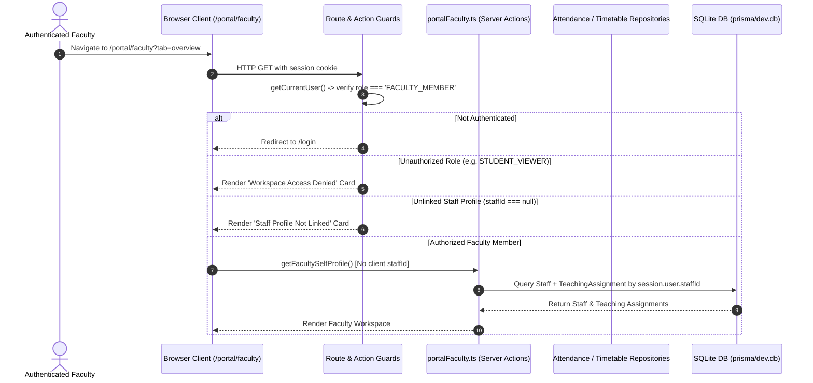

# CAMPUSOS — MILESTONE 2A.4, STAGE 3: FACULTY SELF-SERVICE PORTAL
## Technical Implementation Blueprint & Architecture Specification

**Project:** R.P. Institute of Hospitality & Management — CampusOS ERP  
**Repository:** `G:\rpihm-campusos`  
**Milestone:** 2A.4 — Student & Faculty Self-Service Portals  
**Stage:** Stage 3 — Faculty Self-Service Portal Implementation Blueprint  
**Author:** Lead Product & Systems Architecture Engineering  
**Date:** November 3, 2026  
**Status:** **ARCHITECTURE DISCOVERY APPROVED — WORKSTREAM 1 & WORKSTREAM 2 IMPLEMENTED & VERIFIED (80/80 + 69/69 TESTS PASSED)**  
**Latest Git Commit:** Workstream 2 In-Progress Verification  
**Operational Database:** Local SQLite (`prisma/dev.db`, SHA-256: `862154706b97a110ebe9efb48b96ed3c1b52eada538f6c1805eefe539dff8964`, 745,472 bytes — **100% Invariant, Zero Operational Mutations**)  
**Companion Discovery Report:** [`docs/PHASE_2A4_STAGE_3_FACULTY_PORTAL_DISCOVERY.md`](file:///g:/rpihm-campusos/docs/PHASE_2A4_STAGE_3_FACULTY_PORTAL_DISCOVERY.md)  

---

## 1. Executive Scope & Architecture Principles

### 1.1 Scope Definition
The Faculty Self-Service Portal (`/portal/faculty`) provides authenticated faculty members (`FACULTY_MEMBER`) with an integrated, secure, role-scoped workspace to manage daily academic operations.

#### Included in Scope
1. **Faculty Identity & Workload Console:** Personal profile, designation, department, employee ID, assigned workload hours, and summary of active teaching assignments.
2. **Assigned Classes & Class Directory:** Comprehensive listing of subjects and divisions assigned to the instructor, with active student counts and academic placement details.
3. **Faculty Weekly Schedule & Timetable Matrix:** Day-by-day (Monday to Saturday) class schedule showing time slots, subjects, rooms, session types (Theory/Practical Kitchen), and direct action links to record attendance.
4. **Class Roster & Student Directory:** Division-specific student lists (Roll Number, PRN, Full Name, Enrolment Status; strictly excluding gender, personal contact details, guardian PII, and financial records) restricted strictly to assigned classes.
5. **Daily Attendance Recording & Session Ledger:**
   - Interactive roll-call marking sheet for scheduled timetable slots or ad-hoc sessions.
   - Bulk actions (*"Mark All Present"*), individual status toggles (`PRESENT`, `ABSENT`, `LATE`, `EXCUSED`), topic covered field.
   - Dual-mode submission: Save as `DRAFT` (editable) or submit as `FINALIZED` (locks session).
   - Chronological ledger of past recorded attendance sessions with summary metrics.
6. **Assigned Subject Curriculum & Syllabus Dossier:** Academic specifications (credits, course hours, theory/practical classification) for assigned subjects.

#### Excluded from Scope
- **Hostel, Library, and Transport Modules:** Excluded by project mandate.
- **Administrative Staff Management:** Faculty cannot create, edit, or provision other faculty/staff accounts.
- **Financial & Fee Data:** Complete exclusion of student invoice and fee collection records.
- **Global Examination Publishing:** Faculty do not hold permission to publish institutional exam result sessions (`PUBLISH_RESULTS`).
- **Institutional Document Verification:** Verification of student identity credentials remains restricted to `ACADEMIC_ADMIN` and `SYSTEM_ADMIN`.

---

## 2. System Architecture & Session Derivation Dataflow



### 2.1 Core Architectural Invariant: Client ID Forgery Immunity
All faculty self-service server actions reside in a dedicated file: `src/lib/actions/portalFaculty.ts`.
- Every action calls `requireAuth()` first.
- The user role must be validated: `if (user.role !== "FACULTY_MEMBER") throw FORBIDDEN`.
- The target `staffId` is derived exclusively from `user.staffId`.
- Any `staffId` or `userId` supplied by the client payload is discarded.

---

## 3. Faculty User Journeys & Screen Specifications

### Tab 1: Profile & Teaching Workload (`tab=overview`)
- **Header Card:**
  - Initials Avatar with royal-blue/crimson styling.
  - Faculty Name, Employee ID (`Staff.employeeId`), Designation (`Staff.designation`).
  - Department Badge (`Department.name`), Category Badge (`Staff.category`).
  - Employment Type & Office Location (`Staff.officeLocation` or *"Main Campus"*).
- **KPI Metrics Strip:**
  - **Active Classes:** Count of distinct assigned subjects/divisions.
  - **Weekly Workload:** Prescribed weekly hours (`Staff.workloadHours` or sum of `weeklyHours`).
  - **Today's Classes:** Number of scheduled timetable slots for today's day of the week.
  - **Attendance Completion:** Sessions recorded vs. scheduled this week.
- **Today's Teaching Agenda:**
  - Chronological list of today's classes with room name, start/end time, and quick action button: `[Record Attendance]`.

### Tab 2: Assigned Classes & Class Directory (`tab=classes`)
- **Assigned Class Cards:**
  - Card per `TeachingAssignment`:
    - Subject Code & Title (e.g. `FP-101: Food Production I`).
    - Programme & Semester (e.g. `B.A. Culinary Arts • Semester 1`).
    - Division Badge (e.g. `Division A` or `Cohort-Wide`).
    - Enrolled Student Count: Dynamic count of active students in this division.
    - Weekly Prescribed Hours: (e.g. `4 Hours/Week`).
  - Action Buttons on Card:
    - `[View Student Roster]`: Opens slide-over/modal showing enrolled students.
    - `[Record Attendance]`: Navigates to attendance sheet for this class.
    - `[Subject Details]`: Displays course specifications.

### Tab 3: Weekly Timetable & Teaching Schedule (`tab=timetable`)
- **Matrix Layout (Monday to Saturday):**
  - Clean day-by-day column grid matching the established visual comfort standard.
  - Slot cards showing: Start & End time (`HH:mm`), Subject Code, Subject Title, Room (e.g. *"Basic Training Kitchen 1"*), Session Type (`THEORY` or `PRACTICAL_LAB`).
- **Direct Action Links:**
  - Hover or click on a timetable slot reveals: `[Launch Attendance Roll-Call]`.
- **Honest Empty State:**
  - When no timetable entries exist for the faculty member's teaching assignments:
    ```
    [Calendar Icon]
    No Class Schedule Published
    No weekly timetable slots have been scheduled for your teaching assignments yet.
    Published schedules from Academic Administration will appear here automatically.
    ```

### Tab 4: Attendance Recording & Session Ledger (`tab=attendance`)
- **Dual Mode View:**
  - **Mode A: Active Roll-Call Sheet:**
    - Header: Subject, Division, Date Picker (defaults to today), Start & End Time, Session Type (`THEORY`, `PRACTICAL_LAB`), Topic Covered Input.
    - Batch Controls: `[Mark All Present]`, `[Mark All Absent]`.
    - Student Roster Table: Roll Number, PRN, Student Name, Status Radios (`Present`, `Absent`, `Late`, `Excused`), Remarks input.
    - Submission Footer:
      - `[Save as Draft]`: Saves session with status `DRAFT`.
      - `[Finalize Attendance]`: Locks session with status `FINALIZED`.
  - **Mode B: Attendance Ledger & History:**
    - Filterable history table of past sessions recorded by this instructor.
    - Columns: Date, Subject, Division, Session Type, Topic Covered, Present/Total, Status Badge (`FINALIZED` in green, `DRAFT` in amber).
    - Row Click: Opens session detail breakdown.

### Tab 5: Subject Curriculum Specifications (`tab=curriculum`)
- **Course Dossier Cards:**
  - Code, Title, Credits (e.g. `4.0 Credits`).
  - Subject Type: `Theory` or `Practical Kitchen`.
  - Academic Term: Semester Number, Programme Code.
  - Assigned Instructor Notice: Lists the faculty member's formal institutional appointment.

---

## 4. Data & Permission Matrix

| Operation | SYSTEM_ADMIN | ACADEMIC_ADMIN | FACULTY_MEMBER | STUDENT_VIEWER | Enforcement Mechanism |
|---|:---:|:---:|:---:|:---:|---|
| **Access `/portal/faculty`** | Denied (403) | Denied (403) | **ALLOW** | Denied (403) | Server Route Guard (`user.role === 'FACULTY_MEMBER'`) |
| **View Self Profile & Workload** | N/A | N/A | **ALLOW** (Self) | Denied | `session.user.staffId === staff.id` |
| **View Assigned Timetable** | Full | Full | **ALLOW** (Self) | Denied | `teachingAssignment.staffId === session.user.staffId` |
| **View Assigned Class Roster** | Full | Full | **ALLOW** (Assigned) | Denied | `divisionId` matches `TeachingAssignment` |
| **View Unassigned Class Roster** | Full | Full | **DENIED** (403) | Denied | Server Action checks assignment existence |
| **Record Draft Attendance** | Full | Full | **ALLOW** (Assigned) | Denied | `recordAttendanceSessionAction` row check |
| **Finalize Attendance Session** | Full | Full | **ALLOW** (Self) | Denied | `session.facultyId === user.staffId` |
| **Amend Finalized Session** | **ALLOW** | **ALLOW** | **DENIED** (403) | Denied | Requires `EDIT_FINALIZED_ATTENDANCE` |
| **Access Administrative Finance** | **ALLOW** | **ALLOW** | **DENIED** (403) | Denied | `hasModuleAccess('finance') === false` |

---

## 5. Reusable Components & Design Tokens

### 5.1 Reusable Architecture Assets
- **Layout Shell:** [`AppShell.tsx`](file:///g:/rpihm-campusos/src/components/layout/AppShell.tsx) and [`TopBar.tsx`](file:///g:/rpihm-campusos/src/components/layout/TopBar.tsx).
- **Navigation Body:** [`Sidebar.tsx`](file:///g:/rpihm-campusos/src/components/layout/Sidebar.tsx) — add contextual branch:
  ```tsx
  {isFaculty ? (
    <nav className="space-y-1">
      <div className="px-3.5 text-xs font-bold uppercase tracking-wider text-slate-400 mb-2">
        FACULTY WORKSPACE
      </div>
      <Link href="/portal/faculty?tab=overview">Overview & Workload</Link>
      <Link href="/portal/faculty?tab=classes">Assigned Classes</Link>
      <Link href="/portal/faculty?tab=timetable">Weekly Schedule</Link>
      <Link href="/portal/faculty?tab=attendance">Attendance Console</Link>
      <Link href="/portal/faculty?tab=curriculum">Course Specifications</Link>
    </nav>
  ) : ...}
  ```
- **Design Tokens (`src/app/globals.css`):**
  - `--workspace-bg: #EDF2F7` (calm workspace background).
  - `--card-bg: #FBFDFE` (soft card surface).
  - `--card-surface: #F8FAFD`.
  - `--border-card: #D5DFEB`.
  - `--text-primary: #1E293B`, `--text-secondary: #475569`.
- **Shared UI Icons:** [`Icon.tsx`](file:///g:/rpihm-campusos/src/components/common/Icon.tsx) (`academic-cap`, `calendar`, `clipboard-check`, `users`, `book-open`, `clock`, `check-circle`, `x-circle`).
- **Repositories:**
  - `AttendanceRepository`: `recordAttendanceSession`, `getCohortForSession`, `getAttendanceSessions`, `finalizeSession`.
  - `TimetableRepository`: `getTimetable`.
  - `FacultyRepository`: `getStaffById`.

---

## 6. Implementation Workstreams & Acceptance Criteria

### Workstream 1: Dedicated Faculty Data Access Layer & Server Actions
- **Status:** **IMPLEMENTED & VERIFIED (80/80 Automated Assertions Passed — Awaiting Final Readiness Review)**
- **Deliverables:**
  - `src/lib/actions/portalFaculty.ts`: Exactly five read-only server actions:
    1. `getFacultySelfProfile()`: Resolves authenticated faculty profile, department, and computed workload metrics.
    2. `getFacultySelfTeachingAssignments()`: Returns active subject and division assignments.
    3. `getFacultySelfTimetable()`: Returns day-wise timetable slots strictly scoped to `user.staffId`.
    4. `getFacultyClassRoster(teachingAssignmentId)`: Returns enrolled students for an owned teaching assignment with strict privacy filtering.
    5. `getFacultyAttendanceSessions(filter)`: Returns historical attendance sessions conducted by the faculty member.
  - `scripts/test_m2a4_s3_workstream_1.ts`: 10-suite automated test asserting 80/80 boundaries against `prisma/isolated_test.db`.
- **Architectural Scope & Boundary:**
  - Attendance creation, draft amendment, and finalization mutations are strictly excluded from Workstream 1 and assigned to Workstream 5.
  - Zero client-supplied `staffId` acceptance; 100% session derivation.
  - Zero generic `READ_STUDENTS` bypass.

### Workstream 2: Faculty Workspace Route & Navigation Shell
- **Status:** **NOT STARTED (Ready for Authorization)**
- **Deliverables:**
  - `src/app/portal/faculty/page.tsx`: Server component with role guard (`user.role === 'FACULTY_MEMBER'`), unauthenticated redirect, and unlinked/inactive staff handling.
  - `src/components/layout/Sidebar.tsx`: Dedicated `FACULTY WORKSPACE` navigation branch suppressing administrative module links.
  - `src/app/page.tsx`: Automatic root-dashboard redirect for `FACULTY_MEMBER` users.
- **Acceptance Criteria:**
  - Unauthenticated access redirects to `/login`.
  - Non-faculty users accessing `/portal/faculty` receive `Workspace Access Denied`.
  - Unlinked faculty accounts receive informative instructions without leaking system details.
  - Navigation renders clean faculty-specific items without administrative noise.

### Workstream 3: Faculty Overview, Teaching Workload & Weekly Timetable
- **Status:** **NOT STARTED**
- **Deliverables:**
  - `src/components/modules/portal/FacultyPortalView.tsx`: Client container housing tab navigation and Visual Comfort styling.
  - Tab 1 UI (`overview`): Header card, KPI strip (active classes, weekly workload, today's schedule count), and today's agenda.
  - Tab 3 UI (`timetable`): 6-day matrix (Monday–Saturday) with time, subject, room, and session type.
  - Tab 5 UI (`curriculum`): Assigned course specifications (credits, theory/practical breakdown).
- **Acceptance Criteria:**
  - Workload metrics and agenda strictly reflect authenticated instructor's records.
  - Timetable displays honest neutral empty state when 0 entries exist.

### Workstream 4: Assigned Class Directory & Privacy-Masked Rosters
- **Status:** **NOT STARTED**
- **Deliverables:**
  - Tab 2 UI (`classes`): Card directory of assigned subjects, divisions, and active student counts.
  - Modal/Slide-Over: Enrolled student class roster.
- **Approved Roster Fields Strictly:**
  - Roll Number
  - PRN
  - Full Name
  - Academic Enrolment Status (`ENROLLED`)
- **Acceptance Criteria:**
  - Gender is strictly **excluded** from default rosters.
  - Personal contact details (phone, email), guardian PII, and financial records are strictly masked/omitted.
  - Unassigned class rosters cannot be viewed (returns `FORBIDDEN`).

### Workstream 5: Daily Attendance Roll-Call & Session Ledger
- **Status:** **NOT STARTED (Planned Attendance Mutations)**
- **Deliverables:**
  - `portalFaculty.ts`: Mutation actions `recordFacultyAttendanceSession(dto)` and `amendFacultyDraftAttendance(recordId, status, remarks)`.
  - Tab 4 UI (`attendance`): Interactive roll-call marking sheet, batch toggles (`Mark All Present`), topic covered input.
  - Dual-action controls: Save as `DRAFT` (editable) vs. `FINALIZED` (locks session).
  - Historical session ledger table with draft resumption.
- **Acceptance Criteria:**
  - Attempting to record attendance for an unassigned class returns `UNASSIGNED_CLASS_ACCESS_DENIED`.
  - Duplicate recording for the same timetable slot on the same date is blocked.
  - Finalized sessions lock immediately against further faculty modification.

### Workstream 6: Automated Quality Gates & Real Browser Verification
- **Status:** **NOT STARTED**
- **Deliverables:**
  - Automated regression suite (`scripts/test_faculty_portal_boundaries.ts`).
  - Headless Edge verification orchestrator (`scripts/run_browser_verification_m2a4_s3.ts`) capturing desktop and mobile screenshots.
  - Quality gate verification (`npx tsc --noEmit`, `npm run lint`, `npm run build`, DB hash check).
- **Acceptance Criteria:**
  - 100% database invariance for `prisma/dev.db`.
  - 0 TypeScript errors, 0 ESLint errors, clean production build.

---

## 7. Desktop & Mobile UX Direction

### 7.1 Desktop Layout (1440 × 900)
- **Top Header:** Slim TopBar with institutional brand, active academic year (`2026 – 27`), notifications, and faculty profile badge.
- **Main Canvas:**
  - Persistent tab navigation bar with visual active indicator.
  - Responsive multi-column grid (2-column layout for Overview; 6-column matrix for Timetable; 3-column card grid for Classes).
  - Modals render centered with soft backdrops, avoiding pure-white glare.

### 7.2 Mobile Responsive Layout (390 × 844)
- **Navigation:** Hamburger menu slide-out with dark navy sidebar.
- **Tabs:** Horizontally scrollable pill-tab slider.
- **Timetable:** Collapsible day-by-day accordion (e.g. today expanded by default).
- **Attendance Sheet:** Sticky header showing student counter (`Present: 28 / 32`), stacked roll-call rows with large touch-friendly status radio pills.

---

## 8. Verification & Testing Strategy

### 8.1 Invariance & Isolation Guarantees
- **Operational Database (`prisma/dev.db`):** 100% invariant. SHA-256 hash verified before and after test execution.
- **Isolated Testing Database (`prisma/isolated_test.db`):** All automated tests, role tests, and fixture setups execute strictly with `DATABASE_URL="file:./isolated_test.db"` and `APP_ENV=test`.

### 8.2 Automated Test Suites Planned
1. **`scripts/test_faculty_portal_boundaries.ts`:**
   - Unauthenticated access enforcement (`UNAUTHORIZED`).
   - Non-faculty role denial (`FORBIDDEN` for `STUDENT_VIEWER`, `SYSTEM_ADMIN`, `ACADEMIC_ADMIN`).
   - Unlinked staff account handling (`UNLINKED_STAFF`).
   - Session-derived profile retrieval without client IDs.
   - Timetable query isolation (Faculty A cannot view Faculty B schedule).
   - Class roster isolation (Faculty A cannot view unassigned division students).
   - Attendance recording authorization (Faculty A cannot record for Faculty B).
   - Finalized attendance edit lock enforcement.
2. **`scripts/run_browser_verification_m2a4_s3.ts`:**
   - Real headless Edge CDP test journey capturing 10 high-resolution screenshots.
   - DOM computation checks for visual comfort classes.

---

## 9. Implementation Sequence & Current Status

```
Workstream 1: Data Access Layer & Server Actions [IMPLEMENTED & VERIFIED — 80/80 TESTS PASSED]
├── 1.1 Create src/lib/actions/portalFaculty.ts (5 read actions)
├── 1.2 Implement strict session derivation & IDOR protections
└── 1.3 Validate across 10-suite test suite (scripts/test_m2a4_s3_workstream_1.ts)

Workstream 2: Faculty Workspace Route, Navigation Shell & Read-Only Interface [IMPLEMENTED & VERIFIED — 69/69 TESTS PASSED]
├── 2.1 Implement src/app/portal/faculty/page.tsx (Guards, unlinked & inactive states, Suspense)
├── 2.2 Update src/components/layout/Sidebar.tsx (FACULTY WORKSPACE contextual navigation, module suppression)
├── 2.3 Implement root redirect for FACULTY_MEMBER in src/app/page.tsx
├── 2.4 Implement src/components/modules/portal/FacultyPortalView.tsx (6 Tabs: Overview, Classes, Timetable, Rosters, Attendance, Curriculum)
├── 2.5 Enforce FERPA roster privacy (Roll, PRN, Name, Enrolment Status only; zero contact/guardian PII)
└── 2.6 Execute scripts/test_m2a4_s3_workstream_2.ts (69/69 passed, 100% dev.db hash invariance)

Workstream 3: Daily Attendance Roll-Call & Session Ledger Mutations [NOT STARTED — PLANNED MUTATIONS]
├── 3.1 Add recordFacultyAttendanceSession & amendFacultyDraftAttendance to portalFaculty.ts
├── 3.2 Implement Interactive Roll-Call Sheet, Mark All Present, Topic Input
└── 3.3 Implement Draft & Finalized Session Ledger with resumption controls
```

---

## 10. Summary & Sign-Off Request

This blueprint defines a complete, hardened, and visually comfortable Faculty Self-Service Portal that:
- Natively reuses 100% of existing Prisma models with **zero schema migrations**.
- Implements strict assignment-based authorization boundaries.
- Preserves the operational database state.
- Adheres to CampusOS visual comfort standards.

**Engineering awaits explicit authorization before writing implementation code.**
