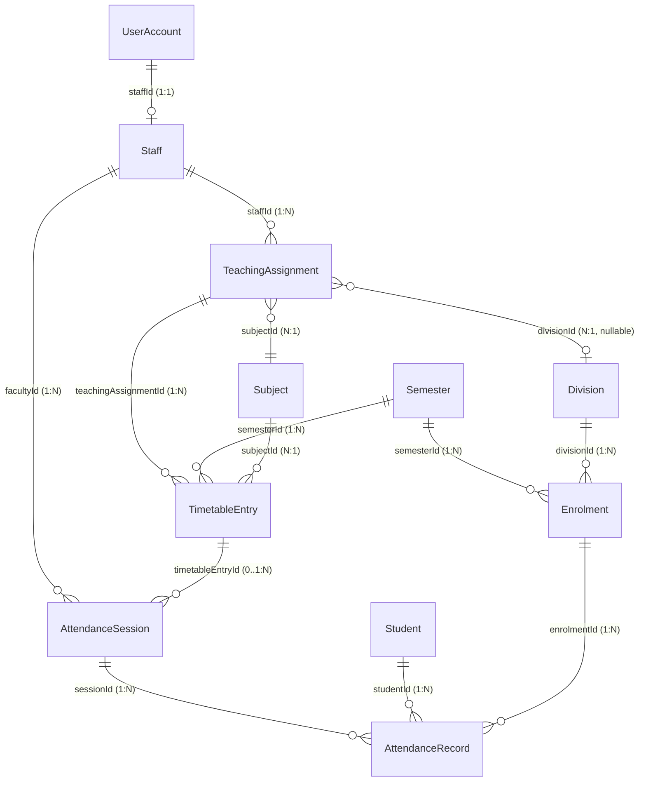

# CAMPUSOS — MILESTONE 2A.4, STAGE 3: FACULTY SELF-SERVICE PORTAL
## Architecture Discovery & Baseline Investigation Report

**Project:** R.P. Institute of Hospitality & Management — CampusOS ERP  
**Repository:** `G:\rpihm-campusos`  
**Milestone:** 2A.4 — Student & Faculty Self-Service Portals  
**Stage:** Stage 3 — Faculty Self-Service Portal Architecture Discovery  
**Author:** Lead Product & Systems Architecture Engineering  
**Date:** November 2, 2026  
**Status:** **DISCOVERY & AUDIT COMPLETE — AWAITING STAKEHOLDER APPROVAL**  

---

## 1. Executive Summary & Governance Mandate

With the formal verification, post-implementation remediation, and closure of Milestone 2A.4 Stage 2 (Student Self-Service Portal), engineering focus advances to **Stage 3: Faculty Self-Service Portal**.

### Core Governance Objectives
1. **Zero Schema Mutations:** Reuse existing Prisma schema models and relational linkages. No destructive migrations, table modifications, or database resets.
2. **Session-Bound Identity Derivation:** Faculty self-service must derive the authenticated staff identity unconditionally from verified server session cookies (`Session -> UserAccount -> Staff`). Client-supplied `staffId` parameters must be rejected.
3. **Strict Teaching Assignment Boundaries:** A faculty member must access only data, classes, divisions, timetables, and attendance sheets for which they possess explicit teaching assignments (`TeachingAssignment`).
4. **Preservation of Operational Data:** All operational records in `prisma/dev.db` remain 100% invariant. All automated testing and fixture setup must execute against `prisma/isolated_test.db`.
5. **Visual Comfort Continuity:** The interface must inherit the calibrated visual comfort design system established in Stage 2 (`--workspace-bg: #EDF2F7`, `--card-bg: #FBFDFE`, `--border-card: #D5DFEB`, dark navy `#0B1528` navigation, and royal-blue/crimson identity).

---

## 2. Existing Architecture & Faculty Identity Audit

### 2.1 Prisma Schema & Data Model Analysis
An inspection of `prisma/schema.prisma` confirms the relational foundation for faculty operations is already fully established:



#### Detailed Model Specifications
1. **`Staff` Model (`prisma/schema.prisma:165-190`):**
   - Core Fields: `id`, `employeeId` (unique, e.g. `RPIHM-FAC-001`), `fullName`, `email`, `phone`, `designation` (e.g. *"Executive Chef Instructor"*), `category` (`TEACHING`, `TECHNICAL`, `ADMINISTRATIVE`), `status` (`ACTIVE`, `ON_LEAVE`), `dateOfJoining`.
   - Academic Attributes: `qualification`, `specialization`, `officeLocation`, `workloadHours`, `employmentType`.
   - Relations: `department` (`Department`), `userAccount` (`UserAccount?`), `teachingAssignments` (`TeachingAssignment[]`), `AttendanceSession` (`AttendanceSession[]`).
2. **`TeachingAssignment` Model (`prisma/schema.prisma:222-239`):**
   - Core Fields: `id`, `staffId`, `subjectId`, `divisionId` (nullable — `null` denotes cohort-wide lecture, whereas a UUID denotes a specific laboratory or division batch), `weeklyHours`.
   - Uniqueness Constraint: `@@unique([staffId, subjectId, divisionId])`.
   - Relational Linkages: Points to `Subject` (which references `Semester` & `Programme`), `Division`, and `TimetableEntry[]`.
3. **`UserAccount` Model (`prisma/schema.prisma:244-274`):**
   - Core Fields: `id`, `email`, `role` (`FACULTY_MEMBER`), `fullName`, `isActive`.
   - Identity Foreign Keys: `staffId` (`String? @unique`), `studentId` (`String? @unique`).
   - Audit Foreign Keys: `recordedAttendanceSessions` (`AttendanceSession[]`), `amendedAttendanceSessions` (`AttendanceSession[]`), `amendedAttendanceRecords` (`AttendanceRecord[]`).
4. **`TimetableEntry` Model (`prisma/schema.prisma:296-321`):**
   - Core Fields: `id`, `semesterId`, `divisionId` (nullable), `subjectId`, `teachingAssignmentId`, `dayOfWeek` (`MONDAY`..`SATURDAY`), `startTime` (`HH:mm`), `endTime` (`HH:mm`), `room`, `sessionType` (`THEORY`, `PRACTICAL_LAB`, `TUTORIAL`), `status` (`ACTIVE`, `CANCELLED`).
5. **`AttendanceSession` Model (`prisma/schema.prisma:323-359`):**
   - Core Fields: `id`, `timetableEntryId` (nullable for ad-hoc sessions), `semesterId`, `divisionId`, `subjectId`, `facultyId` (points to `Staff`), `sessionDate` (`DateTime`), `startTime`, `endTime`, `sessionType`, `status` (`DRAFT`, `FINALIZED`, `CANCELLED`), `topicCovered`, `recordedById`.
   - Uniqueness Constraint: `@@unique([timetableEntryId, sessionDate])`.
6. **`AttendanceRecord` Model (`prisma/schema.prisma:360-380`):**
   - Core Fields: `id`, `sessionId`, `studentId`, `enrolmentId`, `status` (`PRESENT`, `ABSENT`, `LATE`, `EXCUSED`), `remarks`, `markedAt`.

---

## 3. Current Faculty Access vs. Genuine Gaps

### 3.1 What an Authenticated `FACULTY_MEMBER` Can Access Today
An inspection of `src/lib/auth/roles.ts`, `guards.ts`, and `Sidebar.tsx` reveals the current access posture for `FACULTY_MEMBER`:

| Surface / Action | Current Behavior | Access Evaluation |
|---|---|---|
| **`/portal/student`** | Blocked with HTTP 403 / *"Workspace Access Denied"* card. | **Correct.** Faculty must never access student self-service. |
| **`/portal/faculty`** | Returns **HTTP 404** (route does not exist). | **Critical Gap.** No dedicated faculty self-service entrypoint exists. |
| **`Sidebar.tsx` Navigation** | Renders full administrative menu (`/`, `/modules/students`, `/modules/academics`, `/modules/attendance`, etc.). | **Critical Gap.** Exposes raw administrative modules rather than faculty workflows. |
| **`/modules/students`** | Renders full administrative student table across all programmes and years. | **Porous Boundary.** Faculty can inspect students outside their teaching assignments. |
| **`/modules/faculty`** | Renders staff administration console (create/edit/delete staff, manage provisioning). | **Porous Boundary.** Regular faculty should not manage staff credentials or salary workload records. |
| **`/modules/finance`** | Blocked with `Access Restricted` card (`VIEW_FEES` missing). | **Correct.** Faculty have zero financial access. |
| **`/modules/attendance`** | Renders administrative multi-step picker across all programmes. | **Functional Mismatch.** Forces faculty through an administrative workflow rather than a direct personal agenda. |
| **`getTimetableAction`** | Accepts client-supplied `{ staffId }` without enforcing server session equality. | **Security Gap.** Allows faculty to query schedules of other faculty members via parameter tampering. |

### 3.2 Genuinely Missing Components
1. **Dedicated Route:** `/portal/faculty` with search-param tab navigation (`tab=overview`, `tab=classes`, `tab=timetable`, `tab=attendance`, `tab=curriculum`).
2. **Session-Derived Server Actions:** `src/lib/actions/portalFaculty.ts` providing hardened endpoints that derive `staffId` strictly from `requireAuth()`:
   - `getFacultySelfProfile()`
   - `getFacultySelfTeachingAssignments()`
   - `getFacultySelfTimetable()`
   - `getFacultyClassRoster(teachingAssignmentId)`
   - `getFacultyAttendanceSessions(filter)`
   - `recordFacultyAttendanceSession(dto)`
3. **Faculty Workspace UI:** `src/components/modules/portal/FacultyPortalView.tsx` structured into cohesive, role-tailored self-service tabs.
4. **Contextual Sidebar:** `Sidebar.tsx` branch rendering `FACULTY WORKSPACE` when `user.role === "FACULTY_MEMBER"`.

---

## 4. Detailed Functional Analysis Across 5 Core Workstreams

### Workstream A: Faculty Profile, Assigned Classes & Workload Overview
- **Objective:** Provide a centralized identity header and summary of teaching responsibilities.
- **Available Data:** `Staff.fullName`, `Staff.employeeId`, `Staff.designation`, `Staff.category`, `Staff.workloadHours`, `Department.name`, count of active teaching assignments, count of scheduled lectures today.
- **Access Rule:** Strict lock to authenticated `session.user.staffId`. If unlinked (`staffId === null`), render a graceful *"Staff Profile Not Linked"* card with instructions to contact the Academic Dean/Administrator.

### Workstream B: Faculty Weekly Timetable & Teaching Schedule
- **Objective:** Day-wise matrix (Monday to Saturday) showing scheduled classes, rooms, session types, and start/end times.
- **Available Data:** `TimetableEntry` joined through `TeachingAssignment` where `staffId === user.staffId`.
- **Access Rule:** Faculty can view only their own scheduled teaching slots. If no timetable entries exist, render an honest, neutral empty state: *"No class schedule has been published for your teaching assignments yet."*

### Workstream C: Assigned Division Student Lists & Class Rosters
- **Objective:** Enable faculty to view student lists for their assigned divisions and subjects.
- **Available Data:** `Enrolment` records where:
  - `semesterId === teachingAssignment.subject.semesterId`
  - `divisionId === teachingAssignment.divisionId` (or cohort-wide if `divisionId === null`)
  - `status === "ENROLLED"`
- **Student Data Displayed:** Roll Number, PRN, Full Name, Gender, Active Enrolment Status.
- **Access Rule:** Faculty are strictly forbidden from viewing student rosters for unassigned subjects or divisions. Cross-division browsing is rejected with `FORBIDDEN`.

### Workstream D: Session-Bound Attendance Recording & Ledger
- **Objective:** Provide daily attendance roll-call marking, draft saving, and session finalization.
- **Available Data:** `AttendanceSession` and `AttendanceRecord` joined with `TimetableEntry` and `Staff`.
- **Workflow Steps:**
  1. Faculty selects an assigned class slot (or clicks *"Record Today's Class"*).
  2. The system retrieves the active cohort roster for that specific semester and division.
  3. Faculty marks individual attendance (`PRESENT`, `ABSENT`, `LATE`, `EXCUSED`).
  4. Quick controls: *"Mark All Present"*, individual toggle buttons.
  5. Save as `DRAFT` (allows subsequent editing before lock) or `FINALIZED` (locks session).
- **Access Rule:** Faculty can only record attendance for classes matching their active `TeachingAssignment`. Marking attendance for another instructor's class is rejected with `UNASSIGNED_CLASS_ACCESS_DENIED`.

### Workstream E: Assigned Subject Curriculum & Syllabus Details
- **Objective:** Reference view of course details for assigned teaching subjects.
- **Available Data:** `Subject.code`, `Subject.title`, `Subject.credits`, `Subject.subjectType` (`THEORY`, `PRACTICAL_KITCHEN`), `Semester.semesterNumber`, `Programme.name`.
- **Access Rule:** Restricted to subjects present in the faculty member's `TeachingAssignment[]`.

---

## 5. Classification: Existing vs. Missing vs. Policy Decisions

```
┌─────────────────────────────────────────────────────────────────────────────┐
│                              FUNCTIONALITY STATUS                           │
├────────────────────────────────┬───────────────────────────┬────────────────┤
│ 1. EXISTING & REUSABLE         │ 2. MISSING (TO IMPLEMENT) │ 3. POLICY      │
├────────────────────────────────┼───────────────────────────┼────────────────┤
│ • Staff & Assignment Schema    │ • /portal/faculty Route   │ • Ad-Hoc Class │
│ • Timetable overlap math       │ • portalFaculty.ts DAL    │   Recording    │
│ • Attendance transaction logic │ • FacultyPortalView.tsx   │ • Finalization │
│ • Visual Comfort CSS tokens    │ • Faculty Sidebar Menu    │   Grace Window │
│ • AppShell & TopBar Layout     │ • Class Roster Modal      │ • Guardian PII │
│ • Role Guard infrastructure    │ • Assigned Timetable Grid │   Masking      │
└────────────────────────────────┴───────────────────────────┴────────────────┘
```

### Detailed Breakdown

#### 1. Existing & Reusable Architecture
- `Staff`, `TeachingAssignment`, `TimetableEntry`, `AttendanceSession`, and `AttendanceRecord` Prisma models.
- Transactional attendance insertion in `AttendanceRepository.recordAttendanceSession` (duplicate prevention, cohort cross-check).
- Visual Comfort tokens (`--workspace-bg`, `--card-bg`, `--border-card`) and shared icons (`Icon.tsx`).

#### 2. Genuinely Missing (To Implement in Stage 3)
- **`src/app/portal/faculty/page.tsx`:** Dedicated route with server-side authentication, role guard (`FACULTY_MEMBER`), and unlinked profile handling.
- **`src/lib/actions/portalFaculty.ts`:** Dedicated server actions deriving identity exclusively from the session.
- **`src/components/modules/portal/FacultyPortalView.tsx`:** Modern, visual-comfort compliant client component featuring tabbed navigation:
  - Tab 1: Profile & Teaching Workload
  - Tab 2: Assigned Classes & Class Directory
  - Tab 3: Weekly Timetable & Daily Schedule
  - Tab 4: Attendance Recording & Past Sessions Ledger
  - Tab 5: Subject Curriculum Specifications
- **`Sidebar.tsx` Update:** Render dedicated `FACULTY WORKSPACE` navigation for `FACULTY_MEMBER`.

#### 3. Institutional Policy Decisions Required
Prior to implementation, the following operational boundaries must be confirmed:
1. **Ad-Hoc Session Recording:**
   - *Question:* Should faculty be permitted to record attendance for unscheduled sessions (e.g. extra makeup lectures, kitchen practical extensions) that lack a pre-configured `TimetableEntry`?
   - *Architectural Capability:* The database schema allows `timetableEntryId: null` on `AttendanceSession`.
   - *Recommendation:* Permit ad-hoc session recording strictly for assigned `subjectId` + `divisionId`, requiring faculty to input session date, start/end time, and topic covered.
2. **Attendance Finalization & Amendment Grace Window:**
   - *Question:* Can a faculty member amend a `FINALIZED` attendance session, or does finalization permanently lock the record to administrative-only edits?
   - *Architectural Reality:* `AttendanceRepository.amendAttendanceRecord` currently requires `EDIT_FINALIZED_ATTENDANCE` (held only by `SYSTEM_ADMIN` and `ACADEMIC_ADMIN`) once a session is `FINALIZED`. Draft sessions can be edited freely by the assigned faculty.
   - *Recommendation:* Preserve this strict rule. Faculty may save as `DRAFT` during class and verify before clicking `FINALIZED`. Once finalized, modifications require an administrative change request to ensure audit integrity.
3. **Student Profile Data Masking:**
   - *Question:* Should faculty see student guardian contact details and financial invoice status?
   - *Recommendation:* Strictly mask guardian phone numbers and fee payment records. Faculty only require: Full Name, Roll Number, PRN, Academic Enrolment Status, and attendance history in their class.

---

## 6. Schema Invariance & Database Preservation Assessment

A thorough foreign-key and table audit confirms:
- **Zero Schema Alterations:** Every required relationship is already modeled in `prisma/schema.prisma`.
- **Zero Database Migrations:** No migration files or schema pushes are needed.
- **Zero Invalidation of Dev Database:** The operational baseline (`prisma/dev.db`) will remain untouched during development and verification. All automated test suites will execute strictly against `prisma/isolated_test.db`.

---

## 7. Security Boundaries, Dependencies & Migration Risks

### 7.1 Security Boundaries
1. **Client ID Forgery Immunity:** `portalFaculty.ts` must ignore any client-supplied `staffId`. Identity must be extracted strictly from `session.user.staffId`.
2. **Cross-Faculty Tampering Defense:** A faculty member attempting to query class rosters, schedules, or attendance sessions for a `teachingAssignmentId` not belonging to them must receive `FORBIDDEN`.
3. **Student Record Access Limitation:** Faculty accessing student data must be restricted to students actively enrolled in their assigned division and semester.
4. **Administrative Module Isolation:** Faculty navigating to `/modules/finance`, `/modules/settings`, or `/modules/reports` must continue to be blocked by `hasModuleAccess`.

### 7.2 Dependencies
- Next.js Server Actions with `"use server"` and `connection()` boundary.
- Prisma Client with SQLite relations.
- Existing `AppShell` and `TopBar` components.
- Visual Comfort tokens in `src/app/globals.css`.

---

## 8. Summary & Approval Request

This discovery report demonstrates that:
1. The existing CampusOS relational schema natively supports all faculty self-service requirements without migrations.
2. Clear security boundaries can be established by introducing dedicated, session-derived server actions.
3. A cohesive user experience can be delivered by following the proven blueprint of the Student Portal.

Engineering awaits formal approval of this discovery and the accompanying blueprint before proceeding to implementation.
