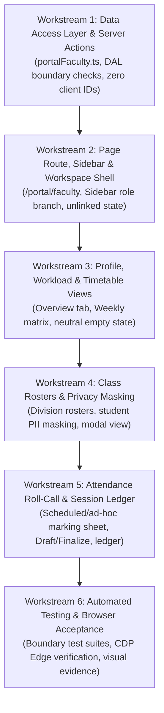

# CAMPUSOS — MILESTONE 2A.4, STAGE 3: FACULTY SELF-SERVICE PORTAL
## Architecture Discovery, Baseline Assessment & Implementation Plan
**Document Classification:** Architectural Assessment & Implementation Deliverable  
**Current Status:** **PROPOSED ARCHITECTURE & SCOPE DISCOVERY — STRICTLY NO CODE IMPLEMENTED — AWAITING STAKEHOLDER APPROVAL**  
**Author:** Antigravity Systems & Product Engineering  
**Project:** R.P. Institute of Hospitality & Management (CampusOS ERP)  
**Date:** November 3, 2026  
**Baseline Git Commit:** [`34aaa4374d8b12303ff03c3a6ed5c6246c016d96`](file:///g:/rpihm-campusos/AGENTS.md)  
**Operational Database:** Local SQLite (`prisma/dev.db`, SHA-256: `415b64ac68f85d57e32b5aa5f5323cefdb2986d5c44a75e1a4f4e53f153fb3d8`, 745,472 bytes — 100% Invariant, Read-Only Audit)

---

## 1. Executive Summary

Following the formal verification, browser acceptance, and closure of Milestone 2A.4 Stage 2 (Student Self-Service Portal), this deliverable provides the comprehensive technical discovery, architecture audit, and implementation plan for **Milestone 2A.4 Stage 3: Faculty Self-Service Portal**.

### Core Findings & Principles
1. **Zero Database Mutations:** The existing Prisma schema (`prisma/schema.prisma`) already natively models every entity required for faculty operations (`Staff`, `TeachingAssignment`, `TimetableEntry`, `AttendanceSession`, `AttendanceRecord`, `Subject`, `Division`, `Semester`, `Enrolment`). **Zero database schema modifications, zero migrations, and zero database writes are required.**
2. **Session-Derived Faculty Identity:** All proposed faculty actions strictly derive faculty identity on the server from the authenticated session token (`Session -> UserAccount.staffId -> Staff`). Browser-supplied identifiers (`staffId`, `facultyId`, `divisionId`, `assignmentId`) are unconditionally untrusted and discarded.
3. **Teaching Assignment Ownership Boundaries:** Access to student rosters, class schedules, attendance marking sheets, and subject curricula is strictly governed by the instructor's explicit `TeachingAssignment` records. Cross-division and cross-faculty peeking are rejected at the data-access tier (`403 FORBIDDEN`).
4. **Separation of Operational Data vs. Isolated Testing:** The operational database `prisma/dev.db` remains 100% invariant throughout discovery. All future automated tests and headless browser verifications must execute strictly against `prisma/isolated_test.db` with synthetic test fixtures.
5. **No Invented Policies:** Unresolved institutional governance questions (such as unverified attendance benchmarks, finalization grace windows, and ad-hoc class policies) are explicitly documented as decisions requiring administrative approval rather than assumed as implemented features.

---

## 2. Current Architecture & Implementation Evidence (Empirical Audit)

A rigorous read-only empirical query of `prisma/dev.db` and inspection of application source code was conducted on November 3, 2026. The empirical findings are contrasted against documented assumptions below:

### 2.1 Operational Database Audit (`prisma/dev.db`)

| Entity / Dimension | Empirical Finding | Architectural Significance |
| :--- | :--- | :--- |
| **`UserAccount` (Total)** | **Exactly 2 accounts** (`admin.local@sample.rpihm.ac.in` [`SYSTEM_ADMIN`] and `k.sharma@sample.rpihm.ac.in` [`ACADEMIC_ADMIN`]). | Zero student viewer or faculty member accounts currently exist in `dev.db`. |
| **`UserAccount` (`role: FACULTY_MEMBER`)** | **0 accounts**. | No operational users currently hold the `FACULTY_MEMBER` role. Mass onboarding is deferred to Milestone 2B. Stage 3 development must utilize isolated test fixtures in `prisma/isolated_test.db`. |
| **`Staff` Records** | **13 staff profiles** across Culinary Arts (`CUL`) and Technology & Computing (`TC`). | Foundational faculty directory is established. |
| **Staff-to-User Linkages** | **1 linkage** (`k.sharma` linked to `Staff` ID `0f277036...` [Khushali Sharma]). 12 staff profiles currently have `userAccount === null`. | Unlinked faculty profiles must be handled gracefully in UI with a structured "Staff Profile Not Linked" state. |
| **`TeachingAssignment`** | **5 active assignments** across 4 faculty members and 2 departments. | Details below. |
| **Assignment Division Scoping** | All 5 assignments have non-null `divisionId` (4 assigned to `Div A`, 1 to `Div B`). | The schema supports nullable `divisionId` (`null` denotes cohort-wide lectures). Existing DB records are division-specific. |
| **`TimetableEntry`** | **0 records**. | Exactly like the Student Portal in Stage 2, the operational database currently has 0 timetable entries. The portal UI must render an honest, neutral empty state without schedule fabrication or arbitrary fallback. |
| **`AttendanceSession`** | **1 record** (Status: `FINALIZED`, Subject: `AI-101`, Faculty: `86951ea0...` [Prof. Snehal Kulkarni], Date: `2026-10-07`). | Existing prototype session. |
| **`AttendanceRecord`** | **2 records** linked to the finalized session above. | Existing prototype records. |

### 2.2 Active Teaching Assignments in `prisma/dev.db`

1. **Chef Vikramaditya Kapoor** (`RPIHM-FAC-012`): `FP-101` (Classical Culinary Foundation, 6 hrs/wk) $\to$ **Div A**
2. **Prof. Sneha Pillai** (`RPIHM-FAC-024`): `FBM-101` (F&B Service Techniques, 4 hrs/wk) $\to$ **Div B**
3. **Prof. Snehal Kulkarni** (`RPIHM-FAC-045`): `AI-101` (Python for AI & Data Science, 4 hrs/wk) $\to$ **Div A**
4. **Chef Laurent Deschanel** (`RPIHM-FAC-059`): `BAK-101` (French Viennoiserie & Artisan Breads, 6 hrs/wk) $\to$ **Div A**
5. **Khushali Sharma** (`RPIHM-FAC-999`): `AI-101` (Python for AI & Data Science, 4 hrs/wk) $\to$ **Div B**

### 2.3 Existing Faculty Access Posture (Code Review)

- **Route `/portal/faculty`:** Currently returns **HTTP 404** (route does not exist).
- **Route `/portal/student`:** Authenticated `FACULTY_MEMBER` is blocked with HTTP 403 (*"Workspace Access Denied"* card).
- **Navigation (`src/components/layout/Sidebar.tsx:28-34`):** When `currentUser.role === "FACULTY_MEMBER"`, `isStudent` evaluates to false, causing the sidebar to fall back to the administrative navigation (`mainModules` and `systemModules`), exposing raw administrative links (`/modules/students`, `/modules/attendance`, etc.).
- **Module Guard (`src/lib/auth/roles.ts:128-133`):**
  - `/modules/finance`: Blocked (`VIEW_FEES` required).
  - `/modules/settings`: Blocked (`ADMIN_ALL` required).
  - `/modules/students`: Allowed because `READ_STUDENTS` is in `FACULTY_MEMBER`. This is a porous administrative boundary that Stage 3 must replace with a dedicated `/portal/faculty` workspace.
- **Server Action `getTimetableAction` (`src/lib/actions/timetable.ts:12-16`):** Accepts an unvalidated client-supplied `filter: TimetableFilter`. If a faculty member supplies `{ staffId: "other-id" }`, it returns another instructor's schedule. This security gap must be avoided in the self-service portal by introducing dedicated session-locked actions.

---

## 3. Existing Functionality That Can Be Reused

The CampusOS codebase contains rich, battle-tested foundations that will be directly reused without modification or duplication:

| Subsystem / Layer | Existing Reusable Artifact | Exact Location | Reusability Scope & Mechanism |
| :--- | :--- | :--- | :--- |
| **Prisma Models** | `Staff`, `TeachingAssignment`, `TimetableEntry`, `AttendanceSession`, `AttendanceRecord`, `Subject`, `Division`, `Enrolment` | [`prisma/schema.prisma`](file:///g:/rpihm-campusos/prisma/schema.prisma) | 100% reusable as-is. Full foreign-key and relational structure already in place. Zero migrations needed. |
| **Attendance DAL** | `AttendanceRepository.recordAttendanceSession` | [`src/lib/dal/attendanceRepository.ts:103-294`](file:///g:/rpihm-campusos/src/lib/dal/attendanceRepository.ts) | Implements atomic multi-record insertion, duplicate session detection (both scheduled and ad-hoc), cohort cross-validation, DRAFT updates, and FINALIZED rate recalculation. |
| **Cohort Roster DAL** | `AttendanceRepository.getCohortForSession` | [`src/lib/dal/attendanceRepository.ts:51-98`](file:///g:/rpihm-campusos/src/lib/dal/attendanceRepository.ts) | Retrieves active enrolled cohort for a semester and division, ordered by roll number. |
| **Faculty Profile DAL**| `FacultyRepository.getStaffById` | [`src/lib/dal/facultyRepository.ts:128-169`](file:///g:/rpihm-campusos/src/lib/dal/facultyRepository.ts) | Queries staff record with department and teaching assignment relations. |
| **Timetable DAL** | `TimetableRepository.getTimetable` | [`src/lib/dal/timetableRepository.ts:52-115`](file:///g:/rpihm-campusos/src/lib/dal/timetableRepository.ts) | Supports filtering by `staffId` through `teachingAssignment.staffId`. |
| **Row-Level Guard Logic** | `recordAttendanceSessionAction` | [`src/lib/actions/attendance.ts:24-51`](file:///g:/rpihm-campusos/src/lib/actions/attendance.ts) | Contains existing row-level verification that faculty can only record attendance for classes they are assigned to via `TeachingAssignment`. |
| **Session Authentication** | `requireAuth()`, `requirePermission()` | [`src/lib/auth/guards.ts`](file:///g:/rpihm-campusos/src/lib/auth/guards.ts) | Hardened cookie verification, session rotation checks, and role validation. |
| **Visual Comfort Design System** | AppShell, TopBar, Icon, CSS variables | [`src/app/globals.css`](file:///g:/rpihm-campusos/src/app/globals.css), [`Icon.tsx`](file:///g:/rpihm-campusos/src/components/common/Icon.tsx) | Calibrated color tokens (`#0B1528`, `#1657D9`, `#EDF2F7`, `#FBFDFE`, `#D5DFEB`) and typography proven in Stage 2. |

---

## 4. Proposed Faculty Portal Capabilities *(PROPOSED / NOT IMPLEMENTED)*

The proposed Faculty Self-Service Portal (`/portal/faculty`) is structured into five distinct, role-tailored workspaces accessible via client-side search-param tabs (`?tab=`):

```
                                 /portal/faculty
                                        │
    ┌───────────────────┬───────────────┴───────────────┬───────────────────┐
    ▼                   ▼                               ▼                   ▼
Tab 1: overview    Tab 2: classes                  Tab 3: timetable    Tab 4: attendance   Tab 5: curriculum
Profile, Workload  Assigned Classes, Student Lists Weekly Matrix,      Session Roll-Call,  Course Specs,
& Today's Agenda   (Strict Division Scoping)       Daily Schedule      Draft & Finalized   Credits & Hours
```

### Capability A: Faculty Dashboard & Workload Overview (`tab=overview`)
- **Profile Header Card:** Faculty full name, employee code (`RPIHM-FAC-xxx`), official designation, department name, office location, employment type, and category badge.
- **Teaching Workload KPIs:**
  - Active Courses: Distinct count of assigned subjects.
  - Assigned Divisions: Count of distinct division batches.
  - Weekly Teaching Hours: Prescribed contractual hours vs. scheduled timetable hours.
  - Today's Classes Count: Scheduled sessions for the current day of the week.
- **Today's Class Agenda:** Chronological list of today's scheduled classes with subject code, room, start/end time, and quick-action link to roll call (`[Record Attendance]`).
- **Empty State:** If no classes are scheduled for today, render: *"No teaching sessions scheduled for today."*

### Capability B: Teaching Assignments & Student Rosters (`tab=classes`)
- **Assigned Class Cards:** Displays each active `TeachingAssignment` held by the instructor:
  - Subject Code & Title (e.g., `FP-101: Classical Culinary Foundation`).
  - Programme & Semester (e.g., `B.Sc. Hospitality Studies • Semester 1`).
  - Division Placement badge: e.g. `Division A` or `Cohort-Wide (All Divisions)`.
  - Enrolled Student Count: Real-time count of active enrolled students in this specific division.
- **Interactive Student Roster Modal:** Clicking *"View Student Roster"* opens an authorized class list displaying:
  - Roll Number, PRN, Full Name, Gender (needed for kitchen lab stations/uniforms), and Academic Enrolment Status (`ENROLLED`).
  - Student photo/avatar placeholder.
  - **Zero Access to Unassigned Classes:** Attempting to view a roster for an unassigned division returns HTTP 403 `FORBIDDEN`.

### Capability C: Faculty Weekly Timetable (`tab=timetable`)
- **Weekly Matrix (Monday to Saturday):** Grid layout rendering timetable slots where `teachingAssignment.staffId === user.staffId`.
- **Slot Information:** Subject Code, Subject Title, Room/Lab Name, Start Time, End Time, Session Type badge (`THEORY`, `PRACTICAL_LAB`), and Division badge.
- **Honest Empty State:** When 0 timetable entries exist for the faculty member (the current reality in `dev.db`), render the neutral advisory card:
  > *"No class schedule has been published for your teaching assignments yet. Published timetable entries will appear here when scheduled by the Academic Office."*
- **Strictly No Schedule Fabrication:** Zero synthetic slots or arbitrary schedule inferences.

### Capability D: Daily Attendance Roll-Call & Session Ledger (`tab=attendance`)
- **Dual-Mode Roll-Call Interface:**
  - **Scheduled Class Roll-Call:** Click *"Record Attendance"* directly from a timetable slot, pre-populating timetableEntryId, subject, semester, and division.
  - **Constrained Ad-Hoc Recording:** If enabled by policy, allows recording an unscheduled session (e.g. makeup practical kitchen session) strictly for an assigned subject and division.
- **Student Attendance Marking Sheet:**
  - Roster loaded strictly via `AttendanceRepository.getCohortForSession(semesterId, divisionId)`.
  - Status toggle buttons per student: `PRESENT`, `ABSENT`, `LATE`, `EXCUSED`.
  - Quick action: `[Mark All Present]` to accelerate routine marking.
  - Session metadata input: Session Date (defaults to today), Start Time, End Time, Session Type, and Topic Covered.
- **Draft vs. Finalized Submission:**
  - `Save as Draft`: Persists session as `DRAFT`, allowing instructor to pause, resume, or adjust before locking.
  - `Submit Final Attendance`: Atomically commits session as `FINALIZED`, locks the register, records `finalizedAt` timestamp, and executes rate recalculations.
- **Attendance Ledger History Table:**
  - Chronological history of past recorded sessions by the faculty member.
  - Columns: Date, Time Slot, Subject, Division, Session Type, Topic Covered, Present Count / Total Enrolled, Status badge (`DRAFT` / `FINALIZED`).
  - Action link: `[Resume Draft]` for draft sessions; `[View Register]` (read-only) for finalized sessions.

### Capability E: Assigned Subject Curriculum & Course Details (`tab=curriculum`)
- **Course Specification Cards:** Detailed syllabus summary for subjects present in the instructor's `TeachingAssignment[]`.
- **Attributes:** Subject Code, Title, Course Credits (e.g. 4.0), Subject Type (`THEORY` / `PRACTICAL_KITCHEN`), Semester Number, Programme Code, and Department.
- **Access Rule:** Read-only reference view restricted strictly to assigned courses.

---

## 5. Faculty Role & Authorization Matrix

For every proposed faculty action, the server-side authorization boundaries, ownership verification, data access rules, and audit requirements are documented below:

| Action / Capability | Required Auth & Role | Server-Side Authorization Boundary | Ownership Verification Mechanism | Readable Records | Writable Records | Audit Log Required | Cross-Boundary Tampering Defense |
| :--- | :--- | :--- | :--- | :--- | :--- | :--- | :---: | :--- |
| **Load Faculty Portal View** | Authenticated; `role === "FACULTY_MEMBER"` | Route page guard + `requireAuth()` in layout | Session token resolved to `UserAccount.staffId` | Own `Staff`, `Department`, and `TeachingAssignment[]` | None (Read-only) | No | Non-faculty redirected or rendered `Workspace Access Denied`. |
| **`getFacultySelfProfile`** | Authenticated; `role === "FACULTY_MEMBER"` | `portalFaculty.ts` server action | Unconditionally queries `Staff` by `session.user.staffId` | Own staff profile and department | None | No | Client cannot supply `staffId`. Parameter tampering impossible. |
| **`getFacultySelfTeachingAssignments`** | Authenticated; `role === "FACULTY_MEMBER"` | `portalFaculty.ts` server action | `where: { staffId: session.user.staffId }` | Own `TeachingAssignment[]` with `Subject` and `Division` | None | No | Filter bound strictly to session staff ID. |
| **`getFacultySelfTimetable`** | Authenticated; `role === "FACULTY_MEMBER"` | `portalFaculty.ts` server action | `where: { teachingAssignment: { staffId: session.user.staffId } }` | Own scheduled `TimetableEntry[]` | None | No | Ignores client `staffId`. Returns empty array if 0 entries exist. |
| **`getFacultyClassRoster`** | Authenticated; `role === "FACULTY_MEMBER"` | `portalFaculty.ts` server action | Asserts `teachingAssignment.staffId === session.user.staffId` before querying cohort | Masked student roster (`rollNumber`, `prn`, `fullName`, `gender`, `status`) | None | No | Requesting roster for unassigned assignment returns HTTP 403 `FORBIDDEN`. |
| **`getFacultyAttendanceSessions`** | Authenticated; `role === "FACULTY_MEMBER"` | `portalFaculty.ts` server action | `where: { facultyId: session.user.staffId }` | Own recorded `AttendanceSession[]` and counts | None | No | Faculty cannot list sessions recorded by other instructors. |
| **`recordFacultyAttendanceSession`** | Authenticated; `role === "FACULTY_MEMBER"`; Perm: `RECORD_ATTENDANCE` | `portalFaculty.ts` server action; validates teaching assignment | Verifies `TeachingAssignment` exists for `session.user.staffId` + `subjectId` + `divisionId` | Enrolled cohort for validation | Creates/updates `AttendanceSession` & `AttendanceRecord[]` | Yes (`recordedById: user.id`) | Cross-cohort students rejected; unassigned class rejected (`UNASSIGNED_CLASS_ACCESS_DENIED`). |
| **`amendFacultyDraftAttendance`** | Authenticated; `role === "FACULTY_MEMBER"` | `portalFaculty.ts` server action | Asserts `session.status === "DRAFT"` AND `session.facultyId === user.staffId` | Existing draft session records | Updates `AttendanceRecord` | Yes | Modifying finalized sessions is blocked with `FINALIZED_RECORD_LOCKED` (requires Admin). |

---

## 6. Data Access & Privacy Boundaries

To safeguard student privacy and comply with institutional data governance, the data exposed to faculty is strictly segregated:

### 6.1 Roster Information Genuinely Necessary for Faculty
- **Academic Identifiers:** Student Full Name, Institutional Roll Number, Permanent Registration Number (PRN).
- **Practical Lab Attributes:** Gender (strictly necessary in culinary and hospitality practicals for commercial kitchen station allocation, uniform sizing, and locker management).
- **Academic Enrolment Status:** `status: "ENROLLED"`, active semester, and division placement.
- **Subject Attendance Count:** Raw number of sessions attended in this specific subject.

### 6.2 Strict Student Privacy & PII Restrictions (Withheld from Faculty)
- **Guardian PII Strictly Masked:** `guardianName`, `guardianRelationship`, and `guardianPhone` are completely excluded from faculty server action payloads.
- **Personal Contact Details Withheld:** Personal phone numbers, personal email addresses, home addresses, dates of birth (`dob`), and blood groups are withheld from class rosters.
- **Zero Financial Peeking:** Complete exclusion of `StudentFeeInvoice`, `FeeReceipt`, payment history, and fee clearance status. Faculty have zero access to student financial records.
- **Zero Student Document Access:** Compliance documents (`StudentDocument`, identity proofs, transfer certificates) remain strictly restricted to `ACADEMIC_ADMIN` and `SYSTEM_ADMIN`.
- **Cross-Subject Grade Isolation:** Faculty cannot view student examination results or grade cards for subjects taught by other faculty members.

---

## 7. Attendance Workflow Assessment & Recommendations

### 7.1 Existing Attendance Mechanics in Code
The existing `AttendanceRepository` (`src/lib/dal/attendanceRepository.ts`) provides full transactional support:
- Atomic database transactions (`prisma.$transaction`) wrapping session creation and record insertion.
- Pre-validation of active student enrolments: any student ID in the payload not matching `status === "ENROLLED"` in that semester and division triggers `CROSS_COHORT_STUDENT_REJECTED`.
- Duplicate student detection within the submission sheet (`DUPLICATE_STUDENT_IN_SHEET`).
- Status transition support: sessions are persisted with `status: "DRAFT"` or `status: "FINALIZED"`.
- Rate recalculation: upon finalization, `recalculateStudentRate` updates the cached rate on `Student`.

### 7.2 Scheduled vs. Ad-Hoc Recording: Analysis & Implications

| Approach | Mechanics | Advantages | Disadvantages & Operational Impact | Recommendation |
| :--- | :--- | :--- | :--- | :--- |
| **Option 1: Timetable-Only Recording** | Attendance can ONLY be recorded if linked to a pre-existing, active `TimetableEntry` (`timetableEntryId` required). | Prevents out-of-schedule attendance inflation; guarantees 1:1 parity with published academic schedules. | **Fatal Blocker in Current System:** The operational database currently has **0 timetable entries**. Faculty would be 100% blocked from recording any attendance until the Academic Office populates complete timetables. | Not recommended as sole mechanism. |
| **Option 2: Constrained Ad-Hoc Recording** | Allows recording attendance with `timetableEntryId: null`, provided the `subjectId` and `divisionId` match an active `TeachingAssignment` held by the faculty member. | Pragmatic and realistic. Accommodates culinary practicals, guest chef masterclasses, makeup labs, and functions immediately without requiring prior timetable entry creation. | Risk of accidental duplicate sessions if date and time slots overlap. (Mitigated by existing duplicate check on `subjectId + divisionId + sessionDate + startTime`). | **Recommended Approach:** Primary workflow links to scheduled slots when present; fallback allows constrained ad-hoc recording for assigned classes. |

### 7.3 Unresolved Institutional Policy Decisions
1. **Attendance Finalization Grace Window:**
   - *Current Code:* Once an attendance session is `FINALIZED`, editing any record requires `EDIT_FINALIZED_ATTENDANCE` (`SYSTEM_ADMIN` or `ACADEMIC_ADMIN`).
   - *Policy Question:* Should faculty have a timed grace window (e.g. 2 hours or until 23:59 of the session date) to correct clerical roll-call errors before permanent lock, or should finalization immediately lock the record?
   - *Proposal:* Keep strict lock upon finalization; faculty should use `DRAFT` status during the instructional day and finalize only after verification.
2. **Attendance Policy Benchmarks (75% Rule):**
   - *Standing Directive:* The previously discussed 75% attendance threshold is an unverified advisory reference, **not** an approved institutional policy. The Faculty Portal will display strictly raw session counts (Sessions Held, Present, Absent, Late, Excused) and will **never** render shortage warnings, eligibility verdicts, or disciplinary flags.

---

## 8. Required Changes Breakdown

### 8.1 No Database Changes (0 Migrations)
- **Zero Schema Modifications:** The current `schema.prisma` natively supports all models, relationships, and enums.
- **Zero Migration Scripts:** No `prisma migrate` or `db push` needed.
- **Zero Operational Writes:** `prisma/dev.db` remains 100% untouched.

### 8.2 Application-Only Changes (To Implement in Stage 3)
1. **`src/app/portal/faculty/page.tsx`:** New App Router page component. Server-rendered route enforcing `requireAuth()`, asserting `user.role === "FACULTY_MEMBER"`, resolving `user.staffId`, and handling unlinked profiles.
2. **`src/lib/actions/portalFaculty.ts`:** New dedicated server actions file implementing session-derived actions:
   - `getFacultySelfProfile()`
   - `getFacultySelfTeachingAssignments()`
   - `getFacultySelfTimetable()`
   - `getFacultyClassRoster(teachingAssignmentId)`
   - `getFacultyAttendanceSessions(filter)`
   - `recordFacultyAttendanceSession(dto)`
   - `amendFacultyDraftAttendance(recordId, status, remarks)`
3. **`src/components/modules/portal/FacultyPortalView.tsx`:** New client component housing the Visual Comfort workspace, tabbed navigation, agenda cards, timetable grid, and roll-call sheet.
4. **`src/components/layout/Sidebar.tsx`:** Add `FACULTY WORKSPACE` branch when `user.role === "FACULTY_MEMBER"`.
5. **Role Redirection in Root Dashboard (`src/app/page.tsx`):** If authenticated user has `role === "FACULTY_MEMBER"`, redirect automatically to `/portal/faculty`.

### 8.3 Potential Future Schema Enhancements *(Deferred to Phase 2B / Phase 3)*
- Department Head (`HOD`) delegation model: allowing HODs to view department-wide attendance without holding teaching assignments.
- Teaching Assignment Academic Year binding: explicitly linking `TeachingAssignment` to `academicYearId` (currently linked implicitly via `Subject -> Semester -> AcademicYear`).
- *Note: Neither enhancement is required for Stage 3 delivery.*

---

## 9. Dependencies & Blockers

### 9.1 Hard Technical Dependencies
- Next.js 16 App Router asynchronous dynamic APIs (`await searchParams`, `await params`, `connection()`).
- React 19 client components with controlled form state.
- Existing IronSession cookie decryption via `requireAuth()`.
- Prisma Client 5.22.0 relational query engine.

### 9.2 Blockers & Current Operational Constraints
- **0 Operational Faculty Accounts:** There are currently 0 user accounts with `role: "FACULTY_MEMBER"` in `prisma/dev.db`.
  - *Resolution:* All automated testing, boundary verification, and browser acceptance suites must execute against `prisma/isolated_test.db` with programmatically created test faculty users, preserving `dev.db` invariance.
- **0 Operational Timetable Entries:** There are 0 timetable records in `dev.db`.
  - *Resolution:* The timetable tab must gracefully render the verified neutral empty state, while test fixtures in `isolated_test.db` provide populated schedules for visual and functional verification.

---

## 10. Risks & Mitigations

| Identified Risk | Severity | Vector | Engineering Mitigation |
| :--- | :---: | :--- | :--- |
| **Insecure Direct Object Reference (IDOR)** | **Critical** | Faculty member passes another staff member's ID in server action payloads. | Complete parameter rejection. Server actions in `portalFaculty.ts` ignore client `staffId` and derive it strictly from verified session. |
| **Cross-Division Roster Leakage** | **High** | Faculty passes arbitrary `divisionId` to view student names outside their teaching scope. | `getFacultyClassRoster` cross-checks requested assignment against faculty's active `TeachingAssignment[]`. Unmatched requests throw `403 FORBIDDEN`. |
| **Cross-Cohort Attendance Tampering** | **High** | Malicious client submits student IDs from Division B into Division A attendance register. | Pre-existing validation in `AttendanceRepository:180-188` rejects foreign students with `CROSS_COHORT_STUDENT_REJECTED`. |
| **Premature Account Overwrite** | **High** | Modifying `dev.db` to create faculty accounts during development. | Strict enforcement of `APP_ENV=test` and `prisma/isolated_test.db` for all test execution. Operational database hash checked before and after tests. |
| **UI Hiding Fallacy** | **Medium** | Hiding attendance marking buttons for finalized sessions without backend enforcement. | `AttendanceRepository` and `recordAttendanceSessionAction` reject mutations on finalized sessions at the database transaction layer (`FINALIZED_RECORD_LOCKED`). |

---

## 11. Ordered Implementation Workstreams



1. **Workstream 1: Dedicated Faculty Data Access Layer & Server Actions**
   - Create `src/lib/actions/portalFaculty.ts`.
   - Implement `getFacultySelfProfile`, `getFacultySelfTeachingAssignments`, `getFacultySelfTimetable`, `getFacultyClassRoster`, `getFacultyAttendanceSessions`, `recordFacultyAttendanceSession`.
   - Implement strict session derivation and IDOR defenses.
2. **Workstream 2: Faculty Workspace Route & Navigation Shell**
   - Create `src/app/portal/faculty/page.tsx` with role guard (`FACULTY_MEMBER`) and unlinked staff profile view.
   - Update `src/components/layout/Sidebar.tsx` to mount `FACULTY WORKSPACE` navigation for faculty members.
   - Configure root dashboard redirect for `FACULTY_MEMBER`.
3. **Workstream 3: Faculty Overview, Teaching Workload & Weekly Timetable**
   - Build Tab 1 (`overview`): Profile header, workload KPIs, today's agenda.
   - Build Tab 3 (`timetable`): Monday–Saturday schedule grid with verified empty state.
   - Build Tab 5 (`curriculum`): Assigned course specifications.
4. **Workstream 4: Assigned Class Directory & Privacy-Masked Rosters**
   - Build Tab 2 (`classes`): Teaching assignment cards with active student counters.
   - Build Class Roster modal with PII masking (roll, PRN, name, gender; no guardian or fee data).
5. **Workstream 5: Daily Attendance Roll-Call & Session Ledger**
   - Build Tab 4 (`attendance`): Interactive roll-call sheet, status toggles, `Mark All Present`, topic covered field.
   - Dual-mode support (scheduled slot roll-call and constrained ad-hoc session).
   - `DRAFT` vs. `FINALIZED` lifecycle actions.
   - Past session ledger table with draft resumption.
6. **Workstream 6: Automated Quality Gates & Real Browser Verification**
   - Automated boundary and regression test suite (`scripts/test_faculty_portal_boundaries.ts`).
   - Headless Edge verification orchestrator (`scripts/run_browser_verification_faculty.ts`) capturing desktop and mobile screenshots.
   - Quality gate audit (`tsc`, `lint`, `build`, DB hash check).

---

## 12. Engineering & UX Acceptance Criteria

### 12.1 Engineering Criteria
- [ ] **Zero Database Mutations:** Zero Prisma schema changes, zero migrations, `prisma/dev.db` hash invariant.
- [ ] **Session-Derived Identity:** 100% of faculty server actions resolve `staffId` from session cookies; client-supplied identifiers rejected.
- [ ] **Row-Level Boundary Enforcement:** Faculty can only view rosters and record attendance for assigned subjects/divisions.
- [ ] **Cross-Role Access Denial:** Students and unauthenticated requests to `/portal/faculty` return HTTP 401/403.
- [ ] **Student Privacy Protection:** Zero guardian phone numbers, zero fee records, and zero personal compliance documents exposed in faculty rosters.
- [ ] **Type & Lint Cleanliness:** `npx tsc --noEmit` returns 0 errors; `npm run lint` returns 0 errors.

### 12.2 UX & Visual Comfort Criteria
- [ ] **Visual Comfort Standard:** Deep navy navigation (`#0B1528`), clean workspace backdrop (`#EDF2F7`), soft card containers (`#FBFDFE`, border `#D5DFEB`).
- [ ] **Honest Empty States:** Timetable renders clear neutral empty state when 0 entries exist. Unassigned faculty see clear guidance.
- [ ] **Responsive Design:** 100% functional without horizontal scrolling or clipping across desktop (1440×900) and mobile (390×844) viewports.
- [ ] **Attendance Efficiency:** Interactive toggles allow completing roll call for a 30-student division in under 30 seconds.

---

## 13. Test Strategy & Security Boundary Scenarios

All testing will execute strictly against `prisma/isolated_test.db` with `APP_ENV=test`:

1. **Authentication & Role Guards:**
   - Unauthenticated GET `/portal/faculty` $\to$ Redirect to `/login` (307).
   - `STUDENT_VIEWER` session accessing `/portal/faculty` $\to$ Access Denied (403).
   - `FACULTY_MEMBER` session with `staffId === null` $\to$ Render "Staff Profile Not Linked" card.
2. **IDOR & Parameter Tampering:**
   - Faculty A calls `getFacultyClassRoster(assignmentId_of_Faculty_B)` $\to$ `FORBIDDEN` (403).
   - Faculty A calls `getFacultySelfTimetable` passing `{ staffId: Faculty_B }` $\to$ Ignores parameter, returns strictly Faculty A's schedule.
3. **Cross-Cohort Attendance Protection:**
   - Faculty submits attendance payload injecting Student X (enrolled in Div B) into Div A register $\to$ `CROSS_COHORT_STUDENT_REJECTED`.
   - Faculty attempts to record attendance for an unassigned course $\to$ `UNASSIGNED_CLASS_ACCESS_DENIED`.
4. **Attendance State Lock:**
   - Faculty attempts to amend a `FINALIZED` attendance record without admin rights $\to$ `FINALIZED_RECORD_LOCKED`.
5. **Real Browser Visual Evidence:**
   - Automated CDP Edge script capturing 10+ screenshots across overview, rosters, timetable, attendance marking sheet, draft state, finalized state, mobile layout, and role denial cards.

---

## 14. Explicit Decisions Requiring User Approval

Before writing any application code, the following architectural and operational decisions are submitted for approval:

1. **Ad-Hoc Attendance Capability:**
   - *Question:* Should faculty be permitted to record attendance for unscheduled classes (e.g. makeup practical labs) that lack a pre-configured timetable slot, provided the class matches an assigned subject and division?
   - *Recommendation:* **Approve constrained ad-hoc recording**. Since `dev.db` currently contains 0 timetable entries, timetable-only recording would completely prevent faculty from testing or using attendance roll-call until timetables are populated.
2. **Attendance Finalization Lock:**
   - *Question:* Should submitting attendance as `FINALIZED` immediately lock the record to administrative-only amendments, or should faculty have a 2-hour grace window?
   - *Recommendation:* **Enforce immediate lock upon finalization**. Faculty should utilize the `DRAFT` status while class is in session, verifying entries before clicking `FINALIZED`.
3. **Student Contact Privacy Policy:**
   - *Question:* Should faculty rosters display student personal email and phone numbers, or strictly academic identifiers (Roll Number, PRN, Full Name, Gender, Enrolment Status)?
   - *Recommendation:* **Display strictly academic identifiers and mask personal phone/email and guardian PII** to protect student data privacy.
4. **Direct Route for Authenticated Faculty:**
   - *Question:* Should faculty users navigating to the root URL (`/`) be automatically redirected to `/portal/faculty` (matching the student portal behavior)?
   - *Recommendation:* **Approve redirect**. Directs faculty straight to their daily agenda while preserving access to any permitted administrative switchboard links.

---

*Authored by Antigravity Engineering for R. P. Institute of Hospitality & Management (CampusOS).*  
*Status: Architecture Discovery & Plan Complete — Standing strictly in planning mode with zero code written — Awaiting approval.*
