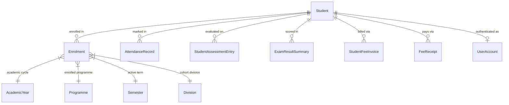
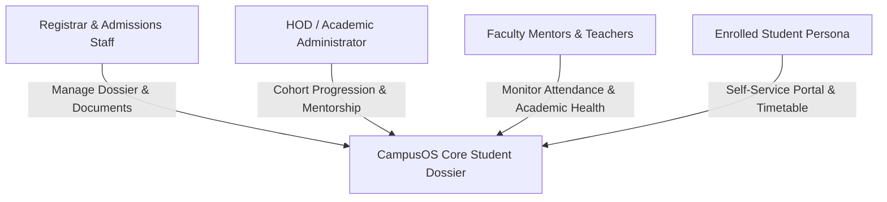
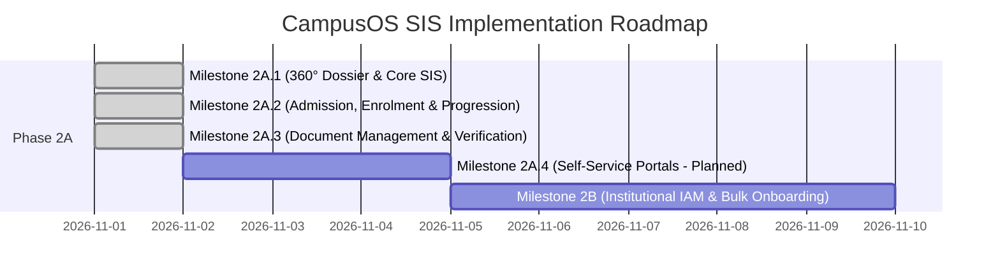

# CAMPUSOS — PHASE 2A: STUDENT INFORMATION SYSTEM (SIS)
## Architecture Discovery, Implementation Gap Analysis & Strategic Blueprint

**Project:** R.P. Institute of Hospitality & Management — CampusOS ERP  
**Cycle:** Phase 2A Initiation  
**Date:** November 1, 2026  
**Author:** Lead Product & Implementation Engineer  
**Database Protection Status:** Cryptographically Invariant (SHA-256: `86ff618cc96c421591237b0f589945644540868e6d151c2db789d3a4d7399e41`, 684,032 bytes)

---

## 1. Executive Summary

Phase 2A initiates the functional deepening of the **Student Information System (SIS)** in CampusOS. While Phase 1 established normalized relational storage for students and academic enrolments, the current user interface interacts with student records primarily through a single tabular dashboard (`StudentsView.tsx`) and popup dialogs (`StudentDetailModal.tsx`, `StudentFormModal.tsx`).

This document provides:
1. An exhaustive architectural discovery of the current SIS codebase.
2. A definition of the target institutional student experience for RPIHM staff and students.
3. A rigorous identification of real implementation gaps, distinguishing technical defects from missing capabilities.
4. A four-milestone phased implementation roadmap.
5. A comprehensive specification for the **First Implementation Milestone (Milestone 2A.1: Foundational SIS Core & 360° Student Dossier)**, presented for architectural approval prior to code implementation.

---

## 2. Current SIS Architecture & Component Inventory

### 2.1 Prisma Relational Data Foundation
The active SQLite database (`prisma/dev.db`) contains 13 student records across 7 programmes and 14 academic enrolments. The core models governing students include:

* **`Student` Model:**
  * Keys: `id` (UUID), `rollNumber` (e.g. `RPIHM-2026DS039`), `prn` (Permanent Registration Number, e.g. `2026DS039`).
  * Identity: `fullName`, `email`, `phone`, `dob`, `gender`, `bloodGroup`, `status` (`ACTIVE`, `ON_LEAVE`, `GRADUATED`, `PENDING_VERIFICATION`).
  * Academic: `currentSemester`, `attendanceRate` (cached scalar), `mentorFaculty`.
  * Guardian: `guardianName`, `guardianRelationship`, `guardianPhone` (flat unindexed fields).
* **`Enrolment` Model:**
  * Relational junction linking `studentId`, `academicYearId`, `programmeId`, `semesterId`, and `divisionId`.
  * Status: `ENROLLED`, `COMPLETED`, `PROMOTED`, `DETAINED`.
  * Lifecycle: Preserves historical terms; Khan Umar currently holds 2 records (Sem 1 `COMPLETED` + Sem 3 `ENROLLED`).

### 2.2 Data Access Layer (DAL) — `src/lib/dal/studentRepository.ts`
The repository implements:
1. `validateEnrolmentPlacement(params)`: Enforces that `programmeId`, `semesterId` (`semester.programmeId === programme.id`), and `divisionId` (`division.semesterId === semester.id`) form a strictly valid hierarchical path in the institutional database.
2. `getStudents(params)`: Paginated query supporting search, programme filter, status filter, and record-level isolation filters (`allowedStudentIds` and `allowedDivisionIds`).
3. `getStudentById(id)`: Resolves a student by UUID, PRN, or roll number, eagerly loading historical enrolments and fee invoice summaries.
4. `createStudentWithEnrolment(dto)`: Transactional creation of student master record and initial enrolment record with placement validation.
5. `updateStudent(id, data)`: Supports three distinct update modes:
   * Identity only (updates personal fields; enrolments untouched).
   * Division update (corrects division within the active semester).
   * Progression (archives active enrolment as `COMPLETED`, creates new `ENROLLED` placement).
6. `deleteStudent(id)`: Protected deletion checking for foreign-key blockers in attendance, exams, and fees.

### 2.3 Server Actions Boundary — `src/lib/actions/students.ts`
Guarded with `requirePermission()` and role-based data isolation:
* `getStudentsAction`:
  * `STUDENT_VIEWER`: Restricted strictly to `allowedStudentIds: [user.studentId]`.
  * `FACULTY_MEMBER`: Restricted to `allowedDivisionIds` derived from active `TeachingAssignment`s.
  * `ACADEMIC_ADMIN` / `SYSTEM_ADMIN`: Unrestricted institutional view.
* `getStudentByIdAction`: Enforces individual record-level authorization.
* `createStudentAction`, `updateStudentAction`: Protected by `WRITE_STUDENTS`.
* `deleteStudentAction`: Protected by `DELETE_STUDENTS`.

### 2.4 User Interface Components — `src/components/modules/students/`
1. `StudentsView.tsx`: Tabular directory with search bar (PRN, Roll No, Name), filters (Programme, Semester, Status, Fee), and pagination.
2. `StudentDetailModal.tsx`: Popup dossier displaying quick metric cards, academic placement details, enrolment history with hierarchy anomaly warning, contact details, and guardian details.
3. `StudentFormModal.tsx`: Multi-field modal for adding and editing students, featuring dynamic division loading and progression mode detection.
4. `DeleteConfirmModal.tsx`: Confirmation modal with dependency checks before record deletion.

---

## 3. The Intended Institutional Student Experience

For R.P. Institute of Hospitality & Management, the Student Information System must serve four primary institutional stakeholders:

### 1. Registrar & Admissions Staff Experience
* Locate any student within 2 seconds using roll number, PRN, mobile number, or full name.
* Open a dedicated, full-screen **360° Student Dossier** with deep-linkable URLs (`/modules/students/[id]`).
* Inspect academic placements, verified admission documents, guardian contacts, and institutional fee status in a unified view.
* Update student particulars with strict validation ensuring no broken semester or division assignments.

### 2. Head of Department (HOD) & Academic Admin Experience
* Review cohort enrolment statistics by programme and semester.
* Perform bulk semester promotions at the end of an academic term without editing students one by one.
* Detect and rectify relational hierarchy anomalies (e.g. division assigned to mismatched semester).

### 3. Faculty Mentor Experience
* Inspect mentees' comprehensive academic performance: real-time attendance percentages across subjects, mid-term marks, and fee payment clearance.
* Quickly access guardian contact numbers for emergency or attendance shortage consultations.

### 4. Student Self-Service Experience (`STUDENT_VIEWER`)
* Access a personalized student dashboard displaying their active schedule, attendance rate, fee receipts, and examination result summaries.
* View verified academic details without exposure to administrative tables or other students' data.

---

## 4. Real Implementation Gaps & Technical Debt

| Gap ID | Focus Area | Existing State in Codebase | Actual Problem & Architectural Defect | Institutional Impact | Proposed Solution | DB & Schema Impact |
| :--- | :--- | :--- | :--- | :--- | :--- | :--- |
| **GAP-01** | **Workspace Architecture** | Modal-only dossier (`StudentDetailModal.tsx`). | Inspection of a student is confined to a 600px popup. Cannot be bookmarked, shared via URL, or navigated with browser history. | Inefficient for staff handling multi-screen student counseling or dossier audits. | Implement dedicated full-page route: `src/app/modules/students/[id]/page.tsx` with `StudentDossierView.tsx`. | None (uses existing Prisma queries). |
| **GAP-02** | **Cross-Module Intelligence** | Disconnected data in modal. Static sample metrics ("Fee: Not Configured", sample attendance %, GPA demo). | `AttendanceRecord`, `FeeReceipt`, and `ExamResultSummary` exist in SQLite, but the modal displays hardcoded sample badges instead of querying live tables. | Staff see misleading or static information when inspecting a student who has real fee or exam records. | Enhance `getStudentById` / DAL query to eagerly correlate live attendance rates, fee invoices, and exam summaries. | None (relations already exist in Prisma schema). |
| **GAP-03** | **Document Management (DMS)** | Nonexistent. Zero tables or UI for documents. | No mechanism to store, track, or verify student documents (10th/12th marksheets, transfer certificates, domicile, photo). | College staff must maintain physical paper files; no digital verification workflow exists. | Design normalized `StudentDocument` model with document types, file URLs/keys, verification status, and audit timestamps. | Requires Prisma schema migration (`StudentDocument`). |
| **GAP-04** | **Intake & Admissions** | Manual one-by-one modal creation (`StudentFormModal.tsx`). | Adding 60 new students requires 60 separate modal form submissions. No batch intake or applicant registration workflow. | Extreme operational friction during annual July/August admissions season. | Implement batch CSV student onboarding and structured admission application intake queue. | Add `AdmissionBatch` / intake tracking fields. |
| **GAP-05** | **Student Self-Service Portal** | `STUDENT_VIEWER` role redirected to admin directory table. | Logged-in students see the administrative `StudentsView` with only their 1 row visible; zero student-facing portal dashboard. | Students cannot check their timetable, personal attendance, or fee receipts conveniently. | Deliver dedicated student-facing portal view (`/student/portal` or student mode in `AppShell`). | None. |
| **GAP-06** | **Guardian & Contact Normalization** | Flat strings on `Student` table (`guardianName`, `guardianPhone`, `guardianRelationship`). | Cannot store address, secondary emergency contacts, or parent email addresses. | Emergency notifications or postal correspondence cannot be automated. | Expand guardian and residential address structures with postal pin code and city. | Add address fields to `Student` or normalize `Guardian`. |
| **GAP-07** | **Cohort Progression Workflow** | Single-student progression in `StudentFormModal`. | Promoting 40 students from Semester 1 to Semester 2 requires 40 individual edits. | High administrative burden and risk of human error at semester transitions. | Implement `CohortProgressionModal` allowing batch promotion of an entire division. | None (creates standard `Enrolment` rows). |

---

## 5. Strategic Phased Implementation Roadmap

### Phase 2A Master Milestone Definition & Status:
* **Milestone 2A.1 — Foundational SIS Core & 360° Student Dossier (Delivered and accepted):** Deep-linkable full-page `/modules/students/[id]` workspace, directory integration, cross-module aggregation (Attendance, Fees, Exams, Placements), and record-level RBAC. *(Verified: 58 automated tests, 11 browser captures, dev.db invariant).*
* **Milestone 2A.2 — Student Admission, Enrolment & Cohort Progression (Delivered and accepted):** Atomic registration workflow with placement hierarchy validation, enrolment lifecycle history preservation, in-place division updates, transactional batch cohort progression with candidate inspection and automatic rollback, and dev-login production hardening. *(Verified: 49 automated tests, 11 browser captures, dev.db invariant).*
* **Milestone 2A.3 — Student Document Management & Verification Engine (Closed and accepted for development and isolated verification):** Secure document receipt, magic-byte inspection, strict path confinement (`path.relative`), symlink escape protection, non-destructive replacement (`onDelete: Restrict`), institutional verification/rejection with mandatory justification, configurable category technical catalog, boundary-level authorization guards, and verification audit timelines. Production document storage and institutional policy approval remain pending. *(Verified: 93 automated tests across primary, boundary authorization, and closure check suites; 15 browser captures; dev.db invariant).*
* **Milestone 2A.4 — Student & Faculty Self-Service Portals (Planned, not started):** Dedicated personal portals for `STUDENT_VIEWER` and `FACULTY_MEMBER`.
* **Milestone 2B — Institutional IAM & Bulk Onboarding (Planned, not started):** Enterprise bulk account provisioning CLI/console, HOD departmental permissions, session management, and credential lifecycle management.

---

## 6. Detailed Specification: First Implementation Milestone (2A.1)

### 6.1 Milestone 2A.1 Objective
Deliver a **comprehensive, responsive, full-page 360° Student Dossier** that replaces modal-based inspection with a deep-linkable institutional record, consolidating real-time attendance, fee invoices, examination results, and academic placement history into a unified workspace.

*(Delivered and accepted, verified with 58 automated tests and 11 browser captures, accepted baseline SHA-256 invariant).*

---

## 7. Detailed Specification: Second Implementation Milestone (2A.2)

### 7.1 Milestone 2A.2 Objective
Deliver an enterprise student admission, relational enrolment lifecycle, and cohort progression system supporting institutional registration, semester progression, division reassignment, duplicate prevention, and transactional cohort promotion.

*(Delivered and accepted, verified with 49 automated tests and 11 browser captures, operational DB SHA-256 invariant).*

---

### 7.2 Milestone 2A.3 Objective: Student Document Management & Verification Engine
Deliver an institutional-grade student document management and verification subsystem integrated into the 360° Student Dossier (`/modules/students/[id]`). Supports secure document receipt, magic-byte inspection, strict path-confinement storage, non-destructive replacement (`onDelete: Restrict`), institutional verification/rejection with mandatory justification, configurable category technical catalog, boundary-level authorization guards, and verification audit timelines.

*(Closed and accepted for development and isolated verification; verified with 93 automated assertions across primary [53/53], boundary authorization [30/30], and closure check [10/10] suites, and 15 real browser captures via Microsoft Edge CDP; operational DB SHA-256 invariant. Production document storage and institutional policy approval remain pending).*

---

## 8. Permanent CampusOS Identity & Access Management (IAM) Architecture & Master Roadmap

### 8.1 Core Architectural Principles
CampusOS requires an integrated, institution-wide Identity & Access Management (IAM) platform serving every relevant member of RPIHM. The core architectural principles are:
1. **Single Institutional Identity:** Every student, faculty member, administrator, and staff member has exactly one institutional profile linked to one login account (`UserAccount`). A person's account does not change or duplicate when their semester, division, designation, or department changes.
2. **Explicit Role & Permission Binding:** Access privileges are governed by an explicit role-based permission matrix, never by ad-hoc flag checks or UI hiding.
3. **Fail-Closed Security Boundary:** All server actions and API routes enforce strict server-side RBAC guards (`requirePermission`). Unauthenticated requests fail closed with `UNAUTHORIZED` (401), and unauthorized users fail closed with `FORBIDDEN` (403).
4. **Separation of Authentication & Profile Data:** Sensitive authentication credentials (passwords, salts, session tokens) are stored exclusively in `UserAccount` and `Session` and are never exposed via student/staff profile APIs or public views.

### 8.2 Persona & Role Matrix

| User Category | Target Role | Primary ERP Workspace & Scope |
|---|---|---|
| **Students** | `STUDENT_VIEWER` | Personal self-service portal: view personal attendance, timetable, fee invoices, payment history, and examination results. Strictly isolated to `studentId === session.studentId`. |
| **Faculty Members** | `FACULTY_MEMBER` | Faculty workspace: view assigned batches/divisions, mark daily session attendance, enter continuous internal assessment / exam marks. Read access scoped to assigned divisions. |
| **Heads of Department (HODs)** | `HOD` | Departmental oversight: academic performance review, faculty load management, curriculum delivery tracking, attendance monitoring, and syllabus completion within their department. |
| **Academic Administrators** | `ACADEMIC_ADMIN` | SIS operations: student admission, enrolment lifecycle management, cohort progression, timetable scheduling, division capacity balancing, and academic year rollover. |
| **Finance Staff** | `FINANCE_OFFICER` | Institutional billing: fee structure configuration, invoice generation, payment collection, fee receipting, dues reconciliation, and financial ledger exports. |
| **System Administrators** | `SYSTEM_ADMIN` | Global configuration: institutional settings, user provisioning, role assignments, audit log review, database maintenance, and security governance. |

### 8.3 Account Lifecycle Workflows
1. **Provisioning:**
   - *Admissions Trigger:* Upon successful student admission, an institutional email and temporary credentials can be provisioned automatically or queued for batch onboarding.
   - *Staff Onboarding:* Created in HR / Administration module, linked directly via `UserAccount.staffId`.
2. **Activation:** First-time login requires password change and verification.
3. **Suspension & Deactivation:**
   - Setting `UserAccount.isActive = false` immediately invalidates all active sessions for that user across all devices.
   - Student withdrawal, rustication, or graduation automatically transitions account to read-only alumni archive or deactivated status.
4. **Credential Reset:** Controlled administrative reset or secure token-based password reset without exposing salts or hashes.

### 8.4 Scope Boundary & Phased Roadmap
* **Milestone 2A (SIS Core):** Establish operational models (`Student`, `Enrolment`, `Programme`, `Semester`, `Division`). Keep existing user baseline (2 operational accounts) without premature bulk generation.
* **Dedicated Milestone 2B (Institutional IAM & Bulk Onboarding):**
  - Implement bulk account provisioning CLI and UI console.
  - Implement HOD role granularity and department-scoped permissions.
  - Integrate self-service password reset and session auditing.
  - Deliver individual student and faculty login portals.

