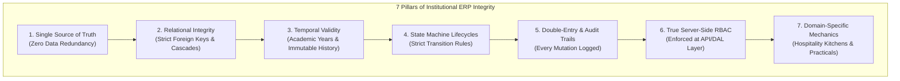
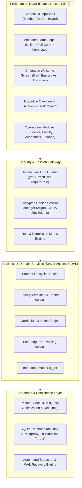
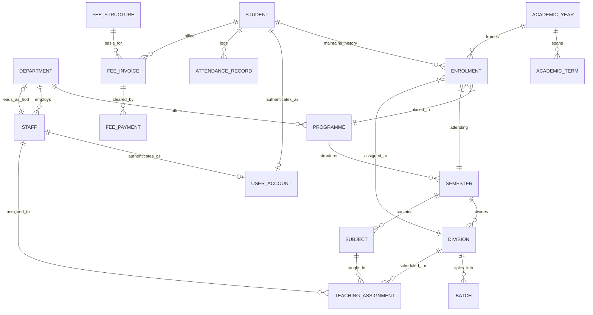
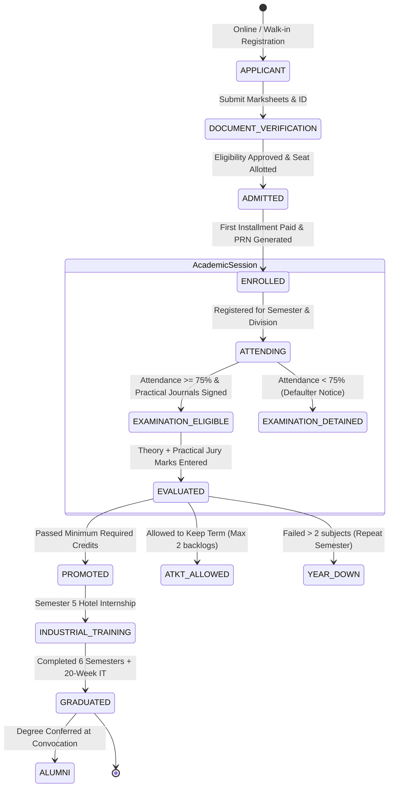
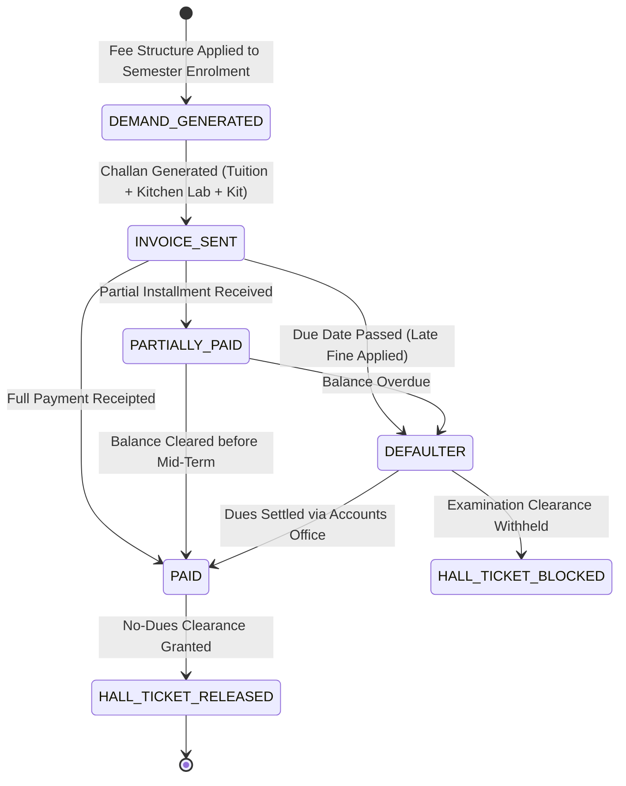
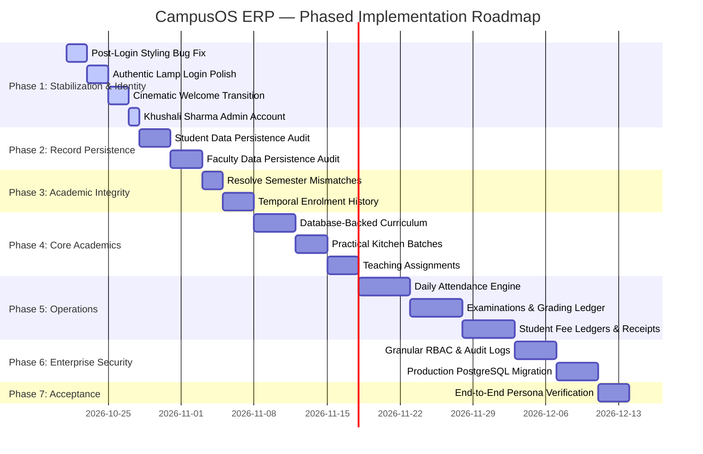

# RPIHM CampusOS — Master Architectural Blueprint & Strategic ERP Roadmap

> **Institutional Context:** R. P. Institute of Hospitality & Management (RPIHM)  
> **System Name:** CampusOS ERP  
> **Technology Stack:** Next.js App Router (Turbopack), TypeScript, Tailwind CSS, Prisma ORM, SQLite (Development) / PostgreSQL (Target Production)  
> **Document Purpose:** Definitive architectural blueprint, domain operating model, and phased roadmap for transforming CampusOS from an initial prototype into an enterprise-grade, secure, creative, and robust institutional ERP.

---

```
                       RPIHM CAMPUSOS ERP — OPERATIONAL LANDSCAPE
+---------------------------------------------------------------------------------------+
|                                    CAMPUS APPSHELL                                    |
|   [Executive Overview]  [Academics]  [Students]  [Faculty]  [Attendance]  [Exams] ...  |
+-------------------------------------------+-------------------------------------------+
|             ACADEMIC ENGINE               |             STUDENT LIFECYCLE             |
|  Year -> Term -> Programme -> Semester    |  Applicant -> Enrolment -> Attendance     |
|      -> Division -> Subject -> Batch      |       -> Evaluation -> Progression        |
+-------------------------------------------+-------------------------------------------+
|         HOSPITALITY LAB ENGINE            |             FINANCIAL LEDGER              |
|  Kitchen Stations - Training Restaurant   |  Fee Structures -> Invoices -> Payments   |
|   Food Production - Industrial Training   |       -> Receipts -> Defaulter List       |
+-------------------------------------------+-------------------------------------------+
|                             ENTERPRISE GOVERNANCE                             |
|          Granular RBAC  *  Immutable Audit Logging  *  Session Security               |
+---------------------------------------------------------------------------------------+
```

---

## PART 1 — WHAT DEFINES A REAL INSTITUTIONAL ERP?

A toy administrative prototype is a collection of decoupled CRUD forms and static tables. A **real institutional ERP** is a centralized, transactionally consistent operating system for an academic institution. It connects admissions, curriculum, faculty workload, daily laboratory attendance, examination ledgers, fee reconciliation, and student transcripts through an unbroken relational thread.

### The 7 Non-Negotiable Pillars of a Real ERP



1. **Single Source of Truth:** A student, faculty member, or course exists in exactly one authoritative table. If a student's division changes, that change immediately propagates across roll sheets, attendance ledgers, practical batches, and fee challans.
2. **Relational Integrity Over Client State:** Client-side caches (`localStorage`) cannot act as sources of truth. Foreign key constraints (`onDelete: Restrict`) prevent orphan records (e.g., deleting a department that still has enrolled students or assigned faculty is rejected at the database engine level).
3. **Temporal Validity & Academic History:** Academic placements are temporal snapshots. When student Aarav Sharma moves from Semester 1 to Semester 2, his Semester 1 performance, attendance, and placement are archived immutably in an `Enrolment` historical ledger, rather than being overwritten.
4. **Finite State Machines (FSM):** Institutional status values cannot be arbitrarily edited via open dropdowns. A student moves through defined lifecycle states:
   $$\text{APPLICANT} \longrightarrow \text{ADMITTED} \longrightarrow \text{ENROLLED} \longrightarrow \text{PROMOTED / DETAINED} \longrightarrow \text{GRADUATED / ALUMNI}$$
5. **Double-Entry Financial Ledgers:** Fee balances are never stored as mutable numbers on a student record. They are computed dynamically from debit invoices (demand raised based on fee structure) minus credit ledger entries (receipted payments, scholarships, or approved waivers).
6. **Server-Side Role-Based Access Control (RBAC):** UI hiding is merely visual ergonomics. The server actions and data access layer (DAL) strictly verify the session token, user role, and department boundary before executing any read or write.
7. **Institutional Domain Depth:** For RPIHM, an ERP must account for the unique operations of a premier Hospitality & Management college: commercial training kitchens, bakery & confectionery labs, front office simulation labs, training restaurants, uniform/knife-kit inventories, food hygiene certifications, and mandatory 20-week industrial training (IT) rotations.

---

## PART 2 — SYSTEM ARCHITECTURE & DOMAIN MODEL

### 1. High-Level System Architecture

CampusOS employs a resilient, layered Next.js App Router architecture where data flows strictly downward and mutations flow through verified server actions.



---

### 2. Relational Domain Entity-Relationship Blueprint

The following entity relationship model links core institutional master data to students, staff, academic progression, and financial accounts:



---

### 3. Detailed Institutional Domain Entities (RPIHM Hospitality Specifics)

To represent real operations at R.P. Institute of Hospitality & Management, the schema extends beyond standard arts/science colleges to encompass hospitality training environments:

| Entity Name | Institutional Purpose | Key Attributes |
|---|---|---|
| **Department** | Academic & administrative divisions | `code` (CUL, HOSP, MGMT, ADM), `name`, `hodStaffId` |
| **Programme** | Degree/Diploma offerings | B.Sc. Hospitality Studies, B.A. Culinary Arts, Diploma in Food Production |
| **Semester** | Curricular progression levels | `semesterNumber` (1 to 6), `termType` (ODD/EVEN) |
| **Division & Batch** | Lecture groups & kitchen stations | Division A/B (Theory 60 cap), Batches K1/K2 (Kitchen practicals 15 cap) |
| **Subject** | Academic courses | Theory, Practical Kitchen, Bakery Lab, Food & Beverage Service, Front Office |
| **Staff & Faculty** | Academic chefs, instructors & admins | `employeeId`, `designation` (Executive Chef Instructor, HOD), `category` |
| **Student** | Student master record | `rollNumber`, `prn` (Permanent Reg No), `guardianDetails`, `mentorFaculty` |
| **Enrolment** | Immutable academic placement ledger | `studentId`, `academicYearId`, `semesterId`, `divisionId`, `status` |
| **Teaching Assignment** | Faculty subject & division matrix | `staffId`, `subjectId`, `divisionId`, `weeklyHours` |
| **Industrial Training (IT)** | 20-week mandatory 5-star internship | `studentId`, `hotelPartnerId`, `departmentRotations`, `logbookRating` |
| **Fee Ledger** | Double-entry student account | `feeStructureId`, `tuitionFee`, `kitchenLabFee`, `uniformKitFee`, `receipts` |

---

## PART 3 — WORKFLOW STATE MACHINES

### 1. Student Academic Lifecycle State Machine



### 2. Fee Assessment & Reconciliation State Machine



---

## PART 4 — PHASE 1 TECHNICAL DEEP-DIVE: UX REPAIR, AUTHENTICATION & IDENTITY

### 1. Post-Login Visual Bug: Root Cause & Definitive Fix

#### Root Cause Analysis
Users reported that upon logging in, the dashboard sometimes renders with broken styles, distorted cards, or displaced layout elements, but a manual browser refresh (`F5`) renders it perfectly.

Detailed investigation of the codebase reveals two interacting root causes:
1. **CSS Selector Bleed & Variable Collision from `lamp-login.css`:**
   `lamp-login.css` (1,344 lines) contains global rules on `:root`, `.room *`, and short class names (`.active`, `.show`, `.shake`, `.spinner`, `--text-main`, `--text-muted`). In Next.js App Router, when navigating from `/login` to `/` client-side via `router.push('/')`, Next.js preserves loaded stylesheets in the DOM `<head>`. Rules from `lamp-login.css` bleed into `AppShell` and `ExecutiveOverview`, overriding typography, box-sizing, and background CSS custom properties.
2. **Hydration & Dynamic Data Loading Mismatches:**
   The dashboard (`src/app/page.tsx`) queries live database counts (`prisma.student.count()`, `prisma.staff.count()`). During client-side transitions, the browser executes Next.js revalidation while CSS transitions from the login animation are still firing, causing elements to measure container bounds before the AppShell sidebar settles.

#### Definitive Technical Solution
- **Strict CSS Isolation:** Wrap all rules in `lamp-login.css` under `#lamp-login-root` or scope them using CSS modules (`lamp-login.module.css`). Ensure `:root` variable overrides are scoped strictly to the lamp container.
- **Clean Component Unmount:** Implement an unmount cleanup hook in `AnimatedLampLogin.tsx` that removes any lingering animation classes, reset any body/html styles, and terminates Web Audio context nodes cleanly before router navigation.
- **Seamless Transition Hand-off:** Ensure `AppShell` enforces its own background color (`#F4F6F9`) and font family independently of any ambient theme variables.

---

### 2. The 3 Distinct Welcome Experiences

The application must never mix login, post-login transition, and dashboard greetings into a single ambiguous component:

```
+---------------------------------------------------------------------------------------+
| EXPERIENCE A: LOGIN PAGE (Pre-Authentication)                                          |
| - Strictly unlit lamp upon initial load.                                              |
| - Cord pull interaction turns on light beam and smoothly reveals credentials card.   |
| - NO post-login greetings, NO user names, NO welcome messages.                        |
+---------------------------------------------------------------------------------------+
                                           |
                                [Valid Authentication]
                                           v
+---------------------------------------------------------------------------------------+
| EXPERIENCE B: CINEMATIC WELCOME TRANSITION (Post-Authentication, Pre-Dashboard)       |
| - Full-screen immersion in deep black/navy.                                           |
| - Atmospheric slow-drifting ember and ash particles (refined cinematic mood).         |
| - Server-verified name & role fade into view with subtle golden glow.                 |
| - Local time greeting: "Good morning / afternoon / evening".                          |
| - Smooth 2-second transition into CampusOS AppShell.                                  |
+---------------------------------------------------------------------------------------+
                                           |
                                  [Router Navigation]
                                           v
+---------------------------------------------------------------------------------------+
| EXPERIENCE C: DASHBOARD WORKSPACE WELCOME (Within Executive Overview)                 |
| - Returning Authenticated User: "Welcome back, Khushali Sharma"                       |
| - Newly Registered / First-Time User: "Welcome to CampusOS — Set up your profile"     |
| - Shows active academic term, live departmental indicators, and pending tasks.        |
+---------------------------------------------------------------------------------------+
```

---

### 3. Correcting the Real Administrator Identity: Khushali Sharma

#### Live Database Investigation Findings
Direct inspection of the SQLite database (`dev.db`) reveals the exact current state:

```json
{
  "staffRecord": {
    "id": "0f277036-c468-4b4d-82ba-d6e6133c6344",
    "employeeId": "RPIHM-FAC-999",
    "fullName": "khushali sharma",
    "email": "k.sharma@sample.rpihm.ac.in",
    "designation": "Head OF The Department",
    "category": "ADMINISTRATIVE",
    "department": "Administrative & Student Affairs (ADM)",
    "userAccount": null
  },
  "existingUsers": [
    {
      "id": "b7ec9ed5-475e-4181-a7b2-93119e7d8d0f",
      "email": "admin.local@sample.rpihm.ac.in",
      "role": "SYSTEM_ADMIN",
      "fullName": "RPIHM System Administrator (Prototype)",
      "staffId": null
    }
  ]
}
```

#### Strategic Action Plan for Administrator Recovery
1. **Preserve Khushali's Staff Identity:** Her `Staff` record (`0f277036-c468-4b4d-82ba-d6e6133c6344`) represents her institutional employment and must never be deleted.
2. **Account Provisioning:** Create a linked `UserAccount` record for Khushali Sharma using the existing secure provisioning pipeline:
   - `email`: `k.sharma@sample.rpihm.ac.in`
   - `fullName`: `Khushali Sharma` (normalized title case)
   - `role`: `ACADEMIC_ADMIN`
   - `staffId`: `0f277036-c468-4b4d-82ba-d6e6133c6344`
   - `passwordHash`: Secure Argon2/Scrypt hash generated via the server provisioning action.
3. **Role & Permission Boundary:**
   - As `ACADEMIC_ADMIN`, Khushali possesses authority over Students, Faculty rosters, Academic Programmes, Curriculum, and Attendance reports.
   - Core low-level database operations and system settings remain accessible to `SYSTEM_ADMIN`.
4. **Bootstrap Administrator Retention:**
   - Retain `admin.local@sample.rpihm.ac.in` exclusively as a break-glass bootstrap recovery account.
   - Do not delete the bootstrap account until Khushali's account is verified end-to-end and institutional login credentials have been handed over.

---

## PART 5 — THE 7-PHASE MASTER STRATEGIC ROADMAP



---

### Phase 1: Repair, Stabilization & Real Administrator Identity
- **Goal:** Deliver a rock-solid login experience, eliminate visual glitches, and establish Khushali Sharma as the verified Academic Administrator.
- **Key Deliverables:**
  1. Fix post-login styling leak by strictly scoping `lamp-login.css`.
  2. Maintain authentic unlit lamp login with harmonic cord spring physics.
  3. Implement separate dark-screen cinematic welcome with subtle drifting embers.
  4. Separate the 3 welcome experiences (Login, Transition, Dashboard).
  5. Provision Khushali Sharma's `UserAccount` (`ACADEMIC_ADMIN`) linked to her `Staff` record.
  6. Verify with live browser sessions and automated Next.js build checks.

### Phase 2: Reliable Student & Faculty Records (Persistence & Validation)
- **Goal:** Guarantee that every single field entered in student and faculty forms persists to the database and reloads accurately.
- **Key Deliverables:**
  1. Audit student guardian, emergency contact, blood group, and mentor fields through Form -> Zod -> Action -> DB Write -> DB Read.
  2. Audit faculty qualifications, workload hours, office location, and designation updates.
  3. Ensure optimistic UI updates correctly match persisted database records upon browser refresh.

### Phase 3: Academic Data Integrity & Temporal Progression
- **Goal:** Prevent curriculum and placement corruption through relational constraints.
- **Key Deliverables:**
  1. Resolve known demo anomalies (e.g., student enrolled in Semester 3 with a Semester 1 division).
  2. Implement an immutable `Enrolment` historical ledger to preserve previous academic placements.
  3. Implement academic term progression rules (PROMOTED, ATKT, DETAINED).

### Phase 4: Core Academic Workflows (Curriculum, Kitchens & Workload)
- **Goal:** Connect `/modules/academics` to live Prisma models.
- **Key Deliverables:**
  1. Replace static mock curriculum data with live `Programme`, `Semester`, `Subject`, and `Division` tables.
  2. Support hospitality kitchen practical batches (Batches K1, K2 under Division A).
  3. Implement faculty teaching assignment matrix with weekly workload tracking.

### Phase 5: Daily Institutional Operations
- **Goal:** Power daily administrative and academic routines.
- **Key Deliverables:**
  1. **Daily Attendance:** Student attendance tracking by session, division, and practical kitchen station.
  2. **Examinations & Grading:** Internal Continuous Assessment (ICA), kitchen practical jury evaluations, and Semester-End Examination (SEE) grade entry.
  3. **Fees & Accounts:** Fee head definitions (Tuition, Kitchen Lab, Knife-Kit), demand generation, installment tracking, and digital receipt generation.
  4. **Placements & Internships:** Mandatory 20-week hotel industrial training (IT) tracking and partner hotel evaluation logbooks.

### Phase 6: Enterprise Security, Governance & Production Readiness
- **Goal:** Harden the system for multi-user production deployment.
- **Key Deliverables:**
  1. Implement fine-grained server-side RBAC guards on every mutation.
  2. Build an immutable `AuditLog` table capturing actor, action, timestamp, target entity, and diff.
  3. Prepare migration pathway from development SQLite to high-availability PostgreSQL with connection pooling.
  4. Automated daily database backup and point-in-time recovery scripts.

### Phase 7: Final End-to-End Acceptance
- **Goal:** Validate the entire institutional workflow against real user personas.
- **Key Deliverables:**
  1. **HOD Persona (Khushali Sharma):** Manages faculty workload, approves admissions, reviews attendance rosters.
  2. **Registrar Persona:** Enrolls students, issues identity dossiers, handles progression.
  3. **Faculty Chef Persona:** Marks practical kitchen attendance, enters jury marks.
  4. **Student Persona:** Checks grades, attendance rate, and fee receipts.
  5. Formal signoff and deployment checklist.

### Phase 8: Future Innovation — CampusOS AI (Intelligent Campus Assistant)
- **Goal:** Deliver one personalized natural-language assistant for students, faculty, HODs, administrators, and other authorized ERP users. It will answer questions using current, permitted ERP data, explain workflows, guide users to relevant modules, and eventually perform explicitly authorized actions.
- **Hard Dependency:** **DO NOT begin AI implementation** until all ERP modules are complete, their elements are connected to the database, their end-to-end workflows work reliably, permissions are verified, and the ERP has passed an overall stability and security review.
- **Future AI Architecture Requirements:**
  1. **Server-Side Authorization:** Enforce the signed-in user's role and record-level permissions server-side for every query and action.
  2. **Credential Isolation:** Never expose unrestricted database credentials or direct raw database connections to the model.
  3. **Source-Grounded Answers:** Start with read-only, source-grounded answers and direct links to relevant ERP records or modules.
  4. **Status Transparency:** Clearly distinguish verified data, missing data, and provisional institutional policies.
  5. **Explicit Action Confirmations:** Require appropriate authorization and explicit human confirmation for sensitive writes, marks changes, result publication, and administrative actions.
  6. **Auditability & Privacy:** Audit all sensitive actions and protect student data, credentials, and conversation privacy.
  7. **Security & Adversarial Testing:** Test prompt injection, unauthorized record access, hallucinated/incorrect answers, and graceful failure handling.
- **Current Operational Boundary:** Strictly NO AI buttons, placeholder chatbots, AI dependencies, or AI-related UI in the current codebase until all operational ERP phases are verified and approved.

---

## PART 6 — VERIFICATION & QUALITY STANDARDS

Every milestone and phase must satisfy the following verification protocol before being deemed complete:

1. **Static Analysis & Compilation:** `npx tsc --noEmit` and `npx next build` must complete with 0 errors and 0 warnings.
2. **Persistence Integrity:** Any updated record must be verified by reading back the database row via direct Prisma query, reloading the page, and inspecting the rendered DOM.
3. **Automated Browser Evidence:** Headless/interactive browser verification must capture timestamped visual artifacts for unlit, illuminated, transitioning, and dashboard states.
4. **Zero-Side-Effect Rule:** No database schema alterations or migrations may occur without a verified pre-migration backup (`dev.db.bak`).

---

## PART 7 — PERMANENT DOCUMENTATION MAINTENANCE PROTOCOL (STANDING MANDATE)

This protocol establishes a permanent engineering standard for all present and future CampusOS development:

> [!IMPORTANT]
> **Standing Institutional Mandate:** Whenever implementation work changes CampusOS functionality, architecture, database schema, permissions, workflows, security, integrations, UI behaviour, testing, deployment readiness, or operational assumptions, update the relevant existing documentation as part of that same work. Documentation updates must never be deferred or wait for explicit administrative requests.

### 7.1 Canonical Living Documents

The following canonical documents must be maintained continuously as living records of system truth (updating only those materially affected by a given change):
1. **Master Blueprint & Strategic Roadmap:** [`docs/campusos_real_erp_blueprint_and_roadmap.md`](file:///g:/rpihm-campusos/docs/campusos_real_erp_blueprint_and_roadmap.md)
2. **Product Reality Audit:** [`CAMPUSOS_PRODUCT_AUDIT.md`](file:///g:/rpihm-campusos/CAMPUSOS_PRODUCT_AUDIT.md)
3. **Domain & Milestone Blueprints:** [`docs/PHASE_2A4_SELF_SERVICE_PORTALS_BLUEPRINT.md`](file:///g:/rpihm-campusos/docs/PHASE_2A4_SELF_SERVICE_PORTALS_BLUEPRINT.md)
4. **Milestone Implementation Reports:**
   - [`docs/MILESTONE_2A4_STAGE_2_IMPLEMENTATION_REPORT.md`](file:///g:/rpihm-campusos/docs/MILESTONE_2A4_STAGE_2_IMPLEMENTATION_REPORT.md)
   - [`docs/MILESTONE_2A4_STAGE_1_IMPLEMENTATION_REPORT.md`](file:///g:/rpihm-campusos/docs/MILESTONE_2A4_STAGE_1_IMPLEMENTATION_REPORT.md)
   - [`docs/MILESTONE_2A3_IMPLEMENTATION_REPORT.md`](file:///g:/rpihm-campusos/docs/MILESTONE_2A3_IMPLEMENTATION_REPORT.md)
5. **Production Readiness & Migration Architecture:** [`docs/PRODUCTION_READINESS_AND_DATABASE_MIGRATION_PLAN.md`](file:///g:/rpihm-campusos/docs/PRODUCTION_READINESS_AND_DATABASE_MIGRATION_PLAN.md)
6. **Cycle & Conversation Navigation Indexes:** [`docs/conversation-indexes/`](file:///g:/rpihm-campusos/docs/conversation-indexes/)

### 7.2 The 10 Standing Documentation Rules

1. **Blueprint and Roadmap Alignment:** Keep planned, in-progress, completed, deferred, and blocked work 100% accurate. Update milestone status, dependencies, decisions, and next steps whenever they evolve.
2. **Product Audit Synchronization:** Maintain descriptions of implemented modules, missing capabilities, known defects, security boundaries, and outstanding limitations aligned with the live codebase.
3. **Technical Architecture Currency:** Document meaningful changes to database models, relations, authentication, authorization, server actions, storage providers, integrations, and architectural decisions.
4. **Milestone Delivery Tracking:** Update relevant milestone reports with implemented functionality, changed files, automated tests, browser verification evidence, known limitations, and acceptance criteria.
5. **Production Readiness Realism:** Keep deployment, infrastructure, security, backup, migration, storage, environment, and operational readiness information accurate. Never mark a planned deployment or migration task as completed without verified execution evidence.
6. **Cross-Document Consistency:** If a fact (such as a database record count, baseline hash, or architecture state) appears in multiple documents, update all materially affected references simultaneously. Contradictory statements across documents are unacceptable.
7. **Historical Integrity:** Do not rewrite historical reports to pretend that a later capability existed earlier. Record subsequent modifications as dated updates, addenda, or remediation sections.
8. **Evidence-Grounded Rigor:** Clearly distinguish verified test results, automated agent outputs, architectural assumptions, planned work, and unresolved questions. Never invent test assertions, institutional approvals, or production deployment status.
9. **No Documentation Sprawl:** Prefer updating existing canonical documents over creating new ad-hoc markdown files. Create a new document only when an authentic, distinct lifecycle deliverable requires it.
10. **No Documentation Dumps:** Do not dump entire blueprints, audits, or reports into conversation responses or final handovers. Maintain documents directly in the repository and provide concise summaries with exact file links and commit SHAs.

### 7.3 Milestone Pre-Closure Protocol

Before closing any engineering milestone or sub-task:
- Identify which canonical primary documents were materially affected.
- Apply proportionate, accurate documentation updates directly to those files.
- Verify internal references, record counts, and cross-document consistency.
- Confirm that completed and pending checklist statuses reflect reality.
- Ensure the roadmap reflects the actual next milestone.
- Include documentation files in the same logical commit as the implementation work whenever appropriate.
